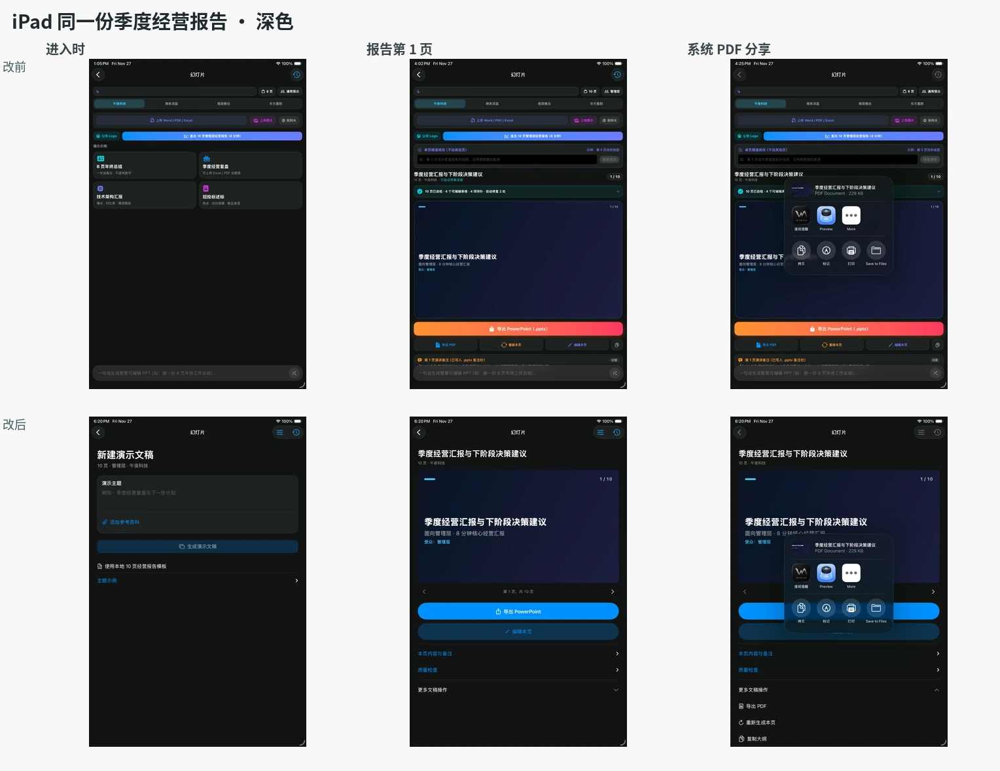
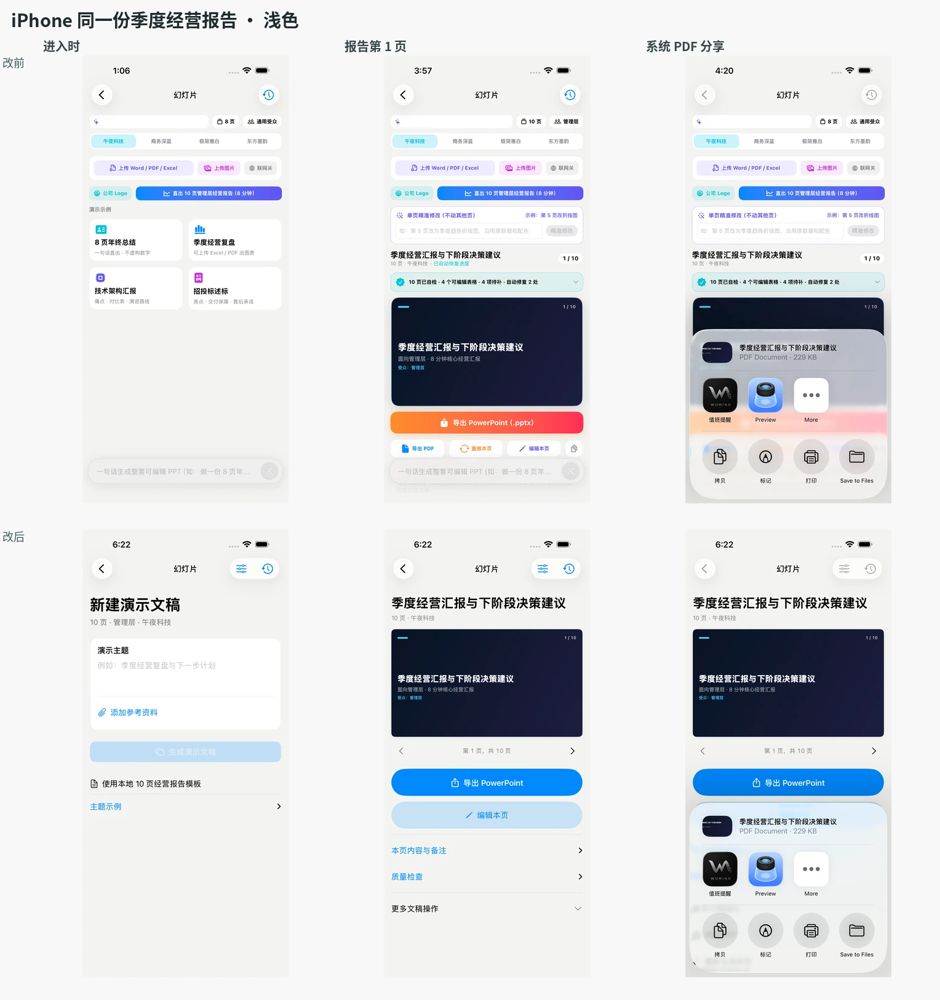

# WuMind 工作台与工坊改版验收

## 截图出处

用户指出的 iPad 画面为《季度经营汇报与下阶段决策建议》第 1 页上打开的系统 PDF 分享面板。系统显示 4:25 PM、PDF Document、229 KB。已从 Xcode 证据包提取完整原图，文件名为 `434F0716-5468-447D-806B-2F83EFBD9515.jpeg`。该附件与同一秒前后的其他三张附件内容相同。iPhone 原图来自同一测试方法、同一份本地报告，系统面板显示在底部。 [iPad 原图](studio-redesign-20261127/ipad-reference-pdf-share.jpg) · [iPhone 原图](studio-redesign-20261127/iphone-reference-pdf-share.jpg)

| 改前画面 | iPhone 17 Pro Max | iPad mini (A17 Pro) | 核对范围 |
|---|---|---|---|
| 工作台、10 个工坊及初次进入幻灯片的空白页 | [浅色](https://github.com/wuyong9494-lab/kriswu/actions/runs/45998573364/artifacts/15199159505) | [深色](https://github.com/wuyong9494-lab/kriswu/actions/runs/45998573364/artifacts/15201065719) | `f57f607`。工作台附件为 `WuMind-clean-workbench`，工坊按 `Workbench-<入口标识>` 命名。 |
| 同一工作台的另一种系统外观 | [深色](https://github.com/wuyong9494-lab/kriswu/actions/runs/46004048441/artifacts/15204465300) | [浅色](https://github.com/wuyong9494-lab/kriswu/actions/runs/46004048441/artifacts/15203923125) | `a28605b`。本轮只有工作台具备这一组改前反向外观截图。 |
| 3D 实际首帧 | [iPhone](https://github.com/wuyong9494-lab/kriswu/actions/runs/46013592826/artifacts/15207645902) | [iPad](https://github.com/wuyong9494-lab/kriswu/actions/runs/46005383057/artifacts/15203929699) | 使用初轮空白视口修复后、这次改版前的真实画面。 |
| 本地报告的第 1 页及编辑版本 | [iPhone](https://github.com/wuyong9494-lab/kriswu/actions/runs/46025311747/artifacts/15213432761) | [iPad](https://github.com/wuyong9494-lab/kriswu/actions/runs/46025311747/artifacts/15214795124) | `f620bc4`。原版封面附件 `Works-OriginalVersionPreview`，编辑版导出到「文件」的附件 `Works-EditedPowerPointExport`。 |
| 同一报告在幻灯片工坊的系统 PDF 分享面板 | [iPhone](https://github.com/wuyong9494-lab/kriswu/actions/runs/46029908204/artifacts/15215266540) | [iPad](https://github.com/wuyong9494-lab/kriswu/actions/runs/46029908204/artifacts/15215487371) | `a18dcdb`。在 `testShareLocalPDFToTenderInboxFromWorkbench` 的系统 JPEG 中保留完整画面。 |

对照图采用上次改版完成后的最后一组工坊首屏：iPhone 取 `e1b589c` 的十个入口截图，iPad 取 `d601f47` 的十个入口截图。这两组也都验证了 3D 首帧。空文稿采用前表中的首次进入画面，封面使用同一经营报告 v1。 [iPhone 改前十个工坊](https://github.com/wuyong9494-lab/kriswu/actions/runs/46013592826/artifacts/15207645902) · [iPad 改前十个工坊](https://github.com/wuyong9494-lab/kriswu/actions/runs/46005383057/artifacts/15203929699)

## 操作范围

新截图从双工作区首页进入 WuMind，再点工作台，使用演示用户及本地数据。选择的输入是产品内置的经营报告模板，保持相同标题和封面。先打开文稿设置查看资料入口，再生成报告、编辑一页，分别核对 PDF 系统分享和保存编辑版 PowerPoint 到本机「文件」。宽屏用 iPad 横屏，最大辅助字号用系统 Accessibility XXXL。远程生成、真实模型计费和真机视觉需分开验证。

## 十个工坊的正常入口

从首页选择 WuMind，点底部「工作台」。下表按入口的实际标签排列。自动化在每个入口完全露出且高至少 44 pt 时点一次，核对目标导航栏、截取完整屏幕，再返回工作台。实时语音另操作诊断开关。3D 另外等待 SceneKit 第一帧并采样视口。

| 工作台入口 | 首屏核对内容 | XCTest 附件 |
|---|---|---|
| 生图 | 画面描述与参考图先于生成参数，底部显示生图动作。 | `Workbench-wumind.quick.image` |
| 视频 | 可切换短剧与单镜头直出。短剧页显示故事梗概、角色素材与镜头列表。 | `Workbench-wumind.quick.video` |
| PPT | 空稿先显示演示主题、参考资料、生成和本地经营报告入口。 | `Workbench-wumind.quick.ppt` |
| 3D 空间 | 当前工程显示已渲染的场景、工具条与建模方式。 | `Workbench-wumind.quick.spatial3d` |
| 标书 | 首项是导入 PDF 或 Word 招标文件，下方可刷新本机收件箱。 | `Workbench-deepSeek.chat.tender` |
| 编程 | 可输入任务、选择任务模板，查看所用通道并生成代码。 | `Workbench-wumind.quick.code` |
| 实时语音 | 可见通话状态、通道、设备和底部通话按钮。缺少网关的演示账号提示联系管理员。 | `Workbench-wumind.quick.live` |
| 语音合成与转写 | 文字转语音和音频转文字两种模式，空文稿时不能开始朗读。 | `Workbench-wumind.quick.speech` |
| 办公助手 | 从工作素材生成文稿，可选用模板并查看通道和模型。 | `Workbench-wumind.quick.work` |
| 项目与智能体 | 打开独立项目页，可见「项目与交付」「任务与审批」分区和当前项目。 | `Workbench-wumind.quick.agentOS` |

`testWorkbenchOpensOriginalTenToolsDirectly` 在 iPhone 和 iPad 的浅色、深色四种组合中均完成上述十次往返。图片分别取自每次进入后的可见内容。3D 视口中心亮度范围在两套外观下，iPad 都为 88、iPhone 都为 93（0–255 尺度）。原始截图及逐工具日志见 [iPad 浅色运行](https://github.com/wuyong9494-lab/kriswu/actions/runs/46045840052/artifacts/15223477281) 与 [iPhone 深色运行](https://github.com/wuyong9494-lab/kriswu/actions/runs/46045840052/artifacts/15223448169)。

## 同屏对照

下列图均保留窗口的原始长宽比。每列上方为改前、下方为改后。iPhone 浅色、iPad 深色使用 `28e9faf` 主矩阵；工作台还列出相同设备的另一种系统外观。点击证据包可取得整屏原始附件。 [主矩阵 iPhone](https://github.com/wuyong9494-lab/kriswu/actions/runs/46045836032/artifacts/15224345118) · [主矩阵 iPad](https://github.com/wuyong9494-lab/kriswu/actions/runs/46045836032/artifacts/15223348921)

### 用户指出的经营报告

两端对照的本地文稿均为《季度经营汇报与下阶段决策建议》。进入空文稿后可以直接填写主题、添加资料或生成本地经营报告。生成后第 1 页预览紧邻文稿标题，下方是导出 PowerPoint 与编辑本页。PDF 通过「更多文稿操作」展开。iPad 的系统分享浮层仍覆盖在同一封面上，iPhone 的分享面板从底部打开。

### 工作台与十个工坊

工作台把搜索框移至标题下；工具目录与「继续编辑」「空间与账户」一起滚动。iPad mini 竖屏和本次 iPhone 的正常字号使用两列工具入口，iPad 横屏把工具目录和后续操作并列，辅助字号下工具改为单列。每个工具的入口及进入后的状态见前表。

| 设备 | 相同外观工作台对照 | 生图、视频、PPT、3D、标书 | 编程、实时语音、语音合成与转写、办公、项目 |
|---|---|---|---|
| iPhone | [浅色与深色](studio-redesign-20261127/iphone-workspace.webp) | [五项首屏](studio-redesign-20261127/iphone-tools-1.webp) | [五项首屏](studio-redesign-20261127/iphone-tools-2.webp) |
| iPad | [深色与浅色](studio-redesign-20261127/ipad-workspace.webp) | [五项首屏](studio-redesign-20261127/ipad-tools-1.webp) | [五项首屏](studio-redesign-20261127/ipad-tools-2.webp) |

两台模拟器都完成画室和单镜头视频的键盘测试。键盘出现后，收起键盘和生成按钮均位于其上方；测试输入一段正文，再收起键盘、返回工作台。默认字号与辅助字号的报告编辑均可点保存。另有真实截图记录通过作品详情重开原稿、修改单页、导出 PowerPoint 到系统「文件」再返回 App。 [iPhone 操作与截图](https://github.com/wuyong9494-lab/kriswu/actions/runs/46045836032/artifacts/15224345118) · [iPad 操作与截图](https://github.com/wuyong9494-lab/kriswu/actions/runs/46045836032/artifacts/15223348921)

初轮两台设备的最大辅助字号测试均通过单列、底栏和报告操作断言，但人工检查 `StudioReport-LargeText-Workbench` 时，发现生图、视频、PPT 等图标覆盖首字。图标随辅助字号放大后超过固定 26 pt 的列宽。`7fb71da` 让图标按其实际布局缩放，并为其保留至多 44 pt 的独立宽度。`59d03c7` 对实际生图按钮的可见图标与首字间距增加栅格断言。初轮截图与修正后的定向回执分别保留。

## 模拟器运行

数字按该设备这次执行的 UI 测试方法计算；同一场景在另一种外观或一次复测中可能再次出现。每个结果链接到含原始图、附件清单与逐项日志的证据包。

| 提交与范围 | iPhone | iPad |
|---|---|---|
| `28e9faf` 主流程、十个工坊、编辑与导出、大字号及键盘 | [9/9](https://github.com/wuyong9494-lab/kriswu/actions/runs/46045836032/artifacts/15224345118) | [9/9](https://github.com/wuyong9494-lab/kriswu/actions/runs/46045836032/artifacts/15223348921) |
| `28e9faf` 反向外观及首屏 | [3/4](https://github.com/wuyong9494-lab/kriswu/actions/runs/46045840052/artifacts/15223448169)。跳过 `WideLauncherAndWorkbenchArrangeTheirContentSideBySide` | [4/4](https://github.com/wuyong9494-lab/kriswu/actions/runs/46045840052/artifacts/15223477281) |
| `19ce5a6` 文稿重写取消、工作台与工坊的深层操作 | 待回执 | [6/7](https://github.com/wuyong9494-lab/kriswu/actions/runs/46046390862/artifacts/15223632284)。失败 `WuMindVideoGenerationStageLayoutWithoutNetwork` |
