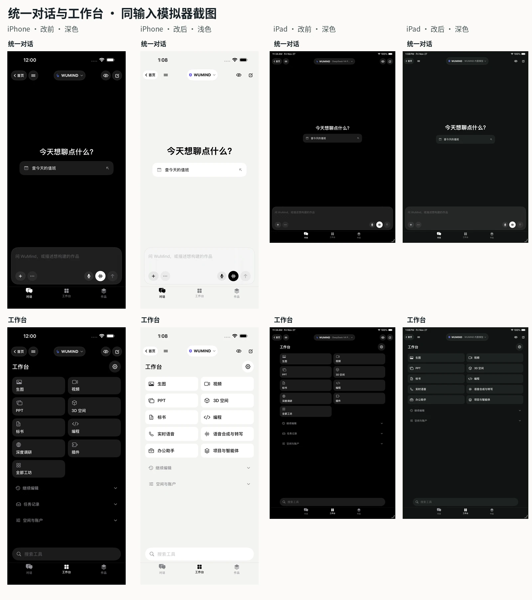
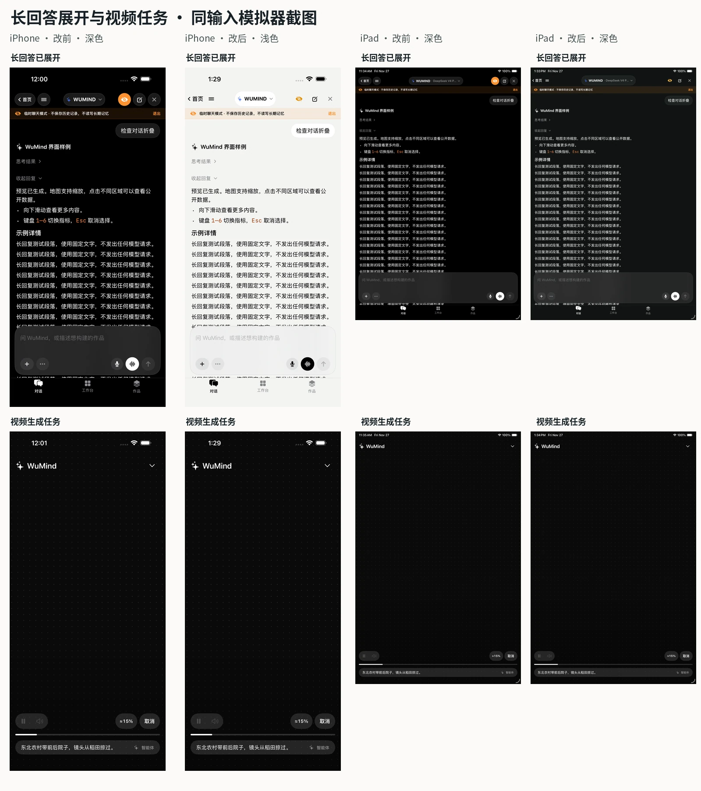
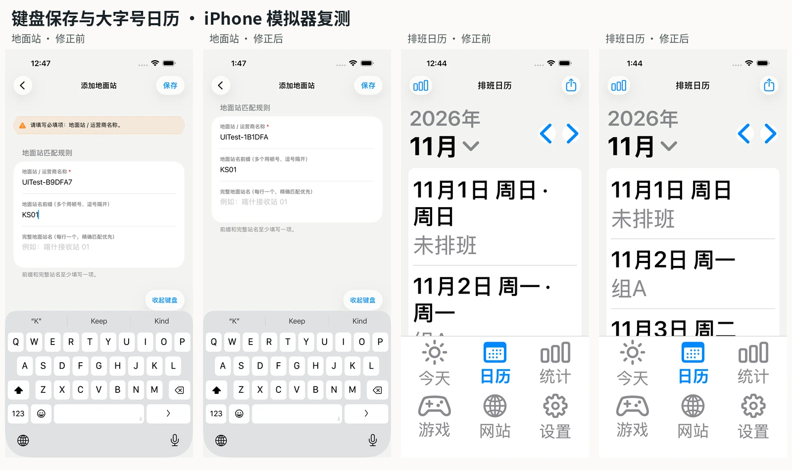
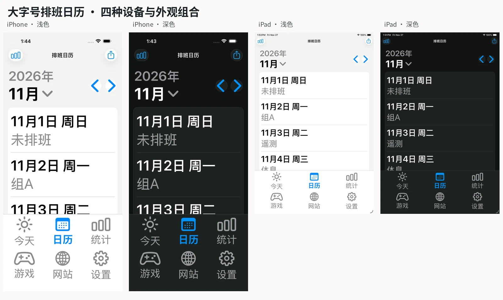

# iOS 页面与入口台账

基线提交 `b09b95f`。下文使用改后的「值班」工作区名称；基线首页显示 On Duty。下列记录覆盖主 App 的 SwiftUI 页面、视图包装器、系统弹层与条件路由，以及 Widget 和分享扩展入口。路由来自源码，模拟器点击和真机截图另记。一个页面可有多个入口。复用卡片、舞台或工具栏单列，不能加到独立页面数里。

## 覆盖统计

- **能按业务入口去重的两组**。值班「全部功能」源码列 37 个目录项，其中 31 个已在模拟器逐项从目录打开，有两项是同一周会页面的不同筛选。工作台十个工坊均在 iPhone 与 iPad 从入口打开并返回；编程和办公助手共用一个视图实现。统计分母按各组的入口定义。
- **按源码视图去重**。基线列出 203 个具名页面、预览及宿主候选，另录 1 个本轮新增导航包装。其中 71 个候选至少有一次模拟器页面到达或操作证据，62 个两种设备均有证据（iPhone 62 个、iPad 71 个）；另 132 个尚无逐页模拟器证据。每项证据的设备及操作范围见末列。
- **内联状态与组件**。表内另列 49 组内联面板和条件状态，以及 163 个嵌入组件。多个状态可共享同一视图，也可依数据分流。独立业务页总数无法由 Swift 类型数推导；尚未取得逐页真机操作证据。

## 证据与真机待验

| 环境 | 已获得的证据 | 待验证 |
|---|---|---|
| 离线核心 | Swift 6.1 禁网运行 WuMind、AILive、AIChat、MultiProvider 专项 200 项，失败 0 项。游戏逻辑另测 80 项，均通过。构建网关选择校验 4 项、Worker 专项 6 个测试文件通过。各组按自己的范围统计。 | 本机文本分段、模型目录、音频转换和路由测试无法给出公网模型延迟、真机首声或逐页视觉结论。 |
| 改前模拟器 | 同一基线下 iPhone 17 Pro Max、iPad mini (A17 Pro) 均有带名称的聊天、工作台、长文折叠／展开和视频任务截图；运行使用离线数据。 [基线运行](https://github.com/wuyong9494-lab/kriswu/actions/runs/45988612781) | 其他页面缺少完全匹配的改前截图。 |
| 真机与真实服务 | 尚需安装本开发分支的 iPhone／iPad、可用测试账号、经确认的独立测试网关、上游额度及语音权限。硬件切换还需可通话的蓝牙设备。 | 真机视觉、真实模型和联网来源、蓝牙路由、麦克风首声、息屏／切后台、云端成品与导出均需真机证据；管理员和联机流程分别需要对应角色或第二台设备。 |

### 模拟器用例从哪里开始

| 场景 | 初始化方式和实际操作 |
|---|---|
| 值班目录、地面站规则、大字号日历、留痕、跨设备同步、外部账号与部分设置 | 从工作区首页选择值班或 WuMind，逐项点击、编辑或返回。测试使用演示数据或模拟角色。 |
| 工坊、技能／项目／定时任务、长回答、工作台搜索、部分角色页 | 测试直接启动 WuMind、今天、对应游戏或管理员账单，再点击页面内的实际控件。工作台十个工坊均逐个点开、返回。首次启动登录与公网服务另验。 |
| 系统深链 | 测试从 WuMind 发起 iOS 打开 `capture/note`、`day`、`managed-calendar` 三条实际 URL，检查目标和关闭后的工作区。 |
| 离线状态样例 | 直接启动 ScreenCatalog 指定页面只证明该样例的内容和控件可以显示。游戏联机、远端配置或成功计费各自需要对应环境。 |

### 模拟器操作与截图

测试分批运行。每个证据包中的 `manifest.json` 按测试方法与附件名列出截图，`wumind-layout.log` 记录每项结果。真机及真实业务状态见下表各页的最后一列。

| 操作范围 | 截图或日志位置 | 可核对的状态 |
|---|---|---|
| 改前统一聊天、工作台、长回答、视频任务 | [iPhone 原图](https://github.com/wuyong9494-lab/kriswu/actions/runs/45988612781/artifacts/15195049457) · [iPad 原图](https://github.com/wuyong9494-lab/kriswu/actions/runs/45988612781/artifacts/15194520523) | 同一离线输入，基线 `b09b95f`。 |
| 值班 › 设置 › 全部功能 | [iPad 目录截图与三组结果](https://github.com/wuyong9494-lab/kriswu/actions/runs/45998573364/artifacts/15199207596) · [iPhone 目录截图与三组结果](https://github.com/wuyong9494-lab/kriswu/actions/runs/45998573364/artifacts/15201732575) | iPad 的 31 个目录项各有同名截图，含指向同一视图不同筛选条件的两个周会入口。iPhone 此轮通过两组，录得 23 个目录项，其余统计与工作入口在“数据核对”失败后未继续。逐图检查发现成员行重复说明、节假日空态仅显示脚注，修正在 `533cb92`。 |
| 首页、外部账号、设置与值班导航 | [iPhone 入口及下钻截图与日志](https://github.com/wuyong9494-lab/kriswu/actions/runs/45998573364/artifacts/15199265486) · [iPad 入口及下钻截图与日志](https://github.com/wuyong9494-lab/kriswu/actions/runs/45998573364/artifacts/15202070889) | 两台初轮均有 11 个具名附件，各 8／9 项通过。外部资料和手机号登录为测试身份，归档为无内容状态，网关诊断未配置。键盘上方的地面站保存可见；初版的旧校验提示及日历重复星期在 `33e5eae` 修正。该批的工作留痕录音菜单选择有重名失败。 |
| 十个工作台入口、技能／定时任务／项目编辑，以及数传和标书 | [iPhone 工具截图与日志](https://github.com/wuyong9494-lab/kriswu/actions/runs/45998573364/artifacts/15199159505) · [iPad 工具截图与日志](https://github.com/wuyong9494-lab/kriswu/actions/runs/45998573364/artifacts/15201065719) | 两台各 4 个 UI 用例通过。十个工坊均从工作台点击并核对导航，三个新建表单的无效保存状态通过检查。实时通话为缺后端状态，投标页为未签名模拟器，3D 的场景内容另验。 |

下图每一列保留同设备、同页面的截图比例。统一对话和工作台在 iPhone、iPad 均按改前、改后相同的深色外观对齐。改后 iPhone 深色原图取自[外观专项](https://github.com/wuyong9494-lab/kriswu/actions/runs/46004048441/artifacts/15204465300)。统一对话中可见输入与标签栏；工作台把六个创作快捷入口改为十个直接打开原工具的入口。初轮 iPhone 浅色截图中，两个可点击的展开分组标题只有约 3.30∶1 的对比度。`956bba6` 已将标签改为主文字色，并为 3D 首帧等待与超时提供状态。初轮 3D 图的中央区域只显示卡片底色。在整图宽 30%–70%、高 18%–27% 范围内，iPhone 全白，iPad 全为 #1e2220。工坊导航成功与场景首帧分别验收。

长文及视频截图使用同一离线内容。长回答已展开，可见输入栏和底部导航；视频为生成进度样例，深色舞台上显示相同任务和控制栏。运行完成 7 项通道与作品专项、5 项语音状态专项及 5 项 UI 用例，两种设备都通过，均使用测试数据。 [iPhone 复测原图与日志](https://github.com/wuyong9494-lab/kriswu/actions/runs/46001068022/artifacts/15200784328) · [iPad 复测原图与日志](https://github.com/wuyong9494-lab/kriswu/actions/runs/46001068022/artifacts/15203030026)

地面站的必填错误在填写有效名称后消失，右上角保存可在键盘展开时点按。排班日历在最大辅助字号下每个日期只读一次星期，相同高度能容纳更多日期。 [修正前 iPhone 原图](https://github.com/wuyong9494-lab/kriswu/actions/runs/45998573364/artifacts/15199265486) · [修正后 iPhone 原图](https://github.com/wuyong9494-lab/kriswu/actions/runs/46002398235/artifacts/15204181556)

两种设备上的最大辅助字号日历，在浅色和深色外观下都能看见日期列表、月份切换与分成两排的工作区标签。 [iPhone／iPad 另一外观及深链](https://github.com/wuyong9494-lab/kriswu/actions/runs/46004048441) · [iPad 深色导航原图](https://github.com/wuyong9494-lab/kriswu/actions/runs/46002398235/artifacts/15203429119)

### 已完成的复测任务

每格独立链接到该设备产物。数字按实际通过的 UI 测试方法和已执行的方法计数；Xcode 托管的通道、音频用例单独列出。不同提交上的复测可能覆盖同一路径。

| 提交与范围 | iPhone | iPad |
|---|---|---|
| `90b2f51` 聊天、通道、语音专项和长文折叠 | [UI 5/5，托管 12/12](https://github.com/wuyong9494-lab/kriswu/actions/runs/46001068022/artifacts/15200784328) | [UI 5/5，托管 12/12](https://github.com/wuyong9494-lab/kriswu/actions/runs/46001068022/artifacts/15203030026) |
| `ab1acd5` 大字号游戏第一次修正 | [UI 3/4](https://github.com/wuyong9494-lab/kriswu/actions/runs/46002041963/artifacts/15201983927)。失败：`testLargestTextKeepsLobbySelectionAndPracticeReachable` | [UI 4/4](https://github.com/wuyong9494-lab/kriswu/actions/runs/46002041963/artifacts/15203605572) |
| `33e5eae` 键盘保存、工作留痕、角色与返回 | [UI 8/9](https://github.com/wuyong9494-lab/kriswu/actions/runs/46002398235/artifacts/15204181556)。失败：`testCreateEditAndReopenNoteFromWorkspace` | [UI 9/9](https://github.com/wuyong9494-lab/kriswu/actions/runs/46002398235/artifacts/15203429119) |
| `a28605b` 深链、另一外观与两处目录修正 | [UI 4/4](https://github.com/wuyong9494-lab/kriswu/actions/runs/46004048441/artifacts/15204465300) | [UI 4/4](https://github.com/wuyong9494-lab/kriswu/actions/runs/46004048441/artifacts/15203923125) |

### 同输入性能记录

本地禁网基准把 1,500 段共 88,893 字节的输入发布 250 次。逐次累计变更文本量由 11,101,689 字节降至 184,437 字节。该数字衡量重新参与更新的文本量。

同一模拟器用例分别运行批量与即时两种模式。首段从本地生成事件开始计时；显示链回调间隔超过目标周期的 1.5 倍计为慢帧。用例在手动滚动后停止生成，各次记录的已消费字节和回调数会变化。

| 设备／版本 | 模式 | 首段（ms） | 慢帧／采样数 | 最长间隔（ms） | 已消费字节 |
|---|---|---:|---:|---:|---:|
| iPhone · 基线 b09b95f | 批量 | 420 | 14/218 | 138 | 15468 |
| iPhone · 基线 b09b95f | 即时 | 235 | 12/209 | 100 | 15055 |
| iPhone · 初轮 f57f607 | 批量 | 324 | 45/81 | 857 | 7090 |
| iPhone · 初轮 f57f607 | 即时 | 182 | 6/402 | 41 | 28212 |
| iPhone · 复测 90b2f51 | 批量 | 396 | 36/59 | 6959 | 6264 |
| iPhone · 复测 90b2f51 | 即时 | 389 | 34/398 | 188 | 27976 |
| iPad · 基线 b09b95f | 批量 | 421 | 15/215 | 106 | 15055 |
| iPad · 基线 b09b95f | 即时 | 276 | 19/224 | 71 | 16058 |
| iPad · 初轮 f57f607 | 批量 | 566 | 36/66 | 1386 | 6500 |
| iPad · 初轮 f57f607 | 即时 | 420 | 27/456 | 252 | 32696 |
| iPad · 复测 90b2f51 | 批量 | 504 | 37/65 | 1702 | 6795 |
| iPad · 复测 90b2f51 | 即时 | 270 | 21/403 | 88 | 28035 |

初轮 iPhone 的即时模式首段缩短，iPad 的即时模式首段变长；两台的批量模式均有长间隔。每组每设备各一次，结果受模拟器负载和测试手势影响。原始输出在两台设备的 `wumind-layout.log`。 [基线](https://github.com/wuyong9494-lab/kriswu/actions/runs/45988612781) · [初轮](https://github.com/wuyong9494-lab/kriswu/actions/runs/45998573364) · [复测](https://github.com/wuyong9494-lab/kriswu/actions/runs/46001068022)

工坊入口从 XCTest 触发点击计到目标导航标题出现，含测试框架等待。初轮十个入口用时如下。

| 工坊 | iPhone（ms） | iPad（ms） |
|---|---:|---:|
| 生图 | 2405 | 4202 |
| 视频 | 3555 | 4655 |
| PPT | 2001 | 2767 |
| 3D 空间 | 3171 | 4419 |
| 标书 | 5258 | 2543 |
| 编程 | 2308 | 4390 |
| 实时语音 | 2567 | 11787 |
| 语音合成与转写 | 1699 | 2183 |
| 办公助手 | 2292 | 2225 |
| 项目与智能体 | 2049 | 2387 |

iPad 的实时语音入口本次耗时 11.8 秒。该指标以导航为终点，无法推算麦克风启动、首包、播放器启动或实际可闻首声。

### 两条通道的手机验收

1. 在新的测试安装打开 WuMind 并登录，保留「WUMIND 内置」。从正常对话请求联网查一条近期公告并给出原文。点开回答中的来源，核对发布机构、发布日期及正文。缺少网关或搜索能力时核对管理员提示和「联网搜索未完成」状态。
2. 在对话顶部模型入口选择「自有通道」›「服务商」，选择自己的服务商，只填写该服务商的 Key 并点「保存 Key」。返回普通对话发一条简短消息，核对所选服务商返回完整回答。用已保存过自定义域名或模型的旧安装另测升级后所选模型与域名。
3. 上述公网验收需要独立测试 API、可登录身份和本人服务商账户；凭据仅在各自客户端或 Worker Secrets 中设置。离线已验证目录获取、真实格式来源 URL、指定服务商及模型路由。 [iPhone 模拟传输层记录](https://github.com/wuyong9494-lab/kriswu/actions/runs/45998573364/artifacts/15198555350) · [iPad 模拟传输层记录](https://github.com/wuyong9494-lab/kriswu/actions/runs/45998573364/artifacts/15200830509)

### 手机上的复核步骤

1. 从双工作区首页分别进入 WuMind、值班。打开深层详情，再返回首页；确认草稿、选中的标签和进行中的任务能恢复。用外部账号重复，核对只出现 WuMind／游戏／我的。
2. 从 WuMind 的对话发送同一长文任务，记录点击到首段正文、展开与收起、滚动离开底部、重新跟随和停止。切后台再回来，核对仍为原对话。联网回答点开引用并核对原文标题、机构和正文；失败时核对状态及是否由用户决定后续通道。
3. 在 WuMind 工作台点「实时语音」，允许麦克风后记录连接到**实际听见问候**的时间，说话并连续打断三次，确认每次停止原音、继续同一会话。切换扬声器和蓝牙；短暂断网再恢复，记录重新接通或明确结束提示。另从对话输入栏打开普通语音，选「转写与朗读」，分开核对这两种入口。
4. 从工作台分别点「生图」「视频」「PPT」「3D 空间」「编程」「办公助手」「标书」「语音合成与转写」和「项目与智能体」。生成或载入测试作品后，从聊天卡片和「我的作品」打开，编辑一页／一镜／一个版本，再导出至文件并从另一 App 打开；复核原版本。真实网关或额度不足的工坊保留待验。
5. 值班 › 今天 › 工作台 › 发数传计划 › 地面站与运营商，新建规则，在键盘打开时保存、重开并编辑。再从日历进入一天、从工作留痕创建笔记、从设置 › 全部功能打开成员搜索，逐级返回。切换系统浅色／深色和最大字号，观察操作行和底部按钮。
6. 游戏页依次进入勇者乱斗、星了个星及裂隙对决，检查大字号选择／返回、对局内外切换及资源缺失状态。蓝牙或局域网、Game Center 联机和外接画面需要相应第二台设备／账号／外接屏幕。管理员用自己权限从钱包进入用户、定价和诊断，只读核对边界与返回路径。

## 导航边界

- 冷启动进入双卡首页。内部用户的「值班」有今天、日历、统计、游戏、网站、设置六个标签。内部 WuMind 直达对话，外部 WuMind 有对话、游戏、我的三个标签；外部用户受角色保护，不能打开值班页和内部深链。
- 系统通知支持 `day:日期` 及工作留痕、录音、笔记、更新、公告、会议、排班记录、团队变化、数传计划。小组件及快捷指令支持拍照、录音、笔记及计划。URL 的 day 和 managed-calendar 打开指定日期。导入表格根据识别结果进入计划或会议，其他文件进入工作留痕；.arenapack 导入游戏资源。入口源见 [RootView](https://github.com/wuyong9494-lab/kriswu/blob/b09b95f891878aef34cba913c07cece40ddb2846/App/ShiftApp.swift)。
- 值班「全部功能」按普通、管理者、管理员权限生成链接。联网、登录、相册、相机、麦克风、蓝牙、StoreKit、局域网或 Game Center 的可用性取决于账号、权限和设备。
- 游戏首页公开入口包括勇者乱斗、星了个星、裂隙对决。徐骁练习仅在 L12_INTERNAL_PREVIEW 条件编译下出现。ScreenCatalog 的 `-screen` 参数只证明开发跳转。
- 路径以入口和构造器的可达链表达。某个父视图引用子视图不能证明入口控件在所有状态都可点；手势、闭包、运行时类型擦除及条件编译需实机或界面测试补证。源码链接固定到基线提交。

## 重点操作路径

| 从哪里进入 | 操作及条件 | 已定位的目的地 | 状态 |
|---|---|---|---|
| 首页 › WuMind › 工作台（可选「全部工具」） | 从列表选工具 | 实时语音、画室、视频、3D、智能体、PPT、音频、编程、办公、标书 | 已查 ToolboxDestination 分派 |
| 旧工作台 › 六个常用工坊快捷项 | 点快捷项后准备输入 | 基线回到聊天预设。分支已把十个工坊接到原编辑器，并修复 PPT／3D 重新编辑回调 | iPhone 和 iPad 均已从工作台逐个进入并返回；真实生成另验 |
| 聊天 › 上传文件 › 发送剪辑指令 | 已附本地 MP4／MOV／M4V | 在聊天交付剪辑作品，点击预览或分享 | 需要视频素材；非独立工作台 |
| 聊天 › 作品卡片 | 按作品类型进预览、详情或编辑 | 代码运行和编辑、图片、视频、PPT、3D、文档；原聊天结果与作品库的重新编辑回调不同 | 合法工件存在时显示 |
| 工作台 › 视频 | 切短剧模式，建分镜、选镜头与版本 | 短剧预览、重做、导出、分平台发布 | 依赖项目、镜头和导出文件 |
| 工作台 › PPT | 生成或恢复项目，选一页 | 页面编辑、单页重做、预览和导出 | 需有项目及幻灯片 |
| WuMind › 我的作品 | 按类型筛选，再选作品与版本 | 图片／视频／PPT／3D／文档／代码详情、同步状态与分享 | 空库、仅本地、上传中、失败、已同步分别需状态样例 |
| 聊天 › 模型及账号设置 | 选择内置或自有通道，按角色配置 | 服务商、Key、高级配置、联网来源、钱包；管理员另有用户、定价、充值、诊断 | 权限和已登录状态分别核验 |
| 值班 › 今天 › 值班工作台 › 发数传计划 | 导入、复核、结果，再进地面站与运营商 | 地面站列表、新建／编辑规则、校验、保存及回到列表 | 列表直达用例与从首页逐步遍历分开计算 |
| 值班 › 今天、日历、统计、网站、设置 | 进入具体日期、成员、班次、权限或功能搜索 | 值班明细、人员页、换班、统计、会议、留痕、设置子页见台账 | 部分入口仅管理者或管理员可用 |
| 游戏 › 勇者乱斗 | 大厅中的不同面板 | 角色与技能、玩法、奖杯、联机、好友、组队、商店、赛季、设置；独立进入诊断、资源或指南 | 对战、结算、组队房需要对应数据与设备 |
| 游戏 › 星了个星 | 选主线、航线、挑战、收藏或联机 | 经典棋盘、星轨、试炼、远征、星图、星际旅程、复盘与每日状态 | 进度解锁及战局内条件需另测 |
| 游戏 › 裂隙对决 | 主页选对局或联网 | 角色选择、房间及战斗；徐骁练习受内部编译开关控制 | 常规包不计内部练习达成 |
| 系统小组件或分享 | 选日期、拍照、录音、笔记、传入文件 | 日期详情、相机、录音、笔记、计划、会议及工作留痕 | 权限拒绝、文件类型、角色限制需另测 |

## 页面及预览

### 启动、账号与角色

| 页面 | 入口路径 | 改动 | 验证状态 |
|---|---|---|---|
| 工作区外壳 `RootView` [源码](https://github.com/wuyong9494-lab/kriswu/blob/b09b95f891878aef34cba913c07cece40ddb2846/App/ShiftApp.swift#L159) | 冷启动 | 工作区外壳和共享外观调整，保留角色边界 | 源码推定，未逐页点验 |
| 外部用户登录 `ExternalAuthView` [源码](https://github.com/wuyong9494-lab/kriswu/blob/b09b95f891878aef34cba913c07cece40ddb2846/App/Views/ExternalAuthView.swift#L7) | 外部身份 › WuMind › 我的 › 绑定或切换账号 › 选择登录方式 | 改为系统表单，区分短信／微信及访客操作 | iPad 模拟器操作通过、有截图；iPhone 模拟器操作通过、有截图；真机未验 |
| 我的 `ExternalAccountProfileView` [源码](https://github.com/wuyong9494-lab/kriswu/blob/b09b95f891878aef34cba913c07cece40ddb2846/App/Views/ExternalAuthView.swift#L426) | 外部 WuMind › 我的 | 资料与账号按操作分组，钱包 ID 可选取复制，工具入口指向真实页面 | iPad 模拟器操作通过、有截图；iPhone 模拟器操作通过、有截图；真机未验 |
| `OnboardingView` [源码](https://github.com/wuyong9494-lab/kriswu/blob/b09b95f891878aef34cba913c07cece40ddb2846/App/Views/OnboardingView.swift#L4) | 首次进入值班 | 简化首次设置的入口与步骤 | 源码推定，未逐页点验 |
| `WorkspaceLauncherHomeView` [源码](https://github.com/wuyong9494-lab/kriswu/blob/b09b95f891878aef34cba913c07cece40ddb2846/App/Views/WorkspaceLauncherHomeView.swift#L10) | 首页 | 工作区入口使用紧凑双卡和语义字号 | iPad 模拟器操作通过、有截图；iPhone 模拟器操作通过、有截图；真机未验 |

### WuMind

| 页面 | 入口路径 | 改动 | 验证状态 |
|---|---|---|---|
| 编程／办公 `AICodeWorkToolsView` [源码](https://github.com/wuyong9494-lab/kriswu/blob/b09b95f891878aef34cba913c07cece40ddb2846/App/Views/AICodeWorkToolsView.swift#L6) | WuMind › 工作台 › 编程或办公助手 | 收起重复介绍，突出编程或办公任务入口 | iPad 模拟器操作通过、有截图；iPhone 模拟器操作通过、有截图；真机未验 |
| WUMIND 画室 `AIImageToolView` [源码](https://github.com/wuyong9494-lab/kriswu/blob/b09b95f891878aef34cba913c07cece40ddb2846/App/Views/AIImageToolView.swift#L11) | WuMind › 工作台 › 生图 | 突出参考图、提示及生成操作，减少重复宣传标签 | iPad 模拟器操作通过、有截图；iPhone 模拟器操作通过、有截图；真机未验 |
| 画室脱敏诊断 `ImageStudioDiagnosticsSheet` [源码](https://github.com/wuyong9494-lab/kriswu/blob/b09b95f891878aef34cba913c07cece40ddb2846/App/Views/AIImageToolView.swift#L2972) | WuMind › 工作台 › 生图 › 诊断 | 沿用本轮共享字体、表面或表单组件 | 源码推定，未逐页点验 |
| 实时语音通话 `AILiveCallView` [源码](https://github.com/wuyong9494-lab/kriswu/blob/b09b95f891878aef34cba913c07cece40ddb2846/App/Views/AILiveCallView.swift#L44) | WuMind › 工作台 › 实时语音；或对话输入栏 › 实时通话 | 通话首要操作、麦克风和输出状态分组，诊断可折叠；无声超时及路由恢复另有专项 | iPad 模拟器操作通过、有截图；iPhone 模拟器操作通过、有截图；真机未验 |
| AI 工具箱 `AIProviderListView` [源码](https://github.com/wuyong9494-lab/kriswu/blob/b09b95f891878aef34cba913c07cece40ddb2846/App/Views/AIProviderListView.swift#L8) | WuMind › 工作台 › 全部工具 | 与工作台共用十个工坊目录 | 源码推定，未逐页点验 |
| `ProviderKeyView` [源码](https://github.com/wuyong9494-lab/kriswu/blob/b09b95f891878aef34cba913c07cece40ddb2846/App/Views/AIProviderListView.swift#L237) | WuMind › 对话顶栏或工作台 › 模型与密钥 › 自有通道 › 服务商 › 配置 Key | 沿用本轮共享字体、表面或表单组件 | iPad 模拟器操作通过；iPhone 模拟器操作通过；真机未验 |
| AIHubMix 连接 `AIHubMixConnectionSheet` [源码](https://github.com/wuyong9494-lab/kriswu/blob/b09b95f891878aef34cba913c07cece40ddb2846/App/Views/AIProviderListView.swift#L595) | WuMind › 工作台 › 生图 › AIHubMix 连接 | 账号及 Key 前置，分离保存、加载和禁用操作 | 源码路径已核实，未逐页点验 |
| 语音合成与转写 `AISpeechToolView` [源码](https://github.com/wuyong9494-lab/kriswu/blob/b09b95f891878aef34cba913c07cece40ddb2846/App/Views/AISpeechToolView.swift#L7) | WuMind › 工作台 › 语音合成与转写 | TTS／STT 使用系统分段控件 | iPad 模拟器操作通过、有截图；iPhone 模拟器操作通过、有截图；真机未验 |
| AI 生视频工坊 `AIVideoToolView` [源码](https://github.com/wuyong9494-lab/kriswu/blob/b09b95f891878aef34cba913c07cece40ddb2846/App/Views/AIVideoToolView.swift#L10) | WuMind › 工作台 › 视频 | 突出视频模式、任务及预览，减少重复介绍 | iPad 模拟器操作通过、有截图；iPhone 模拟器操作通过、有截图；真机未验 |
| `DeepSeekChatView` [源码](https://github.com/wuyong9494-lab/kriswu/blob/b09b95f891878aef34cba913c07cece40ddb2846/App/Views/DeepSeekChatView.swift#L4) | 旧视图；App 中未找到构造调用 | 未发现页面级改动；保留专用布局 | 源码审查，普通入口未证实 |
| DeepSeek API Key `DeepSeekPlanKeyView` [源码](https://github.com/wuyong9494-lab/kriswu/blob/b09b95f891878aef34cba913c07cece40ddb2846/App/Views/DeepSeekPlanKeyView.swift#L4) | 值班 › 发数传计划 › 云端识别配置；或 WuMind › 工作台 › 标书 › 需要设置 DeepSeek Key 时 | 沿用本轮共享字体、表面或表单组件 | 源码推定，未逐页点验 |
| 投标书草稿 `DeepSeekTenderView` [源码](https://github.com/wuyong9494-lab/kriswu/blob/b09b95f891878aef34cba913c07cece40ddb2846/App/Views/DeepSeekTenderView.swift#L286) | WuMind › 工作台 › 标书 | 招标文件选择前置 | iPad 模拟器操作通过、有截图；iPhone 模拟器操作通过、有截图；真机未验 |
| 用户与账单 `WuMindAdminUsersPage` [源码](https://github.com/wuyong9494-lab/kriswu/blob/b09b95f891878aef34cba913c07cece40ddb2846/App/Views/WuMindAdminBillingSections.swift#L175) | WuMind › 钱包 › 商业计费管理 › 用户与账单（管理员） | 用户与账单改用可读宽度及分组表单 | 源码推定，未逐页点验 |
| 用户账单详情 `WuMindAdminUserDetailPage` [源码](https://github.com/wuyong9494-lab/kriswu/blob/b09b95f891878aef34cba913c07cece40ddb2846/App/Views/WuMindAdminBillingSections.swift#L393) | WuMind › 钱包 › 商业计费管理 › 用户与账单 › 选中用户（管理员） | 账单详情减少重复说明，表单随字号布局 | 源码推定，未逐页点验 |
| 模型定价 `WuMindAdminPricingPage` [源码](https://github.com/wuyong9494-lab/kriswu/blob/b09b95f891878aef34cba913c07cece40ddb2846/App/Views/WuMindAdminBillingSections.swift#L840) | WuMind › 钱包 › 商业计费管理 › 模型定价（管理员） | 定价操作与管理状态使用系统分组 | 源码推定，未逐页点验 |
| `WuMindAdminUserDirectorySheet` [源码](https://github.com/wuyong9494-lab/kriswu/blob/b09b95f891878aef34cba913c07cece40ddb2846/App/Views/WuMindAdminBillingSections.swift#L1361) | 兼容包装；全 App 未找到构造调用 | 兼容包装改用系统取消和大尺寸弹层；主体复用用户与账单 | 源码审查，未找到用户入口 |
| `WuMindAdminModelCatalogSheet` [源码](https://github.com/wuyong9494-lab/kriswu/blob/b09b95f891878aef34cba913c07cece40ddb2846/App/Views/WuMindAdminBillingSections.swift#L1378) | 兼容包装；全 App 未找到构造调用 | 兼容包装改用系统取消和大尺寸弹层；主体复用模型定价 | 源码审查，未找到用户入口 |
| 确认给用户加余额 `WuMindAdminManualCreditConfirmSheet` [源码](https://github.com/wuyong9494-lab/kriswu/blob/b09b95f891878aef34cba913c07cece40ddb2846/App/Views/WuMindAdminBillingSections.swift#L1400) | 兼容确认视图；App 中未找到独立构造调用 | 手工入账确认表单使用一致的分组与宽度 | 普通用户入口未证实 |
| 项目与智能体总控 `WuMindAgentWorkspaceView` [源码](https://github.com/wuyong9494-lab/kriswu/blob/b09b95f891878aef34cba913c07cece40ddb2846/App/Views/WuMindAgentWorkspaceView.swift#L8) | WuMind › 工作台 › 项目与智能体 | 去除重复引导，保留项目与交付分区 | iPad 模拟器操作通过、有截图；iPhone 模拟器操作通过、有截图；真机未验 |
| `InteractiveMiniAppWebView` [源码](https://github.com/wuyong9494-lab/kriswu/blob/b09b95f891878aef34cba913c07cece40ddb2846/App/Views/WuMindAgentWorkspaceView.swift#L750) | WuMind › 工作台 › 项目与智能体 › 已生成可交互作品 › 运行预览 | 未发现页面级改动；保留专用布局 | 源码推定，未逐页点验 |
| WUMIND 钱包与计费 `WuMindWalletSheet` [源码](https://github.com/wuyong9494-lab/kriswu/blob/b09b95f891878aef34cba913c07cece40ddb2846/App/Views/WuMindBillingViews.swift#L7) | WuMind › 工作台 › 钱包 | 余额和账单优先，合并说明和装饰 | 源码推定，未逐页点验 |
| 商业计费管理 `WuMindAdminBillingView` [源码](https://github.com/wuyong9494-lab/kriswu/blob/b09b95f891878aef34cba913c07cece40ddb2846/App/Views/WuMindBillingViews.swift#L1030) | WuMind › 工作台 › 钱包 › 商业计费管理（管理员） | 管理卡片随宽度和字号重排 | iPad 模拟器操作通过、有截图；iPhone 模拟器操作通过、有截图；真机未验 |
| 充值与支付 `WuMindAdminPaymentsPage` [源码](https://github.com/wuyong9494-lab/kriswu/blob/b09b95f891878aef34cba913c07cece40ddb2846/App/Views/WuMindBillingViews.swift#L1442) | WuMind › 钱包 › 商业计费管理 › 充值与支付（管理员） | 支付设置适配键盘，保留发布操作 | 源码推定，未逐页点验 |
| 网关与诊断 `WuMindAdminGatewayDiagnosticsPage` [源码](https://github.com/wuyong9494-lab/kriswu/blob/b09b95f891878aef34cba913c07cece40ddb2846/App/Views/WuMindBillingViews.swift#L1695) | WuMind › 钱包 › 商业计费管理 › 网关与诊断（管理员） | 诊断与连接表单支持键盘收起 | iPad 模拟器操作通过、有截图；iPhone 模拟器操作通过、有截图；真机未验 |
| `SpyViewController` [源码](https://github.com/wuyong9494-lab/kriswu/blob/b09b95f891878aef34cba913c07cece40ddb2846/App/Views/WuMindDesignComponents.swift#L87) | App 标记根导航深度 › UIViewControllerRepresentable 内部桥接 | 内部导航控制器桥接；非独立业务页面 | 非独立用户页 |
| 定制中心 `WuMindCustomizationsSheet` [源码](https://github.com/wuyong9494-lab/kriswu/blob/b09b95f891878aef34cba913c07cece40ddb2846/App/Views/WuMindFlagshipHubViews.swift#L28) | WuMind › 工作台 › 技能 | 市场与已安装分组，区分搜索无结果 | iPad 模拟器操作通过、有截图；iPhone 模拟器操作通过、有截图；真机未验 |
| `WuMindQuickSkillEditorSheet` [源码](https://github.com/wuyong9494-lab/kriswu/blob/b09b95f891878aef34cba913c07cece40ddb2846/App/Views/WuMindFlagshipHubViews.swift#L500) | WuMind › 工作台 › 技能 › 新建或编辑技能 | 用途、图标、指令分区，保存校验及换行 | iPad 模拟器操作通过、有截图；iPhone 模拟器操作通过、有截图；真机未验 |
| 项目空间 `WuMindProjectsSheet` [源码](https://github.com/wuyong9494-lab/kriswu/blob/b09b95f891878aef34cba913c07cece40ddb2846/App/Views/WuMindFlagshipHubViews.swift#L582) | WuMind › 工作台 › 项目空间 | 创建项目主按钮和空状态 | iPad 模拟器操作通过、有截图；iPhone 模拟器操作通过、有截图；真机未验 |
| `WuMindProjectEditorSheet` [源码](https://github.com/wuyong9494-lab/kriswu/blob/b09b95f891878aef34cba913c07cece40ddb2846/App/Views/WuMindFlagshipHubViews.swift#L733) | WuMind › 工作台 › 项目空间 › 创建或编辑项目 | 图标与颜色热区，文件导入期间防止提前保存 | iPad 模拟器操作通过、有截图；iPhone 模拟器操作通过、有截图；真机未验 |
| 定时任务中心 `WuMindSchedulesSheet` [源码](https://github.com/wuyong9494-lab/kriswu/blob/b09b95f891878aef34cba913c07cece40ddb2846/App/Views/WuMindFlagshipHubViews.swift#L896) | WuMind › 工作台 › 定时任务 | 任务主操作和空状态 | iPad 模拟器操作通过、有截图；iPhone 模拟器操作通过、有截图；真机未验 |
| `WuMindScheduleEditorSheet` [源码](https://github.com/wuyong9494-lab/kriswu/blob/b09b95f891878aef34cba913c07cece40ddb2846/App/Views/WuMindFlagshipHubViews.swift#L1271) | WuMind › 工作台 › 定时任务 › 创建或编辑任务 | 时间、执行、通道分组，按照实际模型目录提供选项 | iPad 模拟器操作通过、有截图；iPhone 模拟器操作通过、有截图；真机未验 |
| WUMIND 设置 `WuMindSettingsSheet` [源码](https://github.com/wuyong9494-lab/kriswu/blob/b09b95f891878aef34cba913c07cece40ddb2846/App/Views/WuMindFlagshipHubViews.swift#L1505) | WuMind › 工作台 › 右上设置 | 按账号、对话、工作区及数据分组；数据页区分通知、诊断及隐私 | 源码推定，未逐页点验 |
| `WuMindGeminiVoiceView` [源码](https://github.com/wuyong9494-lab/kriswu/blob/b09b95f891878aef34cba913c07cece40ddb2846/App/Views/WuMindGeminiVoiceView.swift#L11) | WuMind › 对话输入栏 › 普通语音 › 转写与朗读 | 命名为转写与朗读，使用可滚动语义表单 | 源码推定，未逐页点验 |
| 充值与计费教程 `WuMindRechargeGuideSheet` [源码](https://github.com/wuyong9494-lab/kriswu/blob/b09b95f891878aef34cba913c07cece40ddb2846/App/Views/WuMindHubComponents.swift#L90) | WuMind › 工作台 › 钱包 › 充值与计费教程 | 充值说明改为四个系统分组 | 源码推定，未逐页点验 |
| 管理员配置教程 `WuMindAdminSetupGuideSheet` [源码](https://github.com/wuyong9494-lab/kriswu/blob/b09b95f891878aef34cba913c07cece40ddb2846/App/Views/WuMindHubComponents.swift#L206) | WuMind › 钱包 › 商业计费管理 › 网关与诊断 › 管理员配置教程 | 命令文字支持动态字号，保留复制和配置步骤 | 源码推定，未逐页点验 |
| 聊天内连接与插件 `WuMindInChatConnectorsSheet` [源码](https://github.com/wuyong9494-lab/kriswu/blob/b09b95f891878aef34cba913c07cece40ddb2846/App/Views/WuMindInChatConnectorsSheet.swift#L8) | WuMind › 工作台 › 插件；或对话 › 附件 | 上传与创作适配宽度，插件开关使用明确的名称 | 源码推定，未逐页点验 |
| `WuMindInlineBuildPreview` [源码](https://github.com/wuyong9494-lab/kriswu/blob/b09b95f891878aef34cba913c07cece40ddb2846/App/Views/WuMindInlineBuildCard.swift#L31) | 首页 › WuMind › WuMindInlineBuildCard › WuMindInlineBuildPreview | 移除视频／图片预览中的部分重复说明 | 源码推定，未逐页点验 |
| `WuMindChatArtifactPreview` [源码](https://github.com/wuyong9494-lab/kriswu/blob/b09b95f891878aef34cba913c07cece40ddb2846/App/Views/WuMindInlineBuildCard.swift#L134) | 首页 › WuMind › WuMindChatArtifactPreview | PPT／3D 作品关联实际编辑器，保留源文件分享 | iPad 模拟器操作通过；iPhone 模拟器操作通过；真机未验 |
| `WuMindOfflineHTMLPreview` [源码](https://github.com/wuyong9494-lab/kriswu/blob/b09b95f891878aef34cba913c07cece40ddb2846/App/Views/WuMindInlineBuildCard.swift#L254) | 首页 › WuMind › WuMindChatArtifactPreview › WuMindOfflineHTMLPreview | 未发现页面级改动；保留专用布局 | iPad 模拟器操作通过；iPhone 模拟器操作通过；真机未验 |
| 发布到多平台 `WuMindMultiPlatformPublishSheet` [源码](https://github.com/wuyong9494-lab/kriswu/blob/b09b95f891878aef34cba913c07cece40ddb2846/App/Views/WuMindMultiPlatformPublishSheet.swift#L11) | WuMind › 工作台 › 视频 › 短剧 › 分平台发布 | 采用系统分组和自适应表面 | 源码推定，未逐页点验 |
| 抖音官方接口授权 `WuMindDouyinAuthSheet` [源码](https://github.com/wuyong9494-lab/kriswu/blob/b09b95f891878aef34cba913c07cece40ddb2846/App/Views/WuMindMultiPlatformPublishSheet.swift#L610) | WuMind › 工作台 › 视频 › 短剧模式 › 分平台发布 › 抖音授权 | 授权表单使用可读宽度和输入反馈 | 源码推定，未逐页点验 |
| AI 写 PPT 工坊 `WuMindPPTStudioView` [源码](https://github.com/wuyong9494-lab/kriswu/blob/b09b95f891878aef34cba913c07cece40ddb2846/App/Views/WuMindPPTStudioView.swift#L522) | WuMind › 工作台 › PPT | 减少首屏说明，保留页面编辑、局部重做与导出 | iPad 模拟器操作通过、有截图；iPhone 模拟器操作通过、有截图；真机未验 |
| `WuMindPPTSlideEditorSheet` [源码](https://github.com/wuyong9494-lab/kriswu/blob/b09b95f891878aef34cba913c07cece40ddb2846/App/Views/WuMindPPTStudioView.swift#L1725) | WuMind › 工作台 › PPT › 项目 › 选择幻灯片 › 编辑 | 简化单页编辑表单并保留局部保存 | 源码推定，未逐页点验 |
| `WuMindMathBlockView` [源码](https://github.com/wuyong9494-lab/kriswu/blob/b09b95f891878aef34cba913c07cece40ddb2846/App/Views/WuMindRichRenderers.swift#L5) | WuMind › 对话 › 展开包含数学公式的回复 | 未发现页面级改动；保留专用布局 | 源码推定，未逐页点验 |
| `WuMindMermaidDiagramView` [源码](https://github.com/wuyong9494-lab/kriswu/blob/b09b95f891878aef34cba913c07cece40ddb2846/App/Views/WuMindRichRenderers.swift#L68) | WuMind › 聊天回答 › Mermaid 图表／源码 › 全屏 | 图表全屏按钮扩大至 44 pt，保留切换、复制及读屏名称 | 源码推定，未逐页点验 |
| `WuMindFlowchartView` [源码](https://github.com/wuyong9494-lab/kriswu/blob/b09b95f891878aef34cba913c07cece40ddb2846/App/Views/WuMindRichRenderers.swift#L182) | WuMind › 对话 › 展开包含 Mermaid 流程图的回复 | 未发现页面级改动；保留专用布局 | 源码推定，未逐页点验 |
| `WuMindSequenceDiagramView` [源码](https://github.com/wuyong9494-lab/kriswu/blob/b09b95f891878aef34cba913c07cece40ddb2846/App/Views/WuMindRichRenderers.swift#L321) | WuMind › 对话 › 展开包含 Mermaid 时序图的回复 | 未发现页面级改动；保留专用布局 | 源码推定，未逐页点验 |
| `WuMindPieDiagramView` [源码](https://github.com/wuyong9494-lab/kriswu/blob/b09b95f891878aef34cba913c07cece40ddb2846/App/Views/WuMindRichRenderers.swift#L393) | WuMind › 对话 › 展开包含 Mermaid 饼图的回复 | 未发现页面级改动；保留专用布局 | 源码推定，未逐页点验 |
| `WuMindMarkdownTableView` [源码](https://github.com/wuyong9494-lab/kriswu/blob/b09b95f891878aef34cba913c07cece40ddb2846/App/Views/WuMindRichRenderers.swift#L440) | WuMind › 对话 › 展开包含 Markdown 表格的回复 | 未发现页面级改动；保留专用布局 | 源码推定，未逐页点验 |
| `WuMindShortDramaView` [源码](https://github.com/wuyong9494-lab/kriswu/blob/b09b95f891878aef34cba913c07cece40ddb2846/App/Views/WuMindShortDramaView.swift#L11) | WuMind › 工作台 › 视频 › 短剧 | 故事输入前置，镜头与重做操作保留 | 源码推定，未逐页点验 |
| 单镜生成与重拍对比 `WuMindShotReshootSheet` [源码](https://github.com/wuyong9494-lab/kriswu/blob/b09b95f891878aef34cba913c07cece40ddb2846/App/Views/WuMindShortDramaView.swift#L881) | WuMind › 工作台 › 视频 › 短剧 › 已有分镜 › 选择镜头重拍 | 简化单镜重做的状态和操作说明 | 源码推定，未逐页点验 |
| 短剧官方视频接口 `WuMindShortDramaAPISheet` [源码](https://github.com/wuyong9494-lab/kriswu/blob/b09b95f891878aef34cba913c07cece40ddb2846/App/Views/WuMindShortDramaView.swift#L1238) | WuMind › 工作台 › 视频 › 短剧模式 › 短剧 API | API 配置表单使用系统列表，输入区支持交互收起键盘 | 源码推定，未逐页点验 |
| AI 3D 空间工坊 `WuMindSpatial3DStudioView` [源码](https://github.com/wuyong9494-lab/kriswu/blob/b09b95f891878aef34cba913c07cece40ddb2846/App/Views/WuMindSpatial3DStudioView.swift#L12) | WuMind › 工作台 › 3D 空间 | 当前工程优先显示，收紧创建和预览区 | iPad 模拟器操作通过、有截图；iPhone 模拟器操作通过、有截图；真机未验 |
| 3D 空间工程库 `WuMindSpatialProjectLibrarySheet` [源码](https://github.com/wuyong9494-lab/kriswu/blob/b09b95f891878aef34cba913c07cece40ddb2846/App/Views/WuMindSpatial3DStudioView.swift#L1373) | WuMind › 工作台 › 3D 空间 › 工程库 | 工程库使用编辑器同一组表面与标题 | 源码推定，未逐页点验 |
| Tripo 自由造型道具接口 `WuMindSpatialTripoSheet` [源码](https://github.com/wuyong9494-lab/kriswu/blob/b09b95f891878aef34cba913c07cece40ddb2846/App/Views/WuMindSpatial3DStudioView.swift#L1436) | WuMind › 工作台 › 3D 空间 › Tripo 自由造型道具接口 | 接口配置使用语义表单 | 源码推定，未逐页点验 |
| 3D 技术库 `WuMind3DTechRegistrySheet` [源码](https://github.com/wuyong9494-lab/kriswu/blob/b09b95f891878aef34cba913c07cece40ddb2846/App/Views/WuMindSpatial3DStudioView.swift#L1513) | WuMind › 工作台 › 3D 空间 › 技术库 | 状态筛选使用自适应网格 | 源码推定，未逐页点验 |
| `WuMindSpatial3DViewport` [源码](https://github.com/wuyong9494-lab/kriswu/blob/b09b95f891878aef34cba913c07cece40ddb2846/App/Views/WuMindSpatial3DViewport.swift#L12) | WuMind › 工作台 › 3D 空间 › 工程视口；或从三维作品卡片进入 | 从真正完成绘制的回调及有效视口判定首帧，缺少 Metal 或超时显示说明 | 源码推定，未逐页点验 |
| 跨设备加密同步 `WuMindSyncSheet` [源码](https://github.com/wuyong9494-lab/kriswu/blob/b09b95f891878aef34cba913c07cece40ddb2846/App/Views/WuMindSyncSheet.swift#L6) | 值班 › 设置 › 跨设备加密同步；或 WuMind 设置中的同步入口 | 联机／离线同步的通用口令前置，反馈可见 | iPad 模拟器操作通过；iPhone 模拟器操作通过；真机未验 |
| WuMind 对话 `WuMindWorkspaceView` [源码](https://github.com/wuyong9494-lab/kriswu/blob/b09b95f891878aef34cba913c07cece40ddb2846/App/Views/WuMindView.swift#L76) | 首页 › WuMind | 减轻聊天顶部装饰、关键控件 44 pt，接回编辑入口 | iPad 模拟器操作通过、有截图；iPhone 模拟器操作通过、有截图；真机未验 |
| `WuMindStreamingTurnView` [源码](https://github.com/wuyong9494-lab/kriswu/blob/b09b95f891878aef34cba913c07cece40ddb2846/App/Views/WuMindView.swift#L2787) | WuMind › 对话 › 流式回答 | 已完成段落复用，增量更新正文尾部 | iPad 模拟器操作通过；iPhone 模拟器操作通过；真机未验 |
| `WuMindTurnView` [源码](https://github.com/wuyong9494-lab/kriswu/blob/b09b95f891878aef34cba913c07cece40ddb2846/App/Views/WuMindView.swift#L2849) | WuMind › 对话 › 回答卡片 › 展开或收起 | 流式回复按段渲染，完成后恢复完整 Markdown | iPad 模拟器操作通过、有截图；iPhone 模拟器操作通过、有截图；真机未验 |
| `WuMindMarkdownView` [源码](https://github.com/wuyong9494-lab/kriswu/blob/b09b95f891878aef34cba913c07cece40ddb2846/App/Views/WuMindView.swift#L3541) | WuMind › 对话 › 展开已完成回复 | 未发现页面级改动；保留专用布局 | 源码推定，未逐页点验 |
| WUMIND 模型与能力中心 `WuMindModelHubSheet` [源码](https://github.com/wuyong9494-lab/kriswu/blob/b09b95f891878aef34cba913c07cece40ddb2846/App/Views/WuMindView.swift#L3825) | WuMind › 工作台 › 模型与密钥 | 选择内置／自有，真实状态代替未知余额数字 | 源码推定，未逐页点验 |
| 连接 GitHub `WuMindGitHubSheet` [源码](https://github.com/wuyong9494-lab/kriswu/blob/b09b95f891878aef34cba913c07cece40ddb2846/App/Views/WuMindView.swift#L4755) | WuMind › 工作台 › 插件 › 连接 GitHub | 突出连接状态与仓库操作，去除重复横幅 | 源码推定，未逐页点验 |
| 同题对比与交叉复核 `WuMindCompareTurnSheet` [源码](https://github.com/wuyong9494-lab/kriswu/blob/b09b95f891878aef34cba913c07cece40ddb2846/App/Views/WuMindView.swift#L5186) | WuMind › 对话 › 消息操作 › 同题对比与交叉复核 | 无第二模型时展示为空及配置动作 | 源码推定，未逐页点验 |
| 对话共享资料 `WuMindSharedMaterialsSheet` [源码](https://github.com/wuyong9494-lab/kriswu/blob/b09b95f891878aef34cba913c07cece40ddb2846/App/Views/WuMindView.swift#L5321) | WuMind › 对话 › 对话共享资料 | 资料列表、空态及删除操作使用可读标签 | 源码推定，未逐页点验 |
| 已归档对话 `WuMindArchivedConversationsSheet` [源码](https://github.com/wuyong9494-lab/kriswu/blob/b09b95f891878aef34cba913c07cece40ddb2846/App/Views/WuMindView.swift#L5381) | WuMind › 对话列表 › 已归档对话 | 使用语义标题、搜索无结果及归档空状态 | iPad 模拟器操作通过、有截图；iPhone 模拟器操作通过、有截图；真机未验 |
| `WuMindWorkbenchView` [源码](https://github.com/wuyong9494-lab/kriswu/blob/b09b95f891878aef34cba913c07cece40ddb2846/App/Views/WuMindWorkbenchView.swift#L7) | 首页 › WuMind › 底部工作台 | 十个工坊直达原编辑器，覆盖搜索，取消队列同步读缩略图 | iPad 模拟器操作通过、有截图；iPhone 模拟器操作通过、有截图；真机未验 |
| `WuMindWorksView` [源码](https://github.com/wuyong9494-lab/kriswu/blob/b09b95f891878aef34cba913c07cece40ddb2846/App/Views/WuMindWorksView.swift#L9) | WuMind › 工作台 › 作品 | 作品列表布局和缩略图加载调整 | 源码推定，未逐页点验 |
| `WuMindWorkDetailSheet` [源码](https://github.com/wuyong9494-lab/kriswu/blob/b09b95f891878aef34cba913c07cece40ddb2846/App/Views/WuMindWorksView.swift#L474) | WuMind › 底部作品 › 选中作品或版本；或从聊天中的作品卡片打开 | 调整详情预览与版本操作，稳定预览生命周期 | 源码推定，未逐页点验 |

### 值班与设置

| 页面 | 入口路径 | 改动 | 验证状态 |
|---|---|---|---|
| 接口字段查看 `APIFieldsView` [源码](https://github.com/wuyong9494-lab/kriswu/blob/b09b95f891878aef34cba913c07cece40ddb2846/App/Views/APIFieldsView.swift#L5) | 值班 › 设置 › 接口字段查看（需有同步记录才能看字段） | 沿用本轮共享字体、表面或表单组件 | 源码推定，未逐页点验 |
| 全部功能 `AllFeaturesView` [源码](https://github.com/wuyong9494-lab/kriswu/blob/b09b95f891878aef34cba913c07cece40ddb2846/App/Views/AllFeaturesView.swift#L4) | 值班 › 设置 › 全部功能 | 简化功能分组，保留角色筛选与页面跳转 | 源码推定，未逐页点验 |
| 备份与恢复 `BackupView` [源码](https://github.com/wuyong9494-lab/kriswu/blob/b09b95f891878aef34cba913c07cece40ddb2846/App/Views/BackupView.swift#L5) | 值班 › 设置 › 全部功能 › 备份与恢复 | 手动导出显示进度与失败重试，自动备份／恢复独立分区 | iPad 模拟器已到达并留图；iPhone 模拟器已到达并留图；真机未验 |
| 排班日历 `CalendarView` [源码](https://github.com/wuyong9494-lab/kriswu/blob/b09b95f891878aef34cba913c07cece40ddb2846/App/Views/CalendarView.swift#L5) | 首页 › 值班 › 日历 | 辅助字号下按日期和班次显示列表 | iPad 模拟器操作通过、有截图；iPhone 模拟器操作通过、有截图；真机未验 |
| `DayEditor` [源码](https://github.com/wuyong9494-lab/kriswu/blob/b09b95f891878aef34cba913c07cece40ddb2846/App/Views/CalendarView.swift#L283) | 内部通知或日链接 › 指定日期 | 备注在顶部保存，管理员班次应用具备独立操作 | iPad 模拟器操作通过、有截图；iPhone 模拟器操作通过、有截图；真机未验 |
| 按日查看 `DayRosterView` [源码](https://github.com/wuyong9494-lab/kriswu/blob/b09b95f891878aef34cba913c07cece40ddb2846/App/Views/DayRosterView.swift#L4) | 值班 › 设置 › 全部功能 › 按日查看 | 扩大日期操作热区，统一空状态 | iPad 模拟器已到达并留图；iPhone 模拟器已到达并留图；真机未验 |
| 电脑版网页 `DesktopNotesBrowser` [源码](https://github.com/wuyong9494-lab/kriswu/blob/b09b95f891878aef34cba913c07cece40ddb2846/App/Views/DesktopNotesBrowser.swift#L4) | 值班 › 设置 › 全部功能 › 各组工作内容 › 打开电脑版网页 | 沿用本轮共享字体、表面或表单组件 | 源码推定，未逐页点验 |
| 自检与诊断 `DiagnosticsView` [源码](https://github.com/wuyong9494-lab/kriswu/blob/b09b95f891878aef34cba913c07cece40ddb2846/App/Views/DiagnosticsView.swift#L5) | 值班 › 设置 › 全部功能 › 自检与诊断 | 沿用本轮共享字体、表面或表单组件 | iPad 模拟器已到达并留图；iPhone 模拟器已到达并留图；真机未验 |
| `DocumentScanner` [源码](https://github.com/wuyong9494-lab/kriswu/blob/b09b95f891878aef34cba913c07cece40ddb2846/App/Views/DocumentScanner.swift#L5) | 值班 › 发数传计划 › 扫描文档 | 未发现页面级改动；保留专用布局 | 系统 VisionKit 相机；需真机权限，未验收 |
| 排班复核 `DutyBurdenUpcomingView` [源码](https://github.com/wuyong9494-lab/kriswu/blob/b09b95f891878aef34cba913c07cece40ddb2846/App/Views/DutyBurdenUpcomingView.swift#L3) | 值班 › 统计 › 近 30 天值班负担 › 未来 7 天排班复核与岗位变动 | 沿用本轮共享字体、表面或表单组件 | 源码推定，未逐页点验 |
| 近 30 天值班负担 `DutyBurdenView` [源码](https://github.com/wuyong9494-lab/kriswu/blob/b09b95f891878aef34cba913c07cece40ddb2846/App/Views/DutyBurdenView.swift#L5) | 值班 › 统计 › 近 30 天值班负担 | 沿用本轮共享字体、表面或表单组件 | 源码推定，未逐页点验 |
| `DutyBurdenDetailView` [源码](https://github.com/wuyong9494-lab/kriswu/blob/b09b95f891878aef34cba913c07cece40ddb2846/App/Views/DutyBurdenView.swift#L126) | 值班 › 统计 › 近 30 天值班负担 › 选中人员 | 沿用本轮共享字体、表面或表单组件 | 源码推定，未逐页点验 |
| 组别任务清单 `DutyChecklistView` [源码](https://github.com/wuyong9494-lab/kriswu/blob/b09b95f891878aef34cba913c07cece40ddb2846/App/Views/DutyWorkbenchView.swift#L188) | 值班 › 今天 › 值班工作台 › 组别任务清单 | 沿用本轮共享字体、表面或表单组件 | 源码推定，未逐页点验 |
| 交班卡 `DutyHandoffView` [源码](https://github.com/wuyong9494-lab/kriswu/blob/b09b95f891878aef34cba913c07cece40ddb2846/App/Views/DutyWorkbenchView.swift#L199) | 值班 › 今天 › 值班工作台 › 交班卡 | 区分排班起止、状态、签到，顶部保存手记 | 源码推定，未逐页点验 |
| 均衡分析 `FairnessView` [源码](https://github.com/wuyong9494-lab/kriswu/blob/b09b95f891878aef34cba913c07cece40ddb2846/App/Views/FairnessView.swift#L4) | 值班 › 设置 › 全部功能 › 均衡分析 | 沿用本轮共享字体、表面或表单组件 | iPad 模拟器已到达并留图；iPhone 模拟器已到达并留图；真机未验 |
| `RowView` [源码](https://github.com/wuyong9494-lab/kriswu/blob/b09b95f891878aef34cba913c07cece40ddb2846/App/Views/FairnessView.swift#L176) | 值班 › 设置 › 全部功能 › 均衡分析 › 个体结果行（嵌入组件） | 沿用本轮共享字体、表面或表单组件 | 源码推定，未逐页点验 |
| `GroupNoteView` [源码](https://github.com/wuyong9494-lab/kriswu/blob/b09b95f891878aef34cba913c07cece40ddb2846/App/Views/GroupNoteView.swift#L5) | 值班 › 日历 › 指定日期 › 当日组别说明；有组别任务时也在今天展示 | 沿用本轮共享字体、表面或表单组件 | 源码推定，未逐页点验 |
| 导入排班表 `ImportView` [源码](https://github.com/wuyong9494-lab/kriswu/blob/b09b95f891878aef34cba913c07cece40ddb2846/App/Views/ImportView.swift#L5) | 值班 › 设置 › 全部功能 › 导入排班表（管理员） | 预览日期范围，确认位于明细之前，保留导入失败反馈 | 源码推定，未逐页点验 |
| 数据核对 `DataCheckView` [源码](https://github.com/wuyong9494-lab/kriswu/blob/b09b95f891878aef34cba913c07cece40ddb2846/App/Views/InsightViews.swift#L7) | 值班 › 设置 › 全部功能 › 数据核对 | 沿用本轮共享字体、表面或表单组件 | iPad 模拟器已到达并留图；真机未验 |
| 工作量规则 `WorkloadRulesView` [源码](https://github.com/wuyong9494-lab/kriswu/blob/b09b95f891878aef34cba913c07cece40ddb2846/App/Views/InsightViews.swift#L84) | 值班 › 设置 › 全部功能 › 工作量规则（管理员） | 沿用本轮共享字体、表面或表单组件 | 源码推定，未逐页点验 |
| 换班记录 `TeamChangesView` [源码](https://github.com/wuyong9494-lab/kriswu/blob/b09b95f891878aef34cba913c07cece40ddb2846/App/Views/InsightViews.swift#L195) | 值班 › 设置 › 全部功能 › 换班记录 | 沿用本轮共享字体、表面或表单组件 | iPad 模拟器已到达并留图；iPhone 模拟器已到达并留图；真机未验 |
| 年度总结 `YearSummaryView` [源码](https://github.com/wuyong9494-lab/kriswu/blob/b09b95f891878aef34cba913c07cece40ddb2846/App/Views/InsightViews.swift#L293) | 值班 › 设置 › 全部功能 › 年度总结 | 沿用本轮共享字体、表面或表单组件 | iPad 模拟器已到达并留图；iPhone 模拟器已到达并留图；真机未验 |
| 周会各组趋势 `MeetingTrendView` [源码](https://github.com/wuyong9494-lab/kriswu/blob/b09b95f891878aef34cba913c07cece40ddb2846/App/Views/MeetingTrendView.swift#L5) | 值班 › 设置 › 全部功能 › 周会各组趋势 | 沿用本轮共享字体、表面或表单组件 | iPad 模拟器已到达并留图；真机未验 |
| 我负责的周会问题 `MeetingIssuesView` [源码](https://github.com/wuyong9494-lab/kriswu/blob/b09b95f891878aef34cba913c07cece40ddb2846/App/Views/MeetingViews.swift#L111) | 值班 › 设置 › 全部功能 › 周会问题／我负责的周会问题 | 沿用本轮共享字体、表面或表单组件 | iPad 模拟器已到达并留图；真机未验 |
| 写回金山文档 `MeetingWriteConfirmView` [源码](https://github.com/wuyong9494-lab/kriswu/blob/b09b95f891878aef34cba913c07cece40ddb2846/App/Views/MeetingViews.swift#L761) | 值班 › 设置 › 全部功能 › 周会问题 › 修改可写回条目 › 确认写回金山文档 | 沿用本轮共享字体、表面或表单组件 | 源码推定，未逐页点验 |
| 下载过程 `MeetingSourceView` [源码](https://github.com/wuyong9494-lab/kriswu/blob/b09b95f891878aef34cba913c07cece40ddb2846/App/Views/MeetingViews.swift#L846) | 值班 › 设置 › 全部功能 › 周会问题 › 下载过程 | 沿用本轮共享字体、表面或表单组件 | 源码推定，未逐页点验 |
| 周会文档 `MeetingDocBrowser` [源码](https://github.com/wuyong9494-lab/kriswu/blob/b09b95f891878aef34cba913c07cece40ddb2846/App/Views/MeetingViews.swift#L1063) | 值班 › 设置 › 全部功能 › 周会问题 › 下载过程 › 打开周会文档 | 沿用本轮共享字体、表面或表单组件 | 源码推定，未逐页点验 |
| 搜索成员 `MemberSearchView` [源码](https://github.com/wuyong9494-lab/kriswu/blob/b09b95f891878aef34cba913c07cece40ddb2846/App/Views/MemberSearchView.swift#L4) | 值班 › 设置 › 全部功能 › 搜索成员 | 合并各成员行的重复操作说明，保留搜索结果与详情入口 | iPad 模拟器修正后操作通过、有截图；iPhone 模拟器修正后操作通过、有截图；真机未验 |
| `MemberScheduleView` [源码](https://github.com/wuyong9494-lab/kriswu/blob/b09b95f891878aef34cba913c07cece40ddb2846/App/Views/MemberSearchView.swift#L81) | 值班 › 设置 › 全部功能 › 搜索成员 › 选中成员 | 保留逐日排班导航，增加用于正常入口核对的日期行标识 | 源码推定，未逐页点验 |
| 本周全员 `WeekRosterView` [源码](https://github.com/wuyong9494-lab/kriswu/blob/b09b95f891878aef34cba913c07cece40ddb2846/App/Views/MoreViews.swift#L62) | 值班 › 设置 › 全部功能 › 本周全员 | 沿用本轮共享字体、表面或表单组件 | iPad 模拟器已到达并留图；iPhone 模拟器已到达并留图；真机未验 |
| 自动同步设置向导 `AutomationGuideView` [源码](https://github.com/wuyong9494-lab/kriswu/blob/b09b95f891878aef34cba913c07cece40ddb2846/App/Views/MoreViews.swift#L175) | 值班 › 设置 › 全部功能 › 自动同步设置向导 | 增加最近运行次数与结果，去除重复横幅 | iPad 模拟器已到达并留图；iPhone 模拟器已到达并留图；真机未验 |
| 节假日值班 `HolidayDutyView` [源码](https://github.com/wuyong9494-lab/kriswu/blob/b09b95f891878aef34cba913c07cece40ddb2846/App/Views/MoreViews.swift#L249) | 值班 › 设置 › 全部功能 › 节假日值班 | 节假日无数据时显示可见的空状态及说明 | iPad 模拟器修正后操作通过、有截图；iPhone 模拟器修正后操作通过、有截图；真机未验 |
| 请假规划 `LeavePlannerView` [源码](https://github.com/wuyong9494-lab/kriswu/blob/b09b95f891878aef34cba913c07cece40ddb2846/App/Views/MoreViews.swift#L287) | 值班 › 设置 › 全部功能 › 请假规划 | 沿用本轮共享字体、表面或表单组件 | iPad 模拟器已到达并留图；iPhone 模拟器已到达并留图；真机未验 |
| 历年统计 `MultiYearStatsView` [源码](https://github.com/wuyong9494-lab/kriswu/blob/b09b95f891878aef34cba913c07cece40ddb2846/App/Views/MultiYearStatsView.swift#L5) | 值班 › 设置 › 全部功能 › 历年统计 | 沿用本轮共享字体、表面或表单组件 | iPad 模拟器已到达并留图；iPhone 模拟器已到达并留图；真机未验 |
| `PassPlanBurstCameraView` [源码](https://github.com/wuyong9494-lab/kriswu/blob/b09b95f891878aef34cba913c07cece40ddb2846/App/Views/PassPlanBurstCameraView.swift#L10) | 值班 › 发数传计划 › 连拍采集 | 未发现页面级改动；保留专用布局 | 相机设备与权限未验收 |
| 地面站与运营商 `PassPlanOperatorsView` [源码](https://github.com/wuyong9494-lab/kriswu/blob/b09b95f891878aef34cba913c07cece40ddb2846/App/Views/PassPlanOperatorsView.swift#L6) | 值班 › 今天 › 值班工作台 › 发数传计划 › 地面站与运营商 | 规则表的移动操作提供 44 pt 点击区 | iPad 模拟器操作通过、有截图；iPhone 模拟器操作通过、有截图；真机未验 |
| `GroundStationRuleEditorView` [源码](https://github.com/wuyong9494-lab/kriswu/blob/b09b95f891878aef34cba913c07cece40ddb2846/App/Views/PassPlanOperatorsView.swift#L251) | 值班 › 今天 › 值班工作台 › 发数传计划 › 地面站与运营商 › 新增或编辑规则 | 保存固定在导航栏，保留表单校验 | iPad 模拟器操作通过、有截图；iPhone 模拟器操作通过、有截图；真机未验 |
| 发数传计划 `PassPlanView` [源码](https://github.com/wuyong9494-lab/kriswu/blob/b09b95f891878aef34cba913c07cece40ddb2846/App/Views/PassPlanView.swift#L46) | 值班 › 设置 › 全部功能 › 发数传计划 | 只突出一个相机主操作，地面站入口更清楚 | iPad 模拟器操作通过、有截图；iPhone 模拟器操作通过、有截图；真机未验 |
| `PassPlanSheet` [源码](https://github.com/wuyong9494-lab/kriswu/blob/b09b95f891878aef34cba913c07cece40ddb2846/App/Views/PassPlanView.swift#L2082) | 值班 › 发数传计划 › 输出计划图片时渲染的图面（渲染组件） | 未发现页面级改动；保留专用布局 | 源码推定，未逐页点验 |
| `PassPlanRowEditor` [源码](https://github.com/wuyong9494-lab/kriswu/blob/b09b95f891878aef34cba913c07cece40ddb2846/App/Views/PassPlanView.swift#L2125) | 值班 › 发数传计划 › 导入或拍摄测试计划 › 新增或编辑一条记录 | 沿用本轮共享字体、表面或表单组件 | 源码推定，未逐页点验 |
| 排班规律 `SchedulePatternsView` [源码](https://github.com/wuyong9494-lab/kriswu/blob/b09b95f891878aef34cba913c07cece40ddb2846/App/Views/PatternsView.swift#L4) | 值班 › 设置 › 全部功能 › 排班规律（管理者或管理员） | 沿用本轮共享字体、表面或表单组件 | 源码推定，未逐页点验 |
| 网站公告 `SiteNoticesView` [源码](https://github.com/wuyong9494-lab/kriswu/blob/b09b95f891878aef34cba913c07cece40ddb2846/App/Views/PatternsView.swift#L457) | 值班 › 设置 › 全部功能 › 网站公告 | 沿用本轮共享字体、表面或表单组件 | iPad 模拟器已到达并留图；真机未验 |
| 排班预览 `RosterPreviewView` [源码](https://github.com/wuyong9494-lab/kriswu/blob/b09b95f891878aef34cba913c07cece40ddb2846/App/Views/RosterPreviewView.swift#L4) | 值班 › 设置 › 全部功能 › 排班预览 | 逐日预演前置，分开加载、资料不足及历史对比 | iPad 模拟器已到达并留图；iPhone 模拟器已到达并留图；真机未验 |
| 规则说明 `RulesExplainView` [源码](https://github.com/wuyong9494-lab/kriswu/blob/b09b95f891878aef34cba913c07cece40ddb2846/App/Views/RulesExplainView.swift#L4) | 值班 › 设置 › 全部功能 › 规则说明 | 压缩重复介绍，保留规则说明 | iPad 模拟器已到达并留图；iPhone 模拟器已到达并留图；真机未验 |
| 设置 `SettingsView` [源码](https://github.com/wuyong9494-lab/kriswu/blob/b09b95f891878aef34cba913c07cece40ddb2846/App/Views/SettingsView.swift#L5) | 首页 › 值班 › 设置 | 补齐服务商、项目、加密同步的回调；设置表单随字号重排 | iPad 模拟器操作通过；iPhone 模拟器操作通过；真机未验 |
| 班次类型 `ShiftTypesView` [源码](https://github.com/wuyong9494-lab/kriswu/blob/b09b95f891878aef34cba913c07cece40ddb2846/App/Views/SettingsView.swift#L752) | 值班 › 设置 › 班次类型 | 沿用设置的可读宽度与分组表面 | 源码推定，未逐页点验 |
| `ShiftTypeEditor` [源码](https://github.com/wuyong9494-lab/kriswu/blob/b09b95f891878aef34cba913c07cece40ddb2846/App/Views/SettingsView.swift#L800) | 值班 › 设置 › 班次类型 › 新增或编辑班次 | 沿用本轮共享字体、表面或表单组件 | 源码推定，未逐页点验 |
| 各组工作内容 `GroupNotesView` [源码](https://github.com/wuyong9494-lab/kriswu/blob/b09b95f891878aef34cba913c07cece40ddb2846/App/Views/SettingsView.swift#L840) | 值班 › 设置 › 全部功能 › 各组工作内容 | 沿用本轮共享字体、表面或表单组件 | iPad 模拟器已到达并留图；真机未验 |
| 播报声音 `VoicePickerView` [源码](https://github.com/wuyong9494-lab/kriswu/blob/b09b95f891878aef34cba913c07cece40ddb2846/App/Views/SettingsView.swift#L987) | 值班 › 设置 › 提醒与日历 › 播报声音 | 沿用本轮共享字体、表面或表单组件 | 源码推定，未逐页点验 |
| 我是谁 `WhoAmIView` [源码](https://github.com/wuyong9494-lab/kriswu/blob/b09b95f891878aef34cba913c07cece40ddb2846/App/Views/SettingsView.swift#L1083) | 值班 › 今天 › 从全员名单里选自己（未设置本人且已有排班） | 沿用本轮共享字体、表面或表单组件 | 源码推定，未逐页点验 |
| 身份 `RoleView` [源码](https://github.com/wuyong9494-lab/kriswu/blob/b09b95f891878aef34cba913c07cece40ddb2846/App/Views/SettingsView.swift#L1147) | 值班 › 设置 › 全部功能 › 身份 | 简化角色引导，支持键盘收起 | iPad 模拟器已到达并留图；iPhone 模拟器已到达并留图；真机未验 |
| 查找网页排班代码 `SiteCodeFinderView` [源码](https://github.com/wuyong9494-lab/kriswu/blob/b09b95f891878aef34cba913c07cece40ddb2846/App/Views/SiteCodeFinderView.swift#L6) | 值班 › 设置 › 查找网页排班代码 | 沿用本轮共享字体、表面或表单组件 | 源码推定，未逐页点验 |
| 找到的代码 `SiteCodeResultsView` [源码](https://github.com/wuyong9494-lab/kriswu/blob/b09b95f891878aef34cba913c07cece40ddb2846/App/Views/SiteCodeFinderView.swift#L75) | 值班 › 设置 › 查找网页排班代码 › 显示找到的代码 | 沿用本轮共享字体、表面或表单组件 | 源码推定，未逐页点验 |
| 值班网站 `SiteView` [源码](https://github.com/wuyong9494-lab/kriswu/blob/b09b95f891878aef34cba913c07cece40ddb2846/App/Views/SiteView.swift#L5) | 首页 › 值班 › 网站 | 区分加载与失败，提供重试，移除双重底部避让 | 源码推定，未逐页点验 |
| 人员档案 `PeopleProfilesView` [源码](https://github.com/wuyong9494-lab/kriswu/blob/b09b95f891878aef34cba913c07cece40ddb2846/App/Views/SystemViews.swift#L7) | 值班 › 设置 › 全部功能 › 人员档案（管理员） | 区分尚无人员与无匹配，去除重复横幅 | 源码推定，未逐页点验 |
| `PersonProfileView` [源码](https://github.com/wuyong9494-lab/kriswu/blob/b09b95f891878aef34cba913c07cece40ddb2846/App/Views/SystemViews.swift#L71) | 值班 › 设置 › 全部功能 › 人员档案（管理员）› 选中人员 | 管理员用单一主操作保存角色 | 源码推定，未逐页点验 |
| 排班变动记录 `RosterLogView` [源码](https://github.com/wuyong9494-lab/kriswu/blob/b09b95f891878aef34cba913c07cece40ddb2846/App/Views/SystemViews.swift#L160) | 值班 › 设置 › 全部功能 › 排班变动记录 | 长姓名和日期换行，区分筛选无匹配 | iPad 模拟器已到达并留图；iPhone 模拟器已到达并留图；真机未验 |
| 今天页的卡片 `TodayLayoutView` [源码](https://github.com/wuyong9494-lab/kriswu/blob/b09b95f891878aef34cba913c07cece40ddb2846/App/Views/TodayLayoutView.swift#L50) | 值班 › 设置 › 全部功能 › 今天页的卡片 | 减少说明与装饰，让卡片顺序与可见性操作前置 | iPad 模拟器已到达并留图；iPhone 模拟器已到达并留图；真机未验 |
| `TodayView` [源码](https://github.com/wuyong9494-lab/kriswu/blob/b09b95f891878aef34cba913c07cece40ddb2846/App/Views/TodayView.swift#L3) | 首页 › 值班 › 今天 | 今天页去除水印和装饰层，突出当前班次 | 源码推定，未逐页点验 |
| 找人换班 `NextWorkSwapView` [源码](https://github.com/wuyong9494-lab/kriswu/blob/b09b95f891878aef34cba913c07cece40ddb2846/App/Views/TodayView.swift#L763) | 值班 › 设置 › 全部功能 › 找人换班 | 换班助手优先呈现可执行操作 | 源码推定，未逐页点验 |
| `ManagerHomeView` [源码](https://github.com/wuyong9494-lab/kriswu/blob/b09b95f891878aef34cba913c07cece40ddb2846/App/Views/TodayView.swift#L825) | 值班 › 今天 › 管理者首页（管理者或管理员） | 管理入口随字号重排 | 源码推定，未逐页点验 |
| 找人换班 `SwapHelperView` [源码](https://github.com/wuyong9494-lab/kriswu/blob/b09b95f891878aef34cba913c07cece40ddb2846/App/Views/ToolsViews.swift#L7) | 值班 › 日历或日期链接 › 选定日期 › 找人换班 | 换班请求表单分组 | 源码推定，未逐页点验 |
| 换班账本 `SwapLedgerView` [源码](https://github.com/wuyong9494-lab/kriswu/blob/b09b95f891878aef34cba913c07cece40ddb2846/App/Views/ToolsViews.swift#L97) | 值班 › 设置 › 全部功能 › 换班账本 | 空账本提示，保留手工登记入口 | iPad 模拟器已到达并留图；iPhone 模拟器已到达并留图；真机未验 |
| 手动记一笔 `AddSwapView` [源码](https://github.com/wuyong9494-lab/kriswu/blob/b09b95f891878aef34cba913c07cece40ddb2846/App/Views/ToolsViews.swift#L161) | 值班 › 设置 › 全部功能 › 换班账本 › 手动记一笔 | 工具栏保存，必填项随时校验 | 源码推定，未逐页点验 |
| 全年统计 `YearStatsView` [源码](https://github.com/wuyong9494-lab/kriswu/blob/b09b95f891878aef34cba913c07cece40ddb2846/App/Views/ToolsViews.swift#L218) | 值班 › 设置 › 全部功能 › 全年统计 | 沿用本轮共享字体、表面或表单组件 | iPad 模拟器已到达并留图；iPhone 模拟器已到达并留图；真机未验 |
| 下次遥测 `DutyForecastView` [源码](https://github.com/wuyong9494-lab/kriswu/blob/b09b95f891878aef34cba913c07cece40ddb2846/App/Views/ToolsViews.swift#L301) | 值班 › 设置 › 全部功能 › 下次遥测 | 沿用本轮共享字体、表面或表单组件 | iPad 模拟器已到达并留图；iPhone 模拟器已到达并留图；真机未验 |
| 待休变化 `RestTrendView` [源码](https://github.com/wuyong9494-lab/kriswu/blob/b09b95f891878aef34cba913c07cece40ddb2846/App/Views/ToolsViews.swift#L373) | 值班 › 设置 › 全部功能 › 待休变化 | 沿用本轮共享字体、表面或表单组件 | iPad 模拟器已到达并留图；iPhone 模拟器已到达并留图；真机未验 |
| 法定节假日 `HolidaysView` [源码](https://github.com/wuyong9494-lab/kriswu/blob/b09b95f891878aef34cba913c07cece40ddb2846/App/Views/ToolsViews.swift#L445) | 值班 › 设置 › 全部功能 › 法定节假日（管理员） | 沿用本轮共享字体、表面或表单组件 | 源码推定，未逐页点验 |
| 网页登录 `WebLoginView` [源码](https://github.com/wuyong9494-lab/kriswu/blob/b09b95f891878aef34cba913c07cece40ddb2846/App/Views/WebLoginView.swift#L6) | 值班 › 今天 › 网页登录（登录状态需要更新时） | 沿用本轮共享字体、表面或表单组件 | 源码推定，未逐页点验 |
| `WebView` [源码](https://github.com/wuyong9494-lab/kriswu/blob/b09b95f891878aef34cba913c07cece40ddb2846/App/Views/WebLoginView.swift#L197) | 值班 › 网站 › 网页内容 | 未发现页面级改动；保留专用布局 | 源码推定，未逐页点验 |
| 新功能 `WhatsNewView` [源码](https://github.com/wuyong9494-lab/kriswu/blob/b09b95f891878aef34cba913c07cece40ddb2846/App/Views/WhatsNewView.swift#L28) | 更新后进入 值班 | 实际版本标题、可缩放正文、VoiceOver 合读 | 源码推定，未逐页点验 |
| 工作留痕 `WorkLogView` [源码](https://github.com/wuyong9494-lab/kriswu/blob/b09b95f891878aef34cba913c07cece40ddb2846/App/Views/WorkLogView.swift#L74) | 值班 › 设置 › 全部功能 › 工作留痕；也可从今天或工作留痕通知进入 | 单一新增菜单，区分锁定、读取失败、无匹配及部分导入失败 | iPad 模拟器操作通过、有截图；真机未验 |
| `WorkLogDetailView` [源码](https://github.com/wuyong9494-lab/kriswu/blob/b09b95f891878aef34cba913c07cece40ddb2846/App/Views/WorkLogView.swift#L405) | 值班 › 今天 › 值班工作台 › 工作留痕 › 选中照片、笔记或录音 | 缺文件提示，录音操作带标签，保留编辑和保存 | iPad 模拟器操作通过；真机未验 |
| 录音 `RecorderSheet` [源码](https://github.com/wuyong9494-lab/kriswu/blob/b09b95f891878aef34cba913c07cece40ddb2846/App/Views/WorkLogView.swift#L539) | 小组件或快捷指令 › record | 录音弹层可滚动，主按钮使用文字并反馈失败 | iPad 模拟器操作通过；真机未验 |
| 记一笔 `NoteSheet` [源码](https://github.com/wuyong9494-lab/kriswu/blob/b09b95f891878aef34cba913c07cece40ddb2846/App/Views/WorkLogView.swift#L632) | 小组件或快捷指令 › note | 表单化笔记，保存固定在导航栏 | iPad 模拟器操作通过；iPhone 模拟器操作通过；真机未验 |
| `CameraPicker` [源码](https://github.com/wuyong9494-lab/kriswu/blob/b09b95f891878aef34cba913c07cece40ddb2846/App/Views/WorkLogView.swift#L668) | 小组件 › 拍照 | 未发现页面级改动；保留专用布局 | 源码推定，未逐页点验 |
| `ActivityView` [源码](https://github.com/wuyong9494-lab/kriswu/blob/b09b95f891878aef34cba913c07cece40ddb2846/App/Views/WorkLogView.swift#L706) | 值班 › 工作留痕 › 分享或导出 › iOS 分享面板 | 未发现页面级改动；保留专用布局 | 源码推定，未逐页点验 |
| 统计／工作量 `WorkloadView` [源码](https://github.com/wuyong9494-lab/kriswu/blob/b09b95f891878aef34cba913c07cece40ddb2846/App/Views/WorkloadView.swift#L4) | 值班 › 设置 › 全部功能 › 工作量；也可从值班 › 统计进入 | 将三枚标签改为日期与计数摘要，补空状态 | iPad 模拟器已到达并留图；iPhone 模拟器已到达并留图；真机未验 |
| `WorkloadDetailView` [源码](https://github.com/wuyong9494-lab/kriswu/blob/b09b95f891878aef34cba913c07cece40ddb2846/App/Views/WorkloadView.swift#L264) | 值班 › 统计 › 工作量 › 选中成员 | 沿用本轮共享字体、表面或表单组件 | 源码推定，未逐页点验 |
| 没排班不算上班的人 `RotationMembersView` [源码](https://github.com/wuyong9494-lab/kriswu/blob/b09b95f891878aef34cba913c07cece40ddb2846/App/Views/WorkloadView.swift#L357) | 值班 › 统计 › 没排班不算上班的人 | 沿用本轮共享字体、表面或表单组件 | 源码推定，未逐页点验 |

### 游戏

| 页面 | 入口路径 | 改动 | 验证状态 |
|---|---|---|---|
| `ArenaDiagnosticSuiteView` [源码](https://github.com/wuyong9494-lab/kriswu/blob/b09b95f891878aef34cba913c07cece40ddb2846/App/Views/ArenaDiagnosticSuiteView.swift#L3) | 游戏 › 勇者乱斗 › 设置 › 一键连续性能诊断／导出 | 未发现页面级改动；保留专用布局 | 源码推定，未逐页点验 |
| `ArenaImportedHeroView` [源码](https://github.com/wuyong9494-lab/kriswu/blob/b09b95f891878aef34cba913c07cece40ddb2846/App/Views/ArenaImportedHeroView.swift#L8) | 游戏 › 勇者乱斗 › 资源包 › 选中已导入英雄 | 未发现页面级改动；保留专用布局 | 源码推定，未逐页点验 |
| `ArenaImportedLobbySceneView` [源码](https://github.com/wuyong9494-lab/kriswu/blob/b09b95f891878aef34cba913c07cece40ddb2846/App/Views/ArenaImportedLobbySceneView.swift#L10) | 游戏 › 勇者乱斗 › 大厅（安装兼容资源包时嵌入场景） | 未发现页面级改动；保留专用布局 | 源码推定，未逐页点验 |
| `ArenaHomeView` [源码](https://github.com/wuyong9494-lab/kriswu/blob/b09b95f891878aef34cba913c07cece40ddb2846/App/Views/ArenaLobby.swift#L11) | 游戏 › 勇者乱斗 | 未发现页面级改动；保留专用布局 | 源码推定，未逐页点验 |
| `ArenaGamePanel` [源码](https://github.com/wuyong9494-lab/kriswu/blob/b09b95f891878aef34cba913c07cece40ddb2846/App/Views/ArenaLobby.swift#L2007) | 游戏 › 勇者乱斗 › 打开大厅面板（复用容器） | 面板标题使用语义字号与读屏标题特征，关闭按钮提升对比度 | 源码推定，未逐页点验 |
| `ArenaMenuScreen` [源码](https://github.com/wuyong9494-lab/kriswu/blob/b09b95f891878aef34cba913c07cece40ddb2846/App/Views/ArenaMenuComponents.swift#L10) | 游戏 › 勇者乱斗 › 打开菜单面板（复用容器） | 简化面板标题，使用同组字号和间距 | 源码推定，未逐页点验 |
| `ArenaAudioSettingsView` [源码](https://github.com/wuyong9494-lab/kriswu/blob/b09b95f891878aef34cba913c07cece40ddb2846/App/Views/ArenaMenuComponents.swift#L126) | 游戏 › 勇者乱斗 › 设置 › 音频 | 缩短音频设置说明，按钮沿用 44 pt 最小点击区 | 源码推定，未逐页点验 |
| `ArenaResourcePackView` [源码](https://github.com/wuyong9494-lab/kriswu/blob/b09b95f891878aef34cba913c07cece40ddb2846/App/Views/ArenaResourcePackView.swift#L8) | 游戏 › 勇者乱斗 › 设置 › 原版资源：英雄、地图、大厅和音乐 | 区分资源状态，使用有含义的操作与无障碍标签 | 源码推定，未逐页点验 |
| `ArenaResourceMapView` [源码](https://github.com/wuyong9494-lab/kriswu/blob/b09b95f891878aef34cba913c07cece40ddb2846/App/Views/ArenaResourcePackView.swift#L292) | 游戏 › 勇者乱斗 › 原版资源 › 选中地图 | 资源地图状态和操作提供可读说明 | 源码推定，未逐页点验 |
| `ArenaSampleReview` [源码](https://github.com/wuyong9494-lab/kriswu/blob/b09b95f891878aef34cba913c07cece40ddb2846/App/Views/ArenaSampleReview.swift#L4) | 游戏 › 勇者乱斗 › 玩法 › 双闸交汇作战指南 | 未发现页面级改动；保留专用布局 | 源码推定，未逐页点验 |
| `ArenaSampleMapPreview` [源码](https://github.com/wuyong9494-lab/kriswu/blob/b09b95f891878aef34cba913c07cece40ddb2846/App/Views/ArenaSampleReview.swift#L132) | 游戏 › 勇者乱斗 › 玩法 › 双闸交汇作战指南 › 地图预览 | 未发现页面级改动；保留专用布局 | 源码推定，未逐页点验 |
| `ArenaSeasonSheet` [源码](https://github.com/wuyong9494-lab/kriswu/blob/b09b95f891878aef34cba913c07cece40ddb2846/App/Views/ArenaSeasonView.swift#L6) | 游戏 › 勇者乱斗 › 活动或赛季经验 | 简化赛季操作，保留进度与奖励 | 源码推定，未逐页点验 |
| `ArenaStoryView` [源码](https://github.com/wuyong9494-lab/kriswu/blob/b09b95f891878aef34cba913c07cece40ddb2846/App/Views/ArenaStoryView.swift#L7) | 游戏 › 勇者乱斗 › 冒险 | 未发现页面级改动；保留专用布局 | 源码推定，未逐页点验 |
| `ArenaPlayView` [源码](https://github.com/wuyong9494-lab/kriswu/blob/b09b95f891878aef34cba913c07cece40ddb2846/App/Views/ArenaView.swift#L50) | 游戏 › 勇者乱斗 › 选择玩法 › 开始对局 | 未发现页面级改动；保留专用布局 | 源码推定，未逐页点验 |
| `ArenaRoomView` [源码](https://github.com/wuyong9494-lab/kriswu/blob/b09b95f891878aef34cba913c07cece40ddb2846/App/Views/ArenaView.swift#L133) | 游戏 › 勇者乱斗 › 联机或组队 › 加入房间 | 未发现页面级改动；保留专用布局 | 源码推定，未逐页点验 |
| `ArenaMatchView` [源码](https://github.com/wuyong9494-lab/kriswu/blob/b09b95f891878aef34cba913c07cece40ddb2846/App/Views/ArenaView.swift#L368) | 游戏 › 勇者乱斗 › 开始对局或运行性能诊断 › 比赛场景 | 沿用本轮共享字体、表面或表单组件 | 源码推定，未逐页点验 |
| `DuelHomeView` [源码](https://github.com/wuyong9494-lab/kriswu/blob/b09b95f891878aef34cba913c07cece40ddb2846/App/Views/DuelHomeView.swift#L6) | 游戏 › 裂隙对决 | 大字号将角色旋转预览放入“查看武者外观”，允许大厅纵向滚到练习操作 | iPad 模拟器操作通过、有截图；真机未验 |
| `DuelLobbyPreview` [源码](https://github.com/wuyong9494-lab/kriswu/blob/b09b95f891878aef34cba913c07cece40ddb2846/App/Views/DuelLobbyPreview.swift#L75) | 游戏 › 裂隙对决 › 大厅 › 角色预览 | 未发现页面级改动；保留专用布局 | 源码推定，未逐页点验 |
| 双人格斗 · 联机测试 `DuelNetworkEntryView` [源码](https://github.com/wuyong9494-lab/kriswu/blob/b09b95f891878aef34cba913c07cece40ddb2846/App/Views/DuelNetworkRoomView.swift#L4) | 游戏 › 裂隙对决 › 联机 | 简化联机帮助，随辅助字号重排连接选择 | 源码推定，未逐页点验 |
| `DuelNetworkRoomView` [源码](https://github.com/wuyong9494-lab/kriswu/blob/b09b95f891878aef34cba913c07cece40ddb2846/App/Views/DuelNetworkRoomView.swift#L107) | 游戏 › 裂隙对决 › 联机 › 进入房间 | 未发现页面级改动；保留专用布局 | 源码推定，未逐页点验 |
| `DuelShadowArenaNetworkRoomView` [源码](https://github.com/wuyong9494-lab/kriswu/blob/b09b95f891878aef34cba913c07cece40ddb2846/App/Views/DuelShadowArenaNetworkRoom.swift#L341) | 游戏 › 裂隙对决 › 联机 › 进入对应影界房间 | 未发现页面级改动；保留专用布局 | 源码推定，未逐页点验 |
| `DuelTelevisionViewController` [源码](https://github.com/wuyong9494-lab/kriswu/blob/b09b95f891878aef34cba913c07cece40ddb2846/App/Views/DuelTelevision.swift#L129) | 游戏 › 裂隙对决 › 接入非交互外接屏幕 | 未发现页面级改动；保留专用布局 | 依赖外接屏幕，未实机验收 |
| `DuelMatchView` [源码](https://github.com/wuyong9494-lab/kriswu/blob/b09b95f891878aef34cba913c07cece40ddb2846/App/Views/DuelView.swift#L1284) | 游戏 › 裂隙对决 › 练习或对局 | 未发现页面级改动；保留专用布局 | 源码推定，未逐页点验 |
| 内部练习 `DuelXuXiaoPracticeView` [源码](https://github.com/wuyong9494-lab/kriswu/blob/b09b95f891878aef34cba913c07cece40ddb2846/App/Views/DuelXuXiaoPracticeView.swift#L7) | 游戏 › 裂隙对决 › 内部练习（仅 L12_INTERNAL_PREVIEW 构建） | 未发现页面级改动；保留专用布局 | 仅 L12_INTERNAL_PREVIEW，未逐页点验 |
| 小游戏 `GamesHomeView` [源码](https://github.com/wuyong9494-lab/kriswu/blob/b09b95f891878aef34cba913c07cece40ddb2846/App/Views/GamesHomeView.swift#L14) | 值班 › 设置 › 全部功能 › 小游戏；也可从值班或外部 WuMind 的游戏标签进入 | 缩短游戏入口说明，统一行距，保留三条公开游戏路径 | 源码推定，未逐页点验 |
| `GameRoomLobby` [源码](https://github.com/wuyong9494-lab/kriswu/blob/b09b95f891878aef34cba913c07cece40ddb2846/App/Views/GamesHomeView.swift#L176) | 游戏 › 星了个星 › 经典竞速 › 建房或加入房间 | 首次进房时显示“正在打开房间…” | 源码推定，未逐页点验 |
| 五子棋 `GomokuHomeView` [源码](https://github.com/wuyong9494-lab/kriswu/blob/b09b95f891878aef34cba913c07cece40ddb2846/App/Views/GomokuView.swift#L30) | 待追踪 | 沿用本轮共享字体、表面或表单组件 | 未证实普通用户入口 |
| `GomokuLocalScreen` [源码](https://github.com/wuyong9494-lab/kriswu/blob/b09b95f891878aef34cba913c07cece40ddb2846/App/Views/GomokuView.swift#L329) | 五子棋主页 › 本机对局（公开游戏目录未找到入口） | 沿用本轮共享字体、表面或表单组件 | 未证实普通用户入口 |
| `GomokuRoomScreen` [源码](https://github.com/wuyong9494-lab/kriswu/blob/b09b95f891878aef34cba913c07cece40ddb2846/App/Views/GomokuView.swift#L540) | 五子棋主页 › 建房或加入房间（公开游戏目录未找到入口） | 沿用本轮共享字体、表面或表单组件 | 未证实普通用户入口 |
| 轮流下 `GomokuTurnScreen` [源码](https://github.com/wuyong9494-lab/kriswu/blob/b09b95f891878aef34cba913c07cece40ddb2846/App/Views/GomokuView.swift#L616) | 五子棋主页 › 轮流下（公开游戏目录未找到入口） | 沿用本轮共享字体、表面或表单组件 | 未证实普通用户入口 |
| 星图修复 `StarCollectionView` [源码](https://github.com/wuyong9494-lab/kriswu/blob/b09b95f891878aef34cba913c07cece40ddb2846/App/Views/StarCollectionView.swift#L3) | 游戏 › 星了个星 › 更多玩法 › 星图修复 | 星图、天幕与牌背分区展示进度 | 源码推定，未逐页点验 |
| 分岔远征 `StarExpeditionHomeView` [源码](https://github.com/wuyong9494-lab/kriswu/blob/b09b95f891878aef34cba913c07cece40ddb2846/App/Views/StarExpeditionView.swift#L34) | 游戏 › 星了个星 › 更多玩法 › 分岔远征 | 将分岔路线和当前进度前置 | 源码推定，未逐页点验 |
| `StarJourneyRewardView` [源码](https://github.com/wuyong9494-lab/kriswu/blob/b09b95f891878aef34cba913c07cece40ddb2846/App/Views/StarJourneyRewardView.swift#L3) | 游戏 › 星了个星 › 星际旅程 › 完成三关 › 奖励 | 三关完成后保留奖励及外观选择 | 源码推定，未逐页点验 |
| 星际旅程 `StarJourneyHomeView` [源码](https://github.com/wuyong9494-lab/kriswu/blob/b09b95f891878aef34cba913c07cece40ddb2846/App/Views/StarJourneyView.swift#L3) | 游戏 › 星了个星 › 星际旅程 | 能力选择和关间选线随字号调整 | iPad 模拟器操作通过；iPhone 模拟器操作通过；真机未验 |
| 逐手复盘 `StarRailReplayView` [源码](https://github.com/wuyong9494-lab/kriswu/blob/b09b95f891878aef34cba913c07cece40ddb2846/App/Views/StarRailReplayView.swift#L3) | 游戏 › 星了个星 › 星轨棋盘 › 逐手复盘 | 逐手复盘信息可缩放并保留回合顺序 | iPad 模拟器操作通过、有截图；iPhone 模拟器操作通过、有截图；真机未验 |
| 星轨移层 `StarRailHomeView` [源码](https://github.com/wuyong9494-lab/kriswu/blob/b09b95f891878aef34cba913c07cece40ddb2846/App/Views/StarRailView.swift#L9) | 游戏 › 星了个星 › 更多玩法 › 星轨移层 | 突出关卡和进度，优化大字布局 | 源码推定，未逐页点验 |
| 叠层与航线 `StarRailBoardView` [源码](https://github.com/wuyong9494-lab/kriswu/blob/b09b95f891878aef34cba913c07cece40ddb2846/App/Views/StarRailView.swift#L97) | 游戏 › 星了个星 › 续玩当前关卡；或更多玩法 › 星轨移层 › 选择关卡 | 大字号支持列表选牌，保留预览与结算 | iPad 模拟器操作通过；iPhone 模拟器操作通过；真机未验 |
| 星约试炼 `StarTrialHomeView` [源码](https://github.com/wuyong9494-lab/kriswu/blob/b09b95f891878aef34cba913c07cece40ddb2846/App/Views/StarTrialView.swift#L46) | 游戏 › 星了个星 › 更多玩法 › 星约试炼 | 契约规则、关卡和挑战进度可读 | 源码推定，未逐页点验 |
| 星了个星 `TileGameHomeView` [源码](https://github.com/wuyong9494-lab/kriswu/blob/b09b95f891878aef34cba913c07cece40ddb2846/App/Views/TileGameHome.swift#L3) | 游戏 › 星了个星 | 大师、深空、每日及更多玩法按进度分组 | iPad 模拟器操作通过；iPhone 模拟器操作通过；真机未验 |
| `TileRaceLobbyView` [源码](https://github.com/wuyong9494-lab/kriswu/blob/b09b95f891878aef34cba913c07cece40ddb2846/App/Views/TileGameView.swift#L209) | 游戏 › 星了个星 › 经典竞速房间 | 联机状态与房间操作分组，适配大字 | 源码推定，未逐页点验 |
| `TileBoardView` [源码](https://github.com/wuyong9494-lab/kriswu/blob/b09b95f891878aef34cba913c07cece40ddb2846/App/Views/TileGameView.swift#L322) | 游戏 › 星了个星 › 经典星域 › 进入关卡 | 经典棋盘与结算露出当前进度和可用操作 | 源码推定，未逐页点验 |
| `TileReplayView` [源码](https://github.com/wuyong9494-lab/kriswu/blob/b09b95f891878aef34cba913c07cece40ddb2846/App/Views/TileReplayView.swift#L4) | 游戏 › 星了个星 › 经典星域 › 结算 › 逐步复盘 | 经典复盘保留逐步回看，改善大字阅读 | 源码推定，未逐页点验 |

### 系统扩展

| 页面 | 入口路径 | 改动 | 验证状态 |
|---|---|---|---|
| `ShareViewController` [源码](https://github.com/wuyong9494-lab/kriswu/blob/b09b95f891878aef34cba913c07cece40ddb2846/TenderShareExtension/ShareViewController.swift#L6) | iOS 系统分享 › 值班提醒 | 未发现页面级改动；保留专用布局 | 源码推定，未逐页点验 |
| `ShiftWidgetView` [源码](https://github.com/wuyong9494-lab/kriswu/blob/b09b95f891878aef34cba913c07cece40ddb2846/Widget/ShiftWidget.swift#L57) | iOS 主屏幕 › 小组件库 › 本 App › 今日班组 | 未发现页面级改动；保留专用布局 | 源码推定，未逐页点验 |
| `ShiftWidget` [源码](https://github.com/wuyong9494-lab/kriswu/blob/b09b95f891878aef34cba913c07cece40ddb2846/Widget/ShiftWidget.swift#L182) | iOS 小组件 | 未发现页面级改动；保留专用布局 | 源码推定，未逐页点验 |
| `NextDutyView` [源码](https://github.com/wuyong9494-lab/kriswu/blob/b09b95f891878aef34cba913c07cece40ddb2846/Widget/ShiftWidget.swift#L409) | iOS 主屏幕 › 小组件库 › 本 App › 下次遥测 | 未发现页面级改动；保留专用布局 | 小组件宿主源已定位，未点验 |
| `CaptureWidgetView` [源码](https://github.com/wuyong9494-lab/kriswu/blob/b09b95f891878aef34cba913c07cece40ddb2846/Widget/ShiftWidget.swift#L497) | iOS 主屏幕 › 小组件库 › 本 App › 工作留痕 | 未发现页面级改动；保留专用布局 | 小组件宿主源已定位，未点验 |
| `TeamDutyView` [源码](https://github.com/wuyong9494-lab/kriswu/blob/b09b95f891878aef34cba913c07cece40ddb2846/Widget/ShiftWidget.swift#L651) | iOS 主屏幕 › 小组件库 › 本 App › 谁值遥测 | 未发现页面级改动；保留专用布局 | 小组件宿主源已定位，未点验 |

### 本轮新增的导航包装

| 页面 | 入口路径 | 改动 | 验证状态 |
|---|---|---|---|
| 成员搜索弹层 [源码](https://github.com/wuyong9494-lab/kriswu/blob/e1f9442/App/Views/MemberSearchView.swift#L74) | 值班 › 今天或管理首页 › 搜索成员 | 从弹层打开时提供完成和导航栏；从全部功能推入时使用父导航栈 | 源码已核实，模拟器结果另记 |

### 内联子页与状态

以下由同一具名视图内的枚举或弹层分派显示。含多个状态的单行只追踪所属面板，逐状态结果需要分别取证。

| 页面 | 入口路径 | 改动 | 验证状态 |
|---|---|---|---|
| 3D 工程库 [源码](https://github.com/wuyong9494-lab/kriswu/blob/b09b95f891878aef34cba913c07cece40ddb2846/App/Views/WuMindSpatial3DStudioView.swift#L1422) | WuMind › 工作台 › 3D 空间 › 更多 3D 工具 › 已保存工程库 | 随宿主页核对 | 源码定位，未逐状态验收 |
| Tripo 接口设置 [源码](https://github.com/wuyong9494-lab/kriswu/blob/b09b95f891878aef34cba913c07cece40ddb2846/App/Views/WuMindSpatial3DStudioView.swift#L1482) | WuMind › 工作台 › 3D 空间 › 更多 3D 工具 › 高级模型与道具接口（Tripo） | 随宿主页核对 | 源码定位，未逐状态验收 |
| 3D 技术库 [源码](https://github.com/wuyong9494-lab/kriswu/blob/b09b95f891878aef34cba913c07cece40ddb2846/App/Views/WuMindSpatial3DStudioView.swift#L1613) | WuMind › 工作台 › 3D 空间 › 3D 技术库 | 随宿主页核对 | 源码定位，未逐状态验收 |
| 描述创建／上传图纸 [源码](https://github.com/wuyong9494-lab/kriswu/blob/b09b95f891878aef34cba913c07cece40ddb2846/App/Views/WuMindSpatial3DStudioView.swift#L40) | WuMind › 工作台 › 3D 空间 › 创建方式 › 描述创建或上传图纸／草图／照片 | 随宿主页核对 | 源码定位，未逐状态验收 |
| 单页重做 [源码](https://github.com/wuyong9494-lab/kriswu/blob/b09b95f891878aef34cba913c07cece40ddb2846/App/Views/WuMindPPTStudioView.swift#L1458) | WuMind › 工作台 › PPT › 已生成的项目 › 选中一页 › 重做 | 随宿主页核对 | 源码定位，未逐状态验收 |
| 配置连接器 [源码](https://github.com/wuyong9494-lab/kriswu/blob/b09b95f891878aef34cba913c07cece40ddb2846/App/Views/WuMindFlagshipHubViews.swift#L310) | WuMind › 工作台 › 技能 › 连接器 › 配置 | 随宿主页核对 | 源码定位，未逐状态验收 |
| 修改记忆与规则 [源码](https://github.com/wuyong9494-lab/kriswu/blob/b09b95f891878aef34cba913c07cece40ddb2846/App/Views/WuMindFlagshipHubViews.swift#L1578) | WuMind › 设置 › 对话偏好 › 记忆 › 编辑已有条目 | 随宿主页核对 | 源码定位，未逐状态验收 |
| 项目与交付／任务与审批／看屏·教材·工具／教一次流程 [源码](https://github.com/wuyong9494-lab/kriswu/blob/b09b95f891878aef34cba913c07cece40ddb2846/App/Views/WuMindAgentWorkspaceView.swift#L21) | WuMind › 工作台 › 项目与智能体 › 工作台分区 › 选择对应标签 | 随宿主页核对 | 源码定位，未逐状态验收 |
| 视频单镜直出／短剧单镜重拍 [源码](https://github.com/wuyong9494-lab/kriswu/blob/b09b95f891878aef34cba913c07cece40ddb2846/App/Views/AIVideoToolView.swift#L56) | WuMind › 工作台 › 视频 › 单镜头直出；或短剧 › 已生成分镜 › 重拍该镜 | 随宿主页核对 | 源码定位，未逐状态验收 |
| TTS／STT [源码](https://github.com/wuyong9494-lab/kriswu/blob/b09b95f891878aef34cba913c07cece40ddb2846/App/Views/AISpeechToolView.swift#L8) | WuMind › 工作台 › 语音合成与转写 › 文字转语音或录音转文字 | 随宿主页核对 | 源码定位，未逐状态验收 |
| 转写与朗读／OpenAI Realtime [源码](https://github.com/wuyong9494-lab/kriswu/blob/b09b95f891878aef34cba913c07cece40ddb2846/App/Views/WuMindGeminiVoiceView.swift#L12) | WuMind › 对话输入栏 › 普通语音 › 选择模式 | 随宿主页核对 | 源码定位，未逐状态验收 |
| 未通话／连接中／聆听／播放／连接中断 [源码](https://github.com/wuyong9494-lab/kriswu/blob/b09b95f891878aef34cba913c07cece40ddb2846/App/Views/AILiveCallView.swift#L4) | WuMind › 工作台 › 实时语音 › 开始实时语音 › 开始通话；讲话、收音或中断时切换状态 | 随宿主页核对 | 源码定位，未逐状态验收 |
| 工程未配置提示 [源码](https://github.com/wuyong9494-lab/kriswu/blob/b09b95f891878aef34cba913c07cece40ddb2846/App/Views/WuMindBillingViews.swift#L1396) | WuMind › 工作台 › 钱包 › 商业计费管理（管理员）› 当前构建缺少网关 | 显示管理员后续操作 | 源码定位，未逐状态验收 |
| 角色 [源码](https://github.com/wuyong9494-lab/kriswu/blob/b09b95f891878aef34cba913c07cece40ddb2846/App/Views/ArenaLobby.swift#L63) | 游戏 › 勇者乱斗 › 角色 | 随宿主页核对 | 源码定位，未逐状态验收 |
| 玩法 [源码](https://github.com/wuyong9494-lab/kriswu/blob/b09b95f891878aef34cba913c07cece40ddb2846/App/Views/ArenaLobby.swift#L63) | 游戏 › 勇者乱斗 › 玩法 | 随宿主页核对 | 源码定位，未逐状态验收 |
| 装备与技能 [源码](https://github.com/wuyong9494-lab/kriswu/blob/b09b95f891878aef34cba913c07cece40ddb2846/App/Views/ArenaLobby.swift#L63) | 游戏 › 勇者乱斗 › 装备与技能 | 随宿主页核对 | 源码定位，未逐状态验收 |
| 奖杯之路 [源码](https://github.com/wuyong9494-lab/kriswu/blob/b09b95f891878aef34cba913c07cece40ddb2846/App/Views/ArenaLobby.swift#L63) | 游戏 › 勇者乱斗 › 奖杯之路 | 随宿主页核对 | 源码定位，未逐状态验收 |
| 与同事对战 [源码](https://github.com/wuyong9494-lab/kriswu/blob/b09b95f891878aef34cba913c07cece40ddb2846/App/Views/ArenaLobby.swift#L63) | 游戏 › 勇者乱斗 › 联机（需要可玩的英雄） | 随宿主页核对 | 源码定位，未逐状态验收 |
| 好友 [源码](https://github.com/wuyong9494-lab/kriswu/blob/b09b95f891878aef34cba913c07cece40ddb2846/App/Views/ArenaLobby.swift#L63) | 游戏 › 勇者乱斗 › 好友 | 随宿主页核对 | 源码定位，未逐状态验收 |
| 组队 [源码](https://github.com/wuyong9494-lab/kriswu/blob/b09b95f891878aef34cba913c07cece40ddb2846/App/Views/ArenaLobby.swift#L63) | 游戏 › 勇者乱斗 › 组队（需要可玩的英雄） | 随宿主页核对 | 源码定位，未逐状态验收 |
| 商店 [源码](https://github.com/wuyong9494-lab/kriswu/blob/b09b95f891878aef34cba913c07cece40ddb2846/App/Views/ArenaLobby.swift#L63) | 游戏 › 勇者乱斗 › 商店 | 随宿主页核对 | 源码定位，未逐状态验收 |
| 赛季 [源码](https://github.com/wuyong9494-lab/kriswu/blob/b09b95f891878aef34cba913c07cece40ddb2846/App/Views/ArenaLobby.swift#L63) | 游戏 › 勇者乱斗 › 活动或赛季经验 | 随宿主页核对 | 源码定位，未逐状态验收 |
| 设置 [源码](https://github.com/wuyong9494-lab/kriswu/blob/b09b95f891878aef34cba913c07cece40ddb2846/App/Views/ArenaLobby.swift#L63) | 游戏 › 勇者乱斗 › 设置 | 随宿主页核对 | 源码定位，未逐状态验收 |
| 性能诊断 [源码](https://github.com/wuyong9494-lab/kriswu/blob/b09b95f891878aef34cba913c07cece40ddb2846/App/Views/ArenaLobby.swift#L63) | 游戏 › 勇者乱斗 › 设置 › 一键连续性能诊断／导出 | 随宿主页核对 | 源码定位，未逐状态验收 |
| 作战指南 [源码](https://github.com/wuyong9494-lab/kriswu/blob/b09b95f891878aef34cba913c07cece40ddb2846/App/Views/ArenaLobby.swift#L63) | 游戏 › 勇者乱斗 › 玩法 › 双闸交汇 · 作战指南 | 随宿主页核对 | 源码定位，未逐状态验收 |
| 三英雄 [源码](https://github.com/wuyong9494-lab/kriswu/blob/b09b95f891878aef34cba913c07cece40ddb2846/App/Views/ArenaLobby.swift#L63) | 游戏 › 勇者乱斗 › 玩法 › 三英雄对战 · 双闸交汇 | 随宿主页核对 | 源码定位，未逐状态验收 |
| 资源包 [源码](https://github.com/wuyong9494-lab/kriswu/blob/b09b95f891878aef34cba913c07cece40ddb2846/App/Views/ArenaLobby.swift#L63) | 游戏 › 勇者乱斗 › 设置 › 原版资源：英雄、地图、大厅和音乐 | 随宿主页核对 | 源码定位，未逐状态验收 |
| 提醒 [源码](https://github.com/wuyong9494-lab/kriswu/blob/c4d764f/App/Views/SettingsView.swift#L124) | 值班 › 设置 › 提醒 | 每日、接班、每周、语音播报与系统日历分组 | 源码定位，未逐状态验收 |
| 外观与显示 [源码](https://github.com/wuyong9494-lab/kriswu/blob/c4d764f/App/Views/SettingsView.swift#L136) | 值班 › 设置 › 外观与显示 | 外观和今天卡片、班次类型入口分组 | 源码定位，未逐状态验收 |
| 微信推送 [源码](https://github.com/wuyong9494-lab/kriswu/blob/c4d764f/App/Views/SettingsView.swift#L150) | 值班 › 设置 › 微信推送 | 使用设置页共享的表单与键盘处理 | 源码定位，未逐状态验收 |
| 值班专用设置 [源码](https://github.com/wuyong9494-lab/kriswu/blob/c4d764f/App/Views/SettingsView.swift#L337) | 值班 › 设置 › 值班专用设置 | 值班身份与账号设置集中 | 源码定位，未逐状态验收 |
| 账号与同步 [源码](https://github.com/wuyong9494-lab/kriswu/blob/c4d764f/App/Views/SettingsView.swift#L277) | 值班 › 设置 › 值班专用设置 › 账号与同步 | 网站登录与同步状态分组 | 源码定位，未逐状态验收 |
| 读到的页面 [源码](https://github.com/wuyong9494-lab/kriswu/blob/c4d764f/App/Views/SettingsView.swift#L934) | 值班 › 设置 › 全部功能 › 各组工作内容 › 查看读取的网页 | 沿用已有原文查看器 | 源码定位，未逐状态验收 |
| 粘贴各组工作内容 [源码](https://github.com/wuyong9494-lab/kriswu/blob/c4d764f/App/Views/SettingsView.swift#L999) | 值班 › 设置 › 全部功能 › 各组工作内容 › 粘贴导入 | 沿用已有粘贴表单 | 源码定位，未逐状态验收 |
| 个性化与记忆 [源码](https://github.com/wuyong9494-lab/kriswu/blob/c4d764f/App/Views/WuMindFlagshipHubViews.swift#L1500) | WuMind › 工作台 › 设置 › 个性化与记忆 | 将记忆管理收进独立设置页 | 源码定位，未逐状态验收 |
| 上下文与智能体 [源码](https://github.com/wuyong9494-lab/kriswu/blob/c4d764f/App/Views/WuMindFlagshipHubViews.swift#L1508) | WuMind › 工作台 › 设置 › 上下文与智能体 | 上下文与工具权限按用途分组 | 源码定位，未逐状态验收 |
| 数据与诊断 [源码](https://github.com/wuyong9494-lab/kriswu/blob/c4d764f/App/Views/WuMindFlagshipHubViews.swift#L1516) | WuMind › 工作台 › 设置 › 数据与诊断 | 分别显示通知、诊断和隐私操作 | 源码定位，未逐状态验收 |
| 直接加余额 [源码](https://github.com/wuyong9494-lab/kriswu/blob/c4d764f/App/Views/WuMindAdminBillingSections.swift#L684) | WuMind › 钱包 › 商业计费管理 › 用户与账单 › 已选用户 › 直接加余额（管理员及可用测试网关） | 金额和确认改用可读宽度的系统表单 | 源码定位，未逐状态验收 |
| 管理员免充值权限 [源码](https://github.com/wuyong9494-lab/kriswu/blob/c4d764f/App/Views/WuMindAdminBillingSections.swift#L737) | WuMind › 钱包 › 商业计费管理 › 用户与账单 › 已选用户 › 管理员免充值权限 | 权限操作与提示按角色显示 | 源码定位，未逐状态验收 |
| 核对价格变动 [源码](https://github.com/wuyong9494-lab/kriswu/blob/c4d764f/App/Views/WuMindAdminBillingSections.swift#L1081) | WuMind › 钱包 › 商业计费管理 › 模型定价 › 有价格变动时核对 | 确认前逐条显示拟变更价格 | 源码定位，未逐状态验收 |
| 启用管理 [源码](https://github.com/wuyong9494-lab/kriswu/blob/c4d764f/App/Views/WuMindAdminBillingSections.swift#L1123) | WuMind › 钱包 › 商业计费管理 › 模型定价 › 启用管理（可用测试网关） | 分类筛选和批量操作按组排列 | 源码定位，未逐状态验收 |
| 日期跳转 [源码](https://github.com/wuyong9494-lab/kriswu/blob/c4d764f/App/Views/CalendarView.swift#L153) | 值班 › 日历 › 月份导航 › 跳到 | 沿用日期选择弹层 | 源码定位，未逐状态验收 |
| 补位参考 [源码](https://github.com/wuyong9494-lab/kriswu/blob/c4d764f/App/Views/DutyBurdenUpcomingView.swift#L108) | 值班 › 统计 › 近 30 天值班负担 › 排班复核 › 点选待复核人员和日期 | 沿用人选与历史同岗记录面板 | 源码定位，未逐状态验收 |
| 数传发送前预览 [源码](https://github.com/wuyong9494-lab/kriswu/blob/c4d764f/App/Views/PassPlanView.swift#L1823) | 值班 › 发数传计划 › 已导入并复核 › 选分组 › 发送前预览 | 沿用待发送计划预览区 | 源码定位，未逐状态验收 |
| 读到的周会内容 [源码](https://github.com/wuyong9494-lab/kriswu/blob/c4d764f/App/Views/MeetingViews.swift#L945) | 值班 › 全部功能 › 周会问题 › 下载过程 › 查看读到的内容 | 沿用来源原文查看器 | 源码定位，未逐状态验收 |
| 粘贴周会内容 [源码](https://github.com/wuyong9494-lab/kriswu/blob/c4d764f/App/Views/MeetingViews.swift#L968) | 值班 › 全部功能 › 周会问题 › 下载过程 › 粘贴周会内容 | 沿用粘贴与解析入口 | 源码定位，未逐状态验收 |
| 周会写回记录 [源码](https://github.com/wuyong9494-lab/kriswu/blob/c4d764f/App/Views/MeetingViews.swift#L1035) | 值班 › 全部功能 › 周会问题 › 下载过程 › 写回记录 | 沿用写回状态与历史记录 | 源码定位，未逐状态验收 |
| 招标原件预览 [源码](https://github.com/wuyong9494-lab/kriswu/blob/c4d764f/App/Views/DeepSeekTenderView.swift#L692) | WuMind › 工作台 › 标书 › 已导入 PDF 或 Word › 点原文件或引用页码 | 保留按证据页跳转和原件预览 | 源码定位，未逐状态验收 |
| 玩法与星级 [源码](https://github.com/wuyong9494-lab/kriswu/blob/c4d764f/App/Views/TileGameHome.swift#L418) | 游戏 › 星了个星 › 玩法与星级 | 游戏玩法入口与星级说明支持缩放 | 源码定位，未逐状态验收 |

展开弹层、导航声明和系统选择器源码索引

## 弹层、导航声明和系统选择器

每行对应一处呈现声明或 NavigationLink。行内构造器以源码行显示。由绑定或枚举分派的目的页以该声明处的 switch 为准。

| 父页面或文件 | 控件或呈现声明 | 来源 |
|---|---|---|
| `RootView` | `.sheet(item: $openDay) { DayEditor(day: $0) }` | [源码](https://github.com/wuyong9494-lab/kriswu/blob/b09b95f891878aef34cba913c07cece40ddb2846/App/ShiftApp.swift#L456) |
| `RootView` | `.sheet(item: $rootSheet) { sheet in` | [源码](https://github.com/wuyong9494-lab/kriswu/blob/b09b95f891878aef34cba913c07cece40ddb2846/App/ShiftApp.swift#L457) |
| `RootView` | `.fullScreenCover(isPresented: Binding(get: { activeWorkspace == .duty && !AppStore.isDemo && !store.settings.onboardingDone },` | [源码](https://github.com/wuyong9494-lab/kriswu/blob/b09b95f891878aef34cba913c07cece40ddb2846/App/ShiftApp.swift#L496) |
| `RootView` | `.fullScreenCover(isPresented: $camera) {` | [源码](https://github.com/wuyong9494-lab/kriswu/blob/b09b95f891878aef34cba913c07cece40ddb2846/App/ShiftApp.swift#L500) |
| `AICodeWorkToolsView` | `NavigationLink { PassPlanView() } label: {` | [源码](https://github.com/wuyong9494-lab/kriswu/blob/b09b95f891878aef34cba913c07cece40ddb2846/App/Views/AICodeWorkToolsView.swift#L110) |
| `AICodeWorkToolsView` | `NavigationLink { DeepSeekTenderView() } label: {` | [源码](https://github.com/wuyong9494-lab/kriswu/blob/b09b95f891878aef34cba913c07cece40ddb2846/App/Views/AICodeWorkToolsView.swift#L129) |
| `AICodeWorkToolsView` | `.sheet(isPresented: $showingKey, onDismiss: syncKeyStatus) {` | [源码](https://github.com/wuyong9494-lab/kriswu/blob/b09b95f891878aef34cba913c07cece40ddb2846/App/Views/AICodeWorkToolsView.swift#L330) |
| `AIImageToolView` | `.photosPicker(isPresented: $showingRefPhotoPicker, selection: $pickedRefPhotoItem, matching: .images)` | [源码](https://github.com/wuyong9494-lab/kriswu/blob/b09b95f891878aef34cba913c07cece40ddb2846/App/Views/AIImageToolView.swift#L475) |
| `AIImageToolView` | `.fileImporter(` | [源码](https://github.com/wuyong9494-lab/kriswu/blob/b09b95f891878aef34cba913c07cece40ddb2846/App/Views/AIImageToolView.swift#L477) |
| `AIImageToolView` | `.sheet(isPresented: $showingHistory) {` | [源码](https://github.com/wuyong9494-lab/kriswu/blob/b09b95f891878aef34cba913c07cece40ddb2846/App/Views/AIImageToolView.swift#L488) |
| `AIImageToolView` | `.sheet(isPresented: $showingDiagnostics) {` | [源码](https://github.com/wuyong9494-lab/kriswu/blob/b09b95f891878aef34cba913c07cece40ddb2846/App/Views/AIImageToolView.swift#L493) |
| `AIImageToolView` | `.sheet(isPresented: $settingAIHubMix) {` | [源码](https://github.com/wuyong9494-lab/kriswu/blob/b09b95f891878aef34cba913c07cece40ddb2846/App/Views/AIImageToolView.swift#L500) |
| `AIImageToolView` | `.sheet(isPresented: $settingKey) {` | [源码](https://github.com/wuyong9494-lab/kriswu/blob/b09b95f891878aef34cba913c07cece40ddb2846/App/Views/AIImageToolView.swift#L509) |
| `AIImageToolView` | `.fullScreenCover(item: $lightboxItem) { item in` | [源码](https://github.com/wuyong9494-lab/kriswu/blob/b09b95f891878aef34cba913c07cece40ddb2846/App/Views/AIImageToolView.swift#L518) |
| `AILiveCallView` | `.sheet(isPresented: $showingKey) {` | [源码](https://github.com/wuyong9494-lab/kriswu/blob/b09b95f891878aef34cba913c07cece40ddb2846/App/Views/AILiveCallView.swift#L438) |
| `AIProviderListView` | `NavigationLink { WuMindAgentWorkspaceView() } label: {` | [源码](https://github.com/wuyong9494-lab/kriswu/blob/b09b95f891878aef34cba913c07cece40ddb2846/App/Views/AIProviderListView.swift#L41) |
| `AIProviderListView` | `NavigationLink { WuMindSpatial3DStudioView() } label: {` | [源码](https://github.com/wuyong9494-lab/kriswu/blob/b09b95f891878aef34cba913c07cece40ddb2846/App/Views/AIProviderListView.swift#L53) |
| `AIProviderListView` | `NavigationLink { AIImageToolView() } label: {` | [源码](https://github.com/wuyong9494-lab/kriswu/blob/b09b95f891878aef34cba913c07cece40ddb2846/App/Views/AIProviderListView.swift#L65) |
| `AIProviderListView` | `NavigationLink { AIVideoToolView() } label: {` | [源码](https://github.com/wuyong9494-lab/kriswu/blob/b09b95f891878aef34cba913c07cece40ddb2846/App/Views/AIProviderListView.swift#L77) |
| `AIProviderListView` | `NavigationLink { WuMindPPTStudioView() } label: {` | [源码](https://github.com/wuyong9494-lab/kriswu/blob/b09b95f891878aef34cba913c07cece40ddb2846/App/Views/AIProviderListView.swift#L89) |
| `AIProviderListView` | `NavigationLink { AILiveCallView() } label: {` | [源码](https://github.com/wuyong9494-lab/kriswu/blob/b09b95f891878aef34cba913c07cece40ddb2846/App/Views/AIProviderListView.swift#L101) |
| `AIProviderListView` | `NavigationLink { AISpeechToolView() } label: {` | [源码](https://github.com/wuyong9494-lab/kriswu/blob/b09b95f891878aef34cba913c07cece40ddb2846/App/Views/AIProviderListView.swift#L113) |
| `AIProviderListView` | `NavigationLink { AICodeWorkToolsView(kind: .code) } label: {` | [源码](https://github.com/wuyong9494-lab/kriswu/blob/b09b95f891878aef34cba913c07cece40ddb2846/App/Views/AIProviderListView.swift#L131) |
| `AIProviderListView` | `NavigationLink { AICodeWorkToolsView(kind: .work) } label: {` | [源码](https://github.com/wuyong9494-lab/kriswu/blob/b09b95f891878aef34cba913c07cece40ddb2846/App/Views/AIProviderListView.swift#L143) |
| `AIProviderListView` | `NavigationLink { DeepSeekTenderView() } label: {` | [源码](https://github.com/wuyong9494-lab/kriswu/blob/b09b95f891878aef34cba913c07cece40ddb2846/App/Views/AIProviderListView.swift#L155) |
| `AISpeechToolView` | `.fileImporter(isPresented: $importing, allowedContentTypes: importTypes) { result in` | [源码](https://github.com/wuyong9494-lab/kriswu/blob/b09b95f891878aef34cba913c07cece40ddb2846/App/Views/AISpeechToolView.swift#L158) |
| `AISpeechToolView` | `.fileExporter(isPresented: $exporting, document: synthesized.map { WaveDocument(data: $0) },` | [源码](https://github.com/wuyong9494-lab/kriswu/blob/b09b95f891878aef34cba913c07cece40ddb2846/App/Views/AISpeechToolView.swift#L161) |
| `AIVideoToolView` | `.fullScreenCover(isPresented: $showingGenerationStage, onDismiss: {` | [源码](https://github.com/wuyong9494-lab/kriswu/blob/b09b95f891878aef34cba913c07cece40ddb2846/App/Views/AIVideoToolView.swift#L313) |
| `AIVideoToolView` | `.sheet(isPresented: $showingHistory) {` | [源码](https://github.com/wuyong9494-lab/kriswu/blob/b09b95f891878aef34cba913c07cece40ddb2846/App/Views/AIVideoToolView.swift#L333) |
| `AIVideoToolView` | `.sheet(isPresented: $showingDramaAPIConfig) {` | [源码](https://github.com/wuyong9494-lab/kriswu/blob/b09b95f891878aef34cba913c07cece40ddb2846/App/Views/AIVideoToolView.swift#L339) |
| `AIVideoToolView` | `.sheet(item: $configuringProvider) { provider in` | [源码](https://github.com/wuyong9494-lab/kriswu/blob/b09b95f891878aef34cba913c07cece40ddb2846/App/Views/AIVideoToolView.swift#L342) |
| `AllFeaturesView` | `NavigationLink {` | [源码](https://github.com/wuyong9494-lab/kriswu/blob/b09b95f891878aef34cba913c07cece40ddb2846/App/Views/AllFeaturesView.swift#L132) |
| `ArenaHomeView` | `.fullScreenCover(item: $sheet, onDismiss: {` | [源码](https://github.com/wuyong9494-lab/kriswu/blob/b09b95f891878aef34cba913c07cece40ddb2846/App/Views/ArenaLobby.swift#L233) |
| `ArenaHomeView` | `.fullScreenCover(isPresented: $adventure, onDismiss: { ArenaSound.shared.enterLobby() }) {` | [源码](https://github.com/wuyong9494-lab/kriswu/blob/b09b95f891878aef34cba913c07cece40ddb2846/App/Views/ArenaLobby.swift#L245) |
| `ArenaHomeView` | `.fullScreenCover(item: $playing, onDismiss: { ArenaSound.shared.enterLobby() }) { entry in` | [源码](https://github.com/wuyong9494-lab/kriswu/blob/b09b95f891878aef34cba913c07cece40ddb2846/App/Views/ArenaLobby.swift#L248) |
| `ArenaHomeView` | `.fullScreenCover(item: $lobby, onDismiss: { ArenaSound.shared.enterLobby() }) { entry in` | [源码](https://github.com/wuyong9494-lab/kriswu/blob/b09b95f891878aef34cba913c07cece40ddb2846/App/Views/ArenaLobby.swift#L251) |
| `ArenaResourcePackView` | `.fileImporter(isPresented: $picking, allowedContentTypes: [.arenaResourcePack, .data], allowsMultipleSelection: false) { result in` | [源码](https://github.com/wuyong9494-lab/kriswu/blob/b09b95f891878aef34cba913c07cece40ddb2846/App/Views/ArenaResourcePackView.swift#L98) |
| `ArenaResourcePackView` | `.sheet(item: $selectedMap) { map in ArenaResourceMapView(map: map) }` | [源码](https://github.com/wuyong9494-lab/kriswu/blob/b09b95f891878aef34cba913c07cece40ddb2846/App/Views/ArenaResourcePackView.swift#L111) |
| `ArenaStoryView` | `.fullScreenCover(item: $playing, onDismiss: finished) { entry in` | [源码](https://github.com/wuyong9494-lab/kriswu/blob/b09b95f891878aef34cba913c07cece40ddb2846/App/Views/ArenaStoryView.swift#L75) |
| `ArenaRoomView` | `.fullScreenCover(item: $lobby.playing) { playing in` | [源码](https://github.com/wuyong9494-lab/kriswu/blob/b09b95f891878aef34cba913c07cece40ddb2846/App/Views/ArenaView.swift#L192) |
| `BackupView` | `.fileImporter(isPresented: $showImporter, allowedContentTypes: pickFolder ? [.folder] : [.json, .data]) { result in` | [源码](https://github.com/wuyong9494-lab/kriswu/blob/b09b95f891878aef34cba913c07cece40ddb2846/App/Views/BackupView.swift#L81) |
| `CalendarView` | `NavigationLink {` | [源码](https://github.com/wuyong9494-lab/kriswu/blob/b09b95f891878aef34cba913c07cece40ddb2846/App/Views/CalendarView.swift#L93) |
| `CalendarView` | `.sheet(item: $editing) { DayEditor(day: $0) }` | [源码](https://github.com/wuyong9494-lab/kriswu/blob/b09b95f891878aef34cba913c07cece40ddb2846/App/Views/CalendarView.swift#L100) |
| `CalendarView` | `.sheet(isPresented: $jumping) {` | [源码](https://github.com/wuyong9494-lab/kriswu/blob/b09b95f891878aef34cba913c07cece40ddb2846/App/Views/CalendarView.swift#L121) |
| `DayEditor` | `NavigationLink { WorkLogDetailView(entry: entry) } label: { WorkLogRow(entry: entry) }` | [源码](https://github.com/wuyong9494-lab/kriswu/blob/b09b95f891878aef34cba913c07cece40ddb2846/App/Views/CalendarView.swift#L344) |
| `DayEditor` | `NavigationLink {` | [源码](https://github.com/wuyong9494-lab/kriswu/blob/b09b95f891878aef34cba913c07cece40ddb2846/App/Views/CalendarView.swift#L349) |
| `DayEditor` | `NavigationLink {` | [源码](https://github.com/wuyong9494-lab/kriswu/blob/b09b95f891878aef34cba913c07cece40ddb2846/App/Views/CalendarView.swift#L355) |
| `DayEditor` | `NavigationLink {` | [源码](https://github.com/wuyong9494-lab/kriswu/blob/b09b95f891878aef34cba913c07cece40ddb2846/App/Views/CalendarView.swift#L361) |
| `DayRosterView` | `NavigationLink {` | [源码](https://github.com/wuyong9494-lab/kriswu/blob/b09b95f891878aef34cba913c07cece40ddb2846/App/Views/DayRosterView.swift#L123) |
| `DayRosterView` | `NavigationLink {` | [源码](https://github.com/wuyong9494-lab/kriswu/blob/b09b95f891878aef34cba913c07cece40ddb2846/App/Views/DayRosterView.swift#L170) |
| `DeepSeekTenderView` | `.fileImporter(isPresented: $selecting, allowedContentTypes: allowedTypes, onCompletion: pick)` | [源码](https://github.com/wuyong9494-lab/kriswu/blob/b09b95f891878aef34cba913c07cece40ddb2846/App/Views/DeepSeekTenderView.swift#L333) |
| `DeepSeekTenderView` | `.sheet(isPresented: $showingKey) { DeepSeekPlanKeyView() }` | [源码](https://github.com/wuyong9494-lab/kriswu/blob/b09b95f891878aef34cba913c07cece40ddb2846/App/Views/DeepSeekTenderView.swift#L334) |
| `DeepSeekTenderView` | `.sheet(item: $sourcePreview, onDismiss: removeWordPreview) { preview in` | [源码](https://github.com/wuyong9494-lab/kriswu/blob/b09b95f891878aef34cba913c07cece40ddb2846/App/Views/DeepSeekTenderView.swift#L335) |
| `DuelHomeView` | `.fullScreenCover(item: $match) { selected in` | [源码](https://github.com/wuyong9494-lab/kriswu/blob/b09b95f891878aef34cba913c07cece40ddb2846/App/Views/DuelHomeView.swift#L199) |
| `DuelHomeView` | `.fullScreenCover(isPresented: $showingNetworkEntry) {` | [源码](https://github.com/wuyong9494-lab/kriswu/blob/b09b95f891878aef34cba913c07cece40ddb2846/App/Views/DuelHomeView.swift#L202) |
| `DuelNetworkEntryView` | `.fullScreenCover(item: $roomEntry) { entry in` | [源码](https://github.com/wuyong9494-lab/kriswu/blob/b09b95f891878aef34cba913c07cece40ddb2846/App/Views/DuelNetworkRoomView.swift#L47) |
| `DutyBurdenUpcomingView` | `.sheet(item: $focus) { item in` | [源码](https://github.com/wuyong9494-lab/kriswu/blob/b09b95f891878aef34cba913c07cece40ddb2846/App/Views/DutyBurdenUpcomingView.swift#L80) |
| `DutyBurdenView` | `NavigationLink {` | [源码](https://github.com/wuyong9494-lab/kriswu/blob/b09b95f891878aef34cba913c07cece40ddb2846/App/Views/DutyBurdenView.swift#L23) |
| `DutyBurdenView` | `NavigationLink {` | [源码](https://github.com/wuyong9494-lab/kriswu/blob/b09b95f891878aef34cba913c07cece40ddb2846/App/Views/DutyBurdenView.swift#L40) |
| `DutyWorkbenchCard` | `NavigationLink {` | [源码](https://github.com/wuyong9494-lab/kriswu/blob/b09b95f891878aef34cba913c07cece40ddb2846/App/Views/DutyWorkbenchView.swift#L71) |
| `DutyWorkbenchCard` | `NavigationLink {` | [源码](https://github.com/wuyong9494-lab/kriswu/blob/b09b95f891878aef34cba913c07cece40ddb2846/App/Views/DutyWorkbenchView.swift#L84) |
| `DutyWorkbenchCard` | `NavigationLink {` | [源码](https://github.com/wuyong9494-lab/kriswu/blob/b09b95f891878aef34cba913c07cece40ddb2846/App/Views/DutyWorkbenchView.swift#L99) |
| `DutyWorkbenchCard` | `NavigationLink {` | [源码](https://github.com/wuyong9494-lab/kriswu/blob/b09b95f891878aef34cba913c07cece40ddb2846/App/Views/DutyWorkbenchView.swift#L112) |
| `DutyWorkbenchCard` | `NavigationLink(destination: destination) {` | [源码](https://github.com/wuyong9494-lab/kriswu/blob/b09b95f891878aef34cba913c07cece40ddb2846/App/Views/DutyWorkbenchView.swift#L177) |
| `DutyHandoffView` | `NavigationLink("打开本班任务清单") { DutyChecklistView(day: window.day) }` | [源码](https://github.com/wuyong9494-lab/kriswu/blob/b09b95f891878aef34cba913c07cece40ddb2846/App/Views/DutyWorkbenchView.swift#L246) |
| `DutyHandoffView` | `NavigationLink("查看原排班") { DayRosterView(day: endDay) }` | [源码](https://github.com/wuyong9494-lab/kriswu/blob/b09b95f891878aef34cba913c07cece40ddb2846/App/Views/DutyWorkbenchView.swift#L269) |
| `DutyHandoffView` | `NavigationLink("查看数传计划") { PassPlanView() }` | [源码](https://github.com/wuyong9494-lab/kriswu/blob/b09b95f891878aef34cba913c07cece40ddb2846/App/Views/DutyWorkbenchView.swift#L302) |
| `ExternalAccountProfileView` | `NavigationLink { AIProviderListView() } label: {` | [源码](https://github.com/wuyong9494-lab/kriswu/blob/b09b95f891878aef34cba913c07cece40ddb2846/App/Views/ExternalAuthView.swift#L502) |
| `ExternalAccountProfileView` | `.sheet(isPresented: $showingExternalAuth) { ExternalAuthView() }` | [源码](https://github.com/wuyong9494-lab/kriswu/blob/b09b95f891878aef34cba913c07cece40ddb2846/App/Views/ExternalAuthView.swift#L564) |
| `ExternalAccountProfileView` | `.sheet(isPresented: $showingWallet) { WuMindWalletSheet(store: wumind) }` | [源码](https://github.com/wuyong9494-lab/kriswu/blob/b09b95f891878aef34cba913c07cece40ddb2846/App/Views/ExternalAuthView.swift#L565) |
| `GamesHomeView` | `NavigationLink { TileGameHomeView() } label: {` | [源码](https://github.com/wuyong9494-lab/kriswu/blob/b09b95f891878aef34cba913c07cece40ddb2846/App/Views/GamesHomeView.swift#L40) |
| `GamesHomeView` | `.fullScreenCover(isPresented: $showingDuel, onDismiss: {` | [源码](https://github.com/wuyong9494-lab/kriswu/blob/b09b95f891878aef34cba913c07cece40ddb2846/App/Views/GamesHomeView.swift#L78) |
| `GamesHomeView` | `.fullScreenCover(isPresented: $showingXuPractice, onDismiss: {` | [源码](https://github.com/wuyong9494-lab/kriswu/blob/b09b95f891878aef34cba913c07cece40ddb2846/App/Views/GamesHomeView.swift#L82) |
| `GamesHomeView` | `.fullScreenCover(isPresented: $showingArena) {` | [源码](https://github.com/wuyong9494-lab/kriswu/blob/b09b95f891878aef34cba913c07cece40ddb2846/App/Views/GamesHomeView.swift#L86) |
| `GomokuHomeView` | `.fullScreenCover(item: $local) { mode in` | [源码](https://github.com/wuyong9494-lab/kriswu/blob/b09b95f891878aef34cba913c07cece40ddb2846/App/Views/GomokuView.swift#L82) |
| `GomokuHomeView` | `.fullScreenCover(item: $room) { entry in` | [源码](https://github.com/wuyong9494-lab/kriswu/blob/b09b95f891878aef34cba913c07cece40ddb2846/App/Views/GomokuView.swift#L85) |
| `GomokuHomeView` | `.sheet(item: $opened) { entry in` | [源码](https://github.com/wuyong9494-lab/kriswu/blob/b09b95f891878aef34cba913c07cece40ddb2846/App/Views/GomokuView.swift#L88) |
| `ImportView` | `.fileImporter(isPresented: $showingFilePicker,` | [源码](https://github.com/wuyong9494-lab/kriswu/blob/b09b95f891878aef34cba913c07cece40ddb2846/App/Views/ImportView.swift#L93) |
| `DataCheckView` | `NavigationLink("看这天全部组别") { DayRosterView(day: day) }.font(.caption)` | [源码](https://github.com/wuyong9494-lab/kriswu/blob/b09b95f891878aef34cba913c07cece40ddb2846/App/Views/InsightViews.swift#L68) |
| `WorkloadRulesView` | `NavigationLink {` | [源码](https://github.com/wuyong9494-lab/kriswu/blob/b09b95f891878aef34cba913c07cece40ddb2846/App/Views/InsightViews.swift#L155) |
| `WorkloadRulesView` | `NavigationLink {` | [源码](https://github.com/wuyong9494-lab/kriswu/blob/b09b95f891878aef34cba913c07cece40ddb2846/App/Views/InsightViews.swift#L160) |
| `MeetingCard` | `NavigationLink { MeetingIssuesView(mineOnly: !mine.isEmpty) } label: {` | [源码](https://github.com/wuyong9494-lab/kriswu/blob/b09b95f891878aef34cba913c07cece40ddb2846/App/Views/MeetingViews.swift#L49) |
| `MeetingIssuesView` | `.sheet(item: $confirming) { pending in` | [源码](https://github.com/wuyong9494-lab/kriswu/blob/b09b95f891878aef34cba913c07cece40ddb2846/App/Views/MeetingViews.swift#L211) |
| `MeetingIssuesView` | `.sheet(isPresented: $showingSource) {` | [源码](https://github.com/wuyong9494-lab/kriswu/blob/b09b95f891878aef34cba913c07cece40ddb2846/App/Views/MeetingViews.swift#L235) |
| `MeetingIssuesView` | `.navigationDestination(isPresented: $showingTrend) { MeetingTrendView() }` | [源码](https://github.com/wuyong9494-lab/kriswu/blob/b09b95f891878aef34cba913c07cece40ddb2846/App/Views/MeetingViews.swift#L238) |
| `MeetingSourceView` | `NavigationLink("查看上次自动下载的过程") {` | [源码](https://github.com/wuyong9494-lab/kriswu/blob/b09b95f891878aef34cba913c07cece40ddb2846/App/Views/MeetingViews.swift#L930) |
| `MeetingSourceView` | `NavigationLink("查看上次读到的内容") {` | [源码](https://github.com/wuyong9494-lab/kriswu/blob/b09b95f891878aef34cba913c07cece40ddb2846/App/Views/MeetingViews.swift#L939) |
| `MeetingSourceView` | `.fullScreenCover(isPresented: $browsing) { MeetingDocBrowser() }` | [源码](https://github.com/wuyong9494-lab/kriswu/blob/b09b95f891878aef34cba913c07cece40ddb2846/App/Views/MeetingViews.swift#L957) |
| `MeetingSourceView` | `.fileImporter(isPresented: $pickingFile,` | [源码](https://github.com/wuyong9494-lab/kriswu/blob/b09b95f891878aef34cba913c07cece40ddb2846/App/Views/MeetingViews.swift#L958) |
| `MeetingSourceView` | `allowedContentTypes: [UTType("org.openxmlformats.spreadsheetml.sheet") ?? .data,` | [源码](https://github.com/wuyong9494-lab/kriswu/blob/b09b95f891878aef34cba913c07cece40ddb2846/App/Views/MeetingViews.swift#L959) |
| `MeetingSourceView` | `.sheet(isPresented: $pasting) {` | [源码](https://github.com/wuyong9494-lab/kriswu/blob/b09b95f891878aef34cba913c07cece40ddb2846/App/Views/MeetingViews.swift#L964) |
| `MeetingSourceView` | `NavigationLink("查看写回记录") {` | [源码](https://github.com/wuyong9494-lab/kriswu/blob/b09b95f891878aef34cba913c07cece40ddb2846/App/Views/MeetingViews.swift#L1030) |
| `MemberSearchView` | `NavigationLink {` | [源码](https://github.com/wuyong9494-lab/kriswu/blob/b09b95f891878aef34cba913c07cece40ddb2846/App/Views/MemberSearchView.swift#L34) |
| `MemberScheduleView` | `NavigationLink { DayRosterView(day: item.day) } label: { row(item.day, item.post, isToday: item.day == today) }` | [源码](https://github.com/wuyong9494-lab/kriswu/blob/b09b95f891878aef34cba913c07cece40ddb2846/App/Views/MemberSearchView.swift#L134) |
| `MemberScheduleView` | `NavigationLink { DayRosterView(day: item.day) } label: { row(item.day, item.post, isToday: false) }` | [源码](https://github.com/wuyong9494-lab/kriswu/blob/b09b95f891878aef34cba913c07cece40ddb2846/App/Views/MemberSearchView.swift#L153) |
| `LeavePlannerView` | `NavigationLink { SwapHelperView(day: d) } label: {` | [源码](https://github.com/wuyong9494-lab/kriswu/blob/b09b95f891878aef34cba913c07cece40ddb2846/App/Views/MoreViews.swift#L317) |
| `OnboardingView` | `.fullScreenCover(isPresented: $showingWebLogin) { WebLoginView() }` | [源码](https://github.com/wuyong9494-lab/kriswu/blob/b09b95f891878aef34cba913c07cece40ddb2846/App/Views/OnboardingView.swift#L60) |
| `OnboardingView` | `.sheet(isPresented: $showingExternalAuth) { ExternalAuthView() }` | [源码](https://github.com/wuyong9494-lab/kriswu/blob/b09b95f891878aef34cba913c07cece40ddb2846/App/Views/OnboardingView.swift#L61) |
| `PassPlanBurstCameraView` | `.fullScreenCover(item: $previewingShot) { shot in` | [源码](https://github.com/wuyong9494-lab/kriswu/blob/b09b95f891878aef34cba913c07cece40ddb2846/App/Views/PassPlanBurstCameraView.swift#L65) |
| `PassPlanOperatorsView` | `.navigationDestination(isPresented: $isPresentingEditor) {` | [源码](https://github.com/wuyong9494-lab/kriswu/blob/b09b95f891878aef34cba913c07cece40ddb2846/App/Views/PassPlanOperatorsView.swift#L129) |
| `PassPlanView` | `NavigationLink {` | [源码](https://github.com/wuyong9494-lab/kriswu/blob/b09b95f891878aef34cba913c07cece40ddb2846/App/Views/PassPlanView.swift#L394) |
| `PassPlanView` | `NavigationLink {` | [源码](https://github.com/wuyong9494-lab/kriswu/blob/b09b95f891878aef34cba913c07cece40ddb2846/App/Views/PassPlanView.swift#L920) |
| `PassPlanView` | `NavigationLink {` | [源码](https://github.com/wuyong9494-lab/kriswu/blob/b09b95f891878aef34cba913c07cece40ddb2846/App/Views/PassPlanView.swift#L1169) |
| `PassPlanView` | `.fullScreenCover(isPresented: $scanning, onDismiss: handleCapturedPhotoDismiss) {` | [源码](https://github.com/wuyong9494-lab/kriswu/blob/b09b95f891878aef34cba913c07cece40ddb2846/App/Views/PassPlanView.swift#L1303) |
| `PassPlanView` | `.fullScreenCover(isPresented: $showingCamera, onDismiss: handleCapturedPhotoDismiss) {` | [源码](https://github.com/wuyong9494-lab/kriswu/blob/b09b95f891878aef34cba913c07cece40ddb2846/App/Views/PassPlanView.swift#L1307) |
| `PassPlanView` | `.fileImporter(isPresented: $importing,` | [源码](https://github.com/wuyong9494-lab/kriswu/blob/b09b95f891878aef34cba913c07cece40ddb2846/App/Views/PassPlanView.swift#L1327) |
| `PassPlanView` | `.sheet(item: $editing) { target in editorView(target) }` | [源码](https://github.com/wuyong9494-lab/kriswu/blob/b09b95f891878aef34cba913c07cece40ddb2846/App/Views/PassPlanView.swift#L1332) |
| `PassPlanView` | `.sheet(item: $sharePreview, onDismiss: { pendingReceipt = nil }) { request in` | [源码](https://github.com/wuyong9494-lab/kriswu/blob/b09b95f891878aef34cba913c07cece40ddb2846/App/Views/PassPlanView.swift#L1333) |
| `PassPlanView` | `.sheet(isPresented: $showingCloudKey, onDismiss: loadCloudKeyStatus) {` | [源码](https://github.com/wuyong9494-lab/kriswu/blob/b09b95f891878aef34cba913c07cece40ddb2846/App/Views/PassPlanView.swift#L1336) |
| `SchedulePatternsView` | `.sheet(item: $sharing) { ActivityView(items: $0.urls) }` | [源码](https://github.com/wuyong9494-lab/kriswu/blob/b09b95f891878aef34cba913c07cece40ddb2846/App/Views/PatternsView.swift#L53) |
| `RulesExplainView` | `NavigationLink("改工作量规则") { WorkloadRulesView() }` | [源码](https://github.com/wuyong9494-lab/kriswu/blob/b09b95f891878aef34cba913c07cece40ddb2846/App/Views/RulesExplainView.swift#L45) |
| `SettingsView` | `NavigationLink { RoleView() } label: {` | [源码](https://github.com/wuyong9494-lab/kriswu/blob/b09b95f891878aef34cba913c07cece40ddb2846/App/Views/SettingsView.swift#L32) |
| `SettingsView` | `NavigationLink {` | [源码](https://github.com/wuyong9494-lab/kriswu/blob/b09b95f891878aef34cba913c07cece40ddb2846/App/Views/SettingsView.swift#L98) |
| `SettingsView` | `NavigationLink {` | [源码](https://github.com/wuyong9494-lab/kriswu/blob/b09b95f891878aef34cba913c07cece40ddb2846/App/Views/SettingsView.swift#L110) |
| `SettingsView` | `NavigationLink {` | [源码](https://github.com/wuyong9494-lab/kriswu/blob/b09b95f891878aef34cba913c07cece40ddb2846/App/Views/SettingsView.swift#L130) |
| `SettingsView` | `NavigationLink {` | [源码](https://github.com/wuyong9494-lab/kriswu/blob/b09b95f891878aef34cba913c07cece40ddb2846/App/Views/SettingsView.swift#L150) |
| `SettingsView` | `NavigationLink {` | [源码](https://github.com/wuyong9494-lab/kriswu/blob/b09b95f891878aef34cba913c07cece40ddb2846/App/Views/SettingsView.swift#L171) |
| `SettingsView` | `NavigationLink {` | [源码](https://github.com/wuyong9494-lab/kriswu/blob/b09b95f891878aef34cba913c07cece40ddb2846/App/Views/SettingsView.swift#L176) |
| `SettingsView` | `.sheet(isPresented: $showWhatsNew) { WhatsNewView() }` | [源码](https://github.com/wuyong9494-lab/kriswu/blob/b09b95f891878aef34cba913c07cece40ddb2846/App/Views/SettingsView.swift#L190) |
| `SettingsView` | `NavigationLink {` | [源码](https://github.com/wuyong9494-lab/kriswu/blob/b09b95f891878aef34cba913c07cece40ddb2846/App/Views/SettingsView.swift#L192) |
| `SettingsView` | `NavigationLink {` | [源码](https://github.com/wuyong9494-lab/kriswu/blob/b09b95f891878aef34cba913c07cece40ddb2846/App/Views/SettingsView.swift#L197) |
| `SettingsView` | `NavigationLink {` | [源码](https://github.com/wuyong9494-lab/kriswu/blob/b09b95f891878aef34cba913c07cece40ddb2846/App/Views/SettingsView.swift#L202) |
| `SettingsView` | `.fullScreenCover(isPresented: $showingWebLogin) {` | [源码](https://github.com/wuyong9494-lab/kriswu/blob/b09b95f891878aef34cba913c07cece40ddb2846/App/Views/SettingsView.swift#L221) |
| `SettingsView` | `.sheet(isPresented: $showingExternalAuth) {` | [源码](https://github.com/wuyong9494-lab/kriswu/blob/b09b95f891878aef34cba913c07cece40ddb2846/App/Views/SettingsView.swift#L224) |
| `SettingsView` | `.sheet(isPresented: $showingWuMindWallet) {` | [源码](https://github.com/wuyong9494-lab/kriswu/blob/b09b95f891878aef34cba913c07cece40ddb2846/App/Views/SettingsView.swift#L227) |
| `SettingsView` | `.sheet(isPresented: $showingWuMindSettings) {` | [源码](https://github.com/wuyong9494-lab/kriswu/blob/b09b95f891878aef34cba913c07cece40ddb2846/App/Views/SettingsView.swift#L230) |
| `SettingsView` | `NavigationLink {` | [源码](https://github.com/wuyong9494-lab/kriswu/blob/b09b95f891878aef34cba913c07cece40ddb2846/App/Views/SettingsView.swift#L247) |
| `SettingsView` | `NavigationLink {` | [源码](https://github.com/wuyong9494-lab/kriswu/blob/b09b95f891878aef34cba913c07cece40ddb2846/App/Views/SettingsView.swift#L265) |
| `SettingsView` | `NavigationLink {` | [源码](https://github.com/wuyong9494-lab/kriswu/blob/b09b95f891878aef34cba913c07cece40ddb2846/App/Views/SettingsView.swift#L274) |
| `SettingsView` | `NavigationLink {` | [源码](https://github.com/wuyong9494-lab/kriswu/blob/b09b95f891878aef34cba913c07cece40ddb2846/App/Views/SettingsView.swift#L279) |
| `SettingsView` | `NavigationLink {` | [源码](https://github.com/wuyong9494-lab/kriswu/blob/b09b95f891878aef34cba913c07cece40ddb2846/App/Views/SettingsView.swift#L284) |
| `SettingsView` | `NavigationLink {` | [源码](https://github.com/wuyong9494-lab/kriswu/blob/b09b95f891878aef34cba913c07cece40ddb2846/App/Views/SettingsView.swift#L293) |
| `SettingsView` | `NavigationLink {` | [源码](https://github.com/wuyong9494-lab/kriswu/blob/b09b95f891878aef34cba913c07cece40ddb2846/App/Views/SettingsView.swift#L299) |
| `SettingsView` | `NavigationLink {` | [源码](https://github.com/wuyong9494-lab/kriswu/blob/b09b95f891878aef34cba913c07cece40ddb2846/App/Views/SettingsView.swift#L304) |
| `SettingsView` | `NavigationLink {` | [源码](https://github.com/wuyong9494-lab/kriswu/blob/b09b95f891878aef34cba913c07cece40ddb2846/App/Views/SettingsView.swift#L309) |
| `SettingsView` | `NavigationLink {` | [源码](https://github.com/wuyong9494-lab/kriswu/blob/b09b95f891878aef34cba913c07cece40ddb2846/App/Views/SettingsView.swift#L377) |
| `SettingsView` | `NavigationLink {` | [源码](https://github.com/wuyong9494-lab/kriswu/blob/b09b95f891878aef34cba913c07cece40ddb2846/App/Views/SettingsView.swift#L383) |
| `SettingsView` | `NavigationLink {` | [源码](https://github.com/wuyong9494-lab/kriswu/blob/b09b95f891878aef34cba913c07cece40ddb2846/App/Views/SettingsView.swift#L493) |
| `SettingsView` | `NavigationLink {` | [源码](https://github.com/wuyong9494-lab/kriswu/blob/b09b95f891878aef34cba913c07cece40ddb2846/App/Views/SettingsView.swift#L581) |
| `ShiftTypesView` | `NavigationLink {` | [源码](https://github.com/wuyong9494-lab/kriswu/blob/b09b95f891878aef34cba913c07cece40ddb2846/App/Views/SettingsView.swift#L760) |
| `GroupNotesView` | `NavigationLink("查看 App 读到的页面内容") {` | [源码](https://github.com/wuyong9494-lab/kriswu/blob/b09b95f891878aef34cba913c07cece40ddb2846/App/Views/SettingsView.swift#L893) |
| `GroupNotesView` | `.fullScreenCover(isPresented: $browsing) { DesktopNotesBrowser() }` | [源码](https://github.com/wuyong9494-lab/kriswu/blob/b09b95f891878aef34cba913c07cece40ddb2846/App/Views/SettingsView.swift#L955) |
| `GroupNotesView` | `.sheet(isPresented: $pasting) {` | [源码](https://github.com/wuyong9494-lab/kriswu/blob/b09b95f891878aef34cba913c07cece40ddb2846/App/Views/SettingsView.swift#L956) |
| `SiteCodeFinderView` | `.sheet(isPresented: $showResults) {` | [源码](https://github.com/wuyong9494-lab/kriswu/blob/b09b95f891878aef34cba913c07cece40ddb2846/App/Views/SiteCodeFinderView.swift#L44) |
| `StarExpeditionHomeView` | `.fullScreenCover(item: $play) { StarRailBoardView(game: $0.game) }` | [源码](https://github.com/wuyong9494-lab/kriswu/blob/b09b95f891878aef34cba913c07cece40ddb2846/App/Views/StarExpeditionView.swift#L68) |
| `StarExpeditionHomeView` | `.sheet(item: $replay) { StarRailReplayView(game: $0.game, back: store.cardBack, sky: store.sky) }` | [源码](https://github.com/wuyong9494-lab/kriswu/blob/b09b95f891878aef34cba913c07cece40ddb2846/App/Views/StarExpeditionView.swift#L69) |
| `StarJourneyHomeView` | `.fullScreenCover(item:$play) { StarRailBoardView(game:$0.game) }` | [源码](https://github.com/wuyong9494-lab/kriswu/blob/b09b95f891878aef34cba913c07cece40ddb2846/App/Views/StarJourneyView.swift#L31) |
| `StarRailHomeView` | `.fullScreenCover(item: $play) { StarRailBoardView(game: $0.game) }` | [源码](https://github.com/wuyong9494-lab/kriswu/blob/b09b95f891878aef34cba913c07cece40ddb2846/App/Views/StarRailView.swift#L56) |
| `StarRailBoardView` | `.sheet(isPresented: $inspection) { inspectionSheet }` | [源码](https://github.com/wuyong9494-lab/kriswu/blob/b09b95f891878aef34cba913c07cece40ddb2846/App/Views/StarRailView.swift#L169) |
| `StarRailBoardView` | `.sheet(item: $replay) { item in` | [源码](https://github.com/wuyong9494-lab/kriswu/blob/b09b95f891878aef34cba913c07cece40ddb2846/App/Views/StarRailView.swift#L170) |
| `StarRailBoardView` | `.fullScreenCover(isPresented: $trialHall) { StarTrialHomeView() }` | [源码](https://github.com/wuyong9494-lab/kriswu/blob/b09b95f891878aef34cba913c07cece40ddb2846/App/Views/StarRailView.swift#L178) |
| `StarTrialHomeView` | `.fullScreenCover(item: $play) { StarRailBoardView(game: $0.game) }` | [源码](https://github.com/wuyong9494-lab/kriswu/blob/b09b95f891878aef34cba913c07cece40ddb2846/App/Views/StarTrialView.swift#L91) |
| `PeopleProfilesView` | `NavigationLink {` | [源码](https://github.com/wuyong9494-lab/kriswu/blob/b09b95f891878aef34cba913c07cece40ddb2846/App/Views/SystemViews.swift#L46) |
| `TileGameHomeView` | `.fullScreenCover(item: $play) { TileBoardView(play: $0, race: nil) }` | [源码](https://github.com/wuyong9494-lab/kriswu/blob/b09b95f891878aef34cba913c07cece40ddb2846/App/Views/TileGameHome.swift#L65) |
| `TileGameHomeView` | `.fullScreenCover(isPresented: $starRails) { StarRailHomeView() }` | [源码](https://github.com/wuyong9494-lab/kriswu/blob/b09b95f891878aef34cba913c07cece40ddb2846/App/Views/TileGameHome.swift#L66) |
| `TileGameHomeView` | `.fullScreenCover(item: $railPlay) { StarRailBoardView(game: $0.game) }` | [源码](https://github.com/wuyong9494-lab/kriswu/blob/b09b95f891878aef34cba913c07cece40ddb2846/App/Views/TileGameHome.swift#L67) |
| `TileGameHomeView` | `.fullScreenCover(isPresented: $trialHall) { StarTrialHomeView() }` | [源码](https://github.com/wuyong9494-lab/kriswu/blob/b09b95f891878aef34cba913c07cece40ddb2846/App/Views/TileGameHome.swift#L68) |
| `TileGameHomeView` | `.fullScreenCover(isPresented: $expeditionHall) { StarExpeditionHomeView() }` | [源码](https://github.com/wuyong9494-lab/kriswu/blob/b09b95f891878aef34cba913c07cece40ddb2846/App/Views/TileGameHome.swift#L69) |
| `TileGameHomeView` | `.fullScreenCover(isPresented: $collection) { StarCollectionView() }` | [源码](https://github.com/wuyong9494-lab/kriswu/blob/b09b95f891878aef34cba913c07cece40ddb2846/App/Views/TileGameHome.swift#L70) |
| `TileGameHomeView` | `.fullScreenCover(isPresented: $journeyHall) { StarJourneyHomeView() }` | [源码](https://github.com/wuyong9494-lab/kriswu/blob/b09b95f891878aef34cba913c07cece40ddb2846/App/Views/TileGameHome.swift#L71) |
| `TileGameHomeView` | `.fullScreenCover(item: $trialPlay) { StarRailBoardView(game: $0.game) }` | [源码](https://github.com/wuyong9494-lab/kriswu/blob/b09b95f891878aef34cba913c07cece40ddb2846/App/Views/TileGameHome.swift#L72) |
| `TileGameHomeView` | `.fullScreenCover(item: $lobby) { TileRaceLobbyView(room: $0.room) }` | [源码](https://github.com/wuyong9494-lab/kriswu/blob/b09b95f891878aef34cba913c07cece40ddb2846/App/Views/TileGameHome.swift#L76) |
| `TileGameHomeView` | `.sheet(isPresented: $social) {` | [源码](https://github.com/wuyong9494-lab/kriswu/blob/b09b95f891878aef34cba913c07cece40ddb2846/App/Views/TileGameHome.swift#L77) |
| `TileGameHomeView` | `.sheet(isPresented: $help) { helpSheet }` | [源码](https://github.com/wuyong9494-lab/kriswu/blob/b09b95f891878aef34cba913c07cece40ddb2846/App/Views/TileGameHome.swift#L94) |
| `TileRaceLobbyView` | `.fullScreenCover(item: $race.presented) { round in` | [源码](https://github.com/wuyong9494-lab/kriswu/blob/b09b95f891878aef34cba913c07cece40ddb2846/App/Views/TileGameView.swift#L261) |
| `TileBoardView` | `.fullScreenCover(isPresented: $showingReplay) { TileReplayView(replay: replay) }` | [源码](https://github.com/wuyong9494-lab/kriswu/blob/b09b95f891878aef34cba913c07cece40ddb2846/App/Views/TileGameView.swift#L422) |
| `TodayView` | `NavigationLink("看诊断") { DiagnosticsView() }` | [源码](https://github.com/wuyong9494-lab/kriswu/blob/b09b95f891878aef34cba913c07cece40ddb2846/App/Views/TodayView.swift#L43) |
| `TodayView` | `NavigationLink { WhoAmIView() } label: {` | [源码](https://github.com/wuyong9494-lab/kriswu/blob/b09b95f891878aef34cba913c07cece40ddb2846/App/Views/TodayView.swift#L52) |
| `TodayView` | `NavigationLink { TodayLayoutView() } label: {` | [源码](https://github.com/wuyong9494-lab/kriswu/blob/b09b95f891878aef34cba913c07cece40ddb2846/App/Views/TodayView.swift#L75) |
| `TodayView` | `NavigationLink {` | [源码](https://github.com/wuyong9494-lab/kriswu/blob/b09b95f891878aef34cba913c07cece40ddb2846/App/Views/TodayView.swift#L119) |
| `TodayView` | `NavigationLink {` | [源码](https://github.com/wuyong9494-lab/kriswu/blob/b09b95f891878aef34cba913c07cece40ddb2846/App/Views/TodayView.swift#L124) |
| `TodayView` | `.sheet(item: $editing) { DayEditor(day: $0) }` | [源码](https://github.com/wuyong9494-lab/kriswu/blob/b09b95f891878aef34cba913c07cece40ddb2846/App/Views/TodayView.swift#L134) |
| `TodayView` | `.sheet(isPresented: $searching) { MemberSearchView() }` | [源码](https://github.com/wuyong9494-lab/kriswu/blob/b09b95f891878aef34cba913c07cece40ddb2846/App/Views/TodayView.swift#L135) |
| `TodayView` | `.fullScreenCover(isPresented: $loggingIn) { WebLoginView() }` | [源码](https://github.com/wuyong9494-lab/kriswu/blob/b09b95f891878aef34cba913c07cece40ddb2846/App/Views/TodayView.swift#L136) |
| `MonthStatCard` | `NavigationLink { WorkloadView() } label: {` | [源码](https://github.com/wuyong9494-lab/kriswu/blob/b09b95f891878aef34cba913c07cece40ddb2846/App/Views/TodayView.swift#L358) |
| `GamesCard` | `NavigationLink { TileGameHomeView() } label: { small("星了个星", "square.stack.3d.up.fill", 6) }` | [源码](https://github.com/wuyong9494-lab/kriswu/blob/b09b95f891878aef34cba913c07cece40ddb2846/App/Views/TodayView.swift#L440) |
| `GamesCard` | `.fullScreenCover(isPresented: $showingArena) {` | [源码](https://github.com/wuyong9494-lab/kriswu/blob/b09b95f891878aef34cba913c07cece40ddb2846/App/Views/TodayView.swift#L443) |
| `QuickActions` | `NavigationLink(destination: destination) { label(title, icon, color: color) }` | [源码](https://github.com/wuyong9494-lab/kriswu/blob/b09b95f891878aef34cba913c07cece40ddb2846/App/Views/TodayView.swift#L493) |
| `StaleSyncBanner` | `NavigationLink { DiagnosticsView() } label: { Label("看原因", systemImage: "stethoscope") }` | [源码](https://github.com/wuyong9494-lab/kriswu/blob/b09b95f891878aef34cba913c07cece40ddb2846/App/Views/TodayView.swift#L580) |
| `NoticeChangeCard` | `NavigationLink { SiteNoticesView() } label: {` | [源码](https://github.com/wuyong9494-lab/kriswu/blob/b09b95f891878aef34cba913c07cece40ddb2846/App/Views/TodayView.swift#L628) |
| `FavoritesCard` | `NavigationLink {` | [源码](https://github.com/wuyong9494-lab/kriswu/blob/b09b95f891878aef34cba913c07cece40ddb2846/App/Views/TodayView.swift#L689) |
| `DutyInsightCard` | `NavigationLink { SchedulePatternsView() } label: {` | [源码](https://github.com/wuyong9494-lab/kriswu/blob/b09b95f891878aef34cba913c07cece40ddb2846/App/Views/TodayView.swift#L785) |
| `ManagerHomeView` | `.sheet(isPresented: $searching) { MemberSearchView() }` | [源码](https://github.com/wuyong9494-lab/kriswu/blob/b09b95f891878aef34cba913c07cece40ddb2846/App/Views/TodayView.swift#L896) |
| `ManagerHomeView` | `return NavigationLink { DayRosterView(day: day) } label: {` | [源码](https://github.com/wuyong9494-lab/kriswu/blob/b09b95f891878aef34cba913c07cece40ddb2846/App/Views/TodayView.swift#L902) |
| `ManagerHomeView` | `NavigationLink(destination: destination) { label(title, icon) }` | [源码](https://github.com/wuyong9494-lab/kriswu/blob/b09b95f891878aef34cba913c07cece40ddb2846/App/Views/TodayView.swift#L933) |
| `SwapHelperView` | `NavigationLink("这些规则从哪来？看规则说明") { RulesExplainView() }` | [源码](https://github.com/wuyong9494-lab/kriswu/blob/b09b95f891878aef34cba913c07cece40ddb2846/App/Views/ToolsViews.swift#L31) |
| `SwapLedgerView` | `.sheet(isPresented: $adding) { AddSwapView() }` | [源码](https://github.com/wuyong9494-lab/kriswu/blob/b09b95f891878aef34cba913c07cece40ddb2846/App/Views/ToolsViews.swift#L151) |
| `YearStatsView` | `NavigationLink { YearSummaryView(year: year) } label: {` | [源码](https://github.com/wuyong9494-lab/kriswu/blob/b09b95f891878aef34cba913c07cece40ddb2846/App/Views/ToolsViews.swift#L233) |
| `YearStatsView` | `NavigationLink { MultiYearStatsView() } label: {` | [源码](https://github.com/wuyong9494-lab/kriswu/blob/b09b95f891878aef34cba913c07cece40ddb2846/App/Views/ToolsViews.swift#L236) |
| `DutyForecastView` | `NavigationLink("看完整顺序和规律") { SchedulePatternsView() }` | [源码](https://github.com/wuyong9494-lab/kriswu/blob/b09b95f891878aef34cba913c07cece40ddb2846/App/Views/ToolsViews.swift#L316) |
| `WebLoginView` | `.sheet(item: $captured) { page in` | [源码](https://github.com/wuyong9494-lab/kriswu/blob/b09b95f891878aef34cba913c07cece40ddb2846/App/Views/WebLoginView.swift#L78) |
| `WorkLogCard` | `NavigationLink { WorkLogView() } label: {` | [源码](https://github.com/wuyong9494-lab/kriswu/blob/b09b95f891878aef34cba913c07cece40ddb2846/App/Views/WorkLogView.swift#L17) |
| `WorkLogCard` | `.fullScreenCover(isPresented: $camera) {` | [源码](https://github.com/wuyong9494-lab/kriswu/blob/b09b95f891878aef34cba913c07cece40ddb2846/App/Views/WorkLogView.swift#L46) |
| `WorkLogCard` | `.sheet(isPresented: $recording) { RecorderSheet() }` | [源码](https://github.com/wuyong9494-lab/kriswu/blob/b09b95f891878aef34cba913c07cece40ddb2846/App/Views/WorkLogView.swift#L54) |
| `WorkLogCard` | `.sheet(isPresented: $writing) { NoteSheet() }` | [源码](https://github.com/wuyong9494-lab/kriswu/blob/b09b95f891878aef34cba913c07cece40ddb2846/App/Views/WorkLogView.swift#L55) |
| `WorkLogView` | `NavigationLink { WorkLogDetailView(entry: entry) } label: { WorkLogRow(entry: entry) }` | [源码](https://github.com/wuyong9494-lab/kriswu/blob/b09b95f891878aef34cba913c07cece40ddb2846/App/Views/WorkLogView.swift#L124) |
| `WorkLogView` | `.sheet(item: $sharing) { ActivityView(items: $0.urls) }` | [源码](https://github.com/wuyong9494-lab/kriswu/blob/b09b95f891878aef34cba913c07cece40ddb2846/App/Views/WorkLogView.swift#L243) |
| `WorkLogView` | `.fullScreenCover(isPresented: $camera) {` | [源码](https://github.com/wuyong9494-lab/kriswu/blob/b09b95f891878aef34cba913c07cece40ddb2846/App/Views/WorkLogView.swift#L267) |
| `WorkLogView` | `.sheet(isPresented: $recording) { RecorderSheet() }` | [源码](https://github.com/wuyong9494-lab/kriswu/blob/b09b95f891878aef34cba913c07cece40ddb2846/App/Views/WorkLogView.swift#L273) |
| `WorkLogView` | `.sheet(isPresented: $writing) { NoteSheet() }` | [源码](https://github.com/wuyong9494-lab/kriswu/blob/b09b95f891878aef34cba913c07cece40ddb2846/App/Views/WorkLogView.swift#L274) |
| `WorkLogView` | `.fileImporter(isPresented: $importing, allowedContentTypes: [.audio, .image, .pdf, .item],` | [源码](https://github.com/wuyong9494-lab/kriswu/blob/b09b95f891878aef34cba913c07cece40ddb2846/App/Views/WorkLogView.swift#L275) |
| `WorkloadView` | `NavigationLink {` | [源码](https://github.com/wuyong9494-lab/kriswu/blob/b09b95f891878aef34cba913c07cece40ddb2846/App/Views/WorkloadView.swift#L91) |
| `WorkloadView` | `NavigationLink { SwapLedgerView() } label: {` | [源码](https://github.com/wuyong9494-lab/kriswu/blob/b09b95f891878aef34cba913c07cece40ddb2846/App/Views/WorkloadView.swift#L105) |
| `WorkloadView` | `NavigationLink {` | [源码](https://github.com/wuyong9494-lab/kriswu/blob/b09b95f891878aef34cba913c07cece40ddb2846/App/Views/WorkloadView.swift#L125) |
| `WorkloadView` | `NavigationLink {` | [源码](https://github.com/wuyong9494-lab/kriswu/blob/b09b95f891878aef34cba913c07cece40ddb2846/App/Views/WorkloadView.swift#L173) |
| `WorkloadView` | `.navigationDestination(isPresented: Binding(get: { toolIndex != nil }, set: { if !$0 { toolIndex = nil } })) {` | [源码](https://github.com/wuyong9494-lab/kriswu/blob/b09b95f891878aef34cba913c07cece40ddb2846/App/Views/WorkloadView.swift#L202) |
| `WorkloadView` | `NavigationLink {` | [源码](https://github.com/wuyong9494-lab/kriswu/blob/b09b95f891878aef34cba913c07cece40ddb2846/App/Views/WorkloadView.swift#L209) |
| `WorkloadDetailView` | `NavigationLink {` | [源码](https://github.com/wuyong9494-lab/kriswu/blob/b09b95f891878aef34cba913c07cece40ddb2846/App/Views/WorkloadView.swift#L331) |
| `WuMindAdminUsersPage` | `NavigationLink {` | [源码](https://github.com/wuyong9494-lab/kriswu/blob/b09b95f891878aef34cba913c07cece40ddb2846/App/Views/WuMindAdminBillingSections.swift#L217) |
| `WuMindAdminUserDetailPage` | `.sheet(isPresented: $showingDirectCredit) {` | [源码](https://github.com/wuyong9494-lab/kriswu/blob/b09b95f891878aef34cba913c07cece40ddb2846/App/Views/WuMindAdminBillingSections.swift#L539) |
| `WuMindAdminUserDetailPage` | `.sheet(isPresented: $showingExemptSheet) {` | [源码](https://github.com/wuyong9494-lab/kriswu/blob/b09b95f891878aef34cba913c07cece40ddb2846/App/Views/WuMindAdminBillingSections.swift#L542) |
| `WuMindAdminPricingPage` | `.sheet(item: $editingModel) { m in` | [源码](https://github.com/wuyong9494-lab/kriswu/blob/b09b95f891878aef34cba913c07cece40ddb2846/App/Views/WuMindAdminBillingSections.swift#L1030) |
| `WuMindAdminPricingPage` | `.sheet(isPresented: Binding(` | [源码](https://github.com/wuyong9494-lab/kriswu/blob/b09b95f891878aef34cba913c07cece40ddb2846/App/Views/WuMindAdminBillingSections.swift#L1033) |
| `WuMindWalletSheet` | `.sheet(isPresented: $showingGuide) {` | [源码](https://github.com/wuyong9494-lab/kriswu/blob/b09b95f891878aef34cba913c07cece40ddb2846/App/Views/WuMindBillingViews.swift#L85) |
| `WuMindAdminBillingView` | `NavigationLink {` | [源码](https://github.com/wuyong9494-lab/kriswu/blob/b09b95f891878aef34cba913c07cece40ddb2846/App/Views/WuMindBillingViews.swift#L1120) |
| `WuMindAdminBillingView` | `NavigationLink {` | [源码](https://github.com/wuyong9494-lab/kriswu/blob/b09b95f891878aef34cba913c07cece40ddb2846/App/Views/WuMindBillingViews.swift#L1137) |
| `WuMindAdminBillingView` | `NavigationLink {` | [源码](https://github.com/wuyong9494-lab/kriswu/blob/b09b95f891878aef34cba913c07cece40ddb2846/App/Views/WuMindBillingViews.swift#L1159) |
| `WuMindAdminBillingView` | `NavigationLink {` | [源码](https://github.com/wuyong9494-lab/kriswu/blob/b09b95f891878aef34cba913c07cece40ddb2846/App/Views/WuMindBillingViews.swift#L1173) |
| `WuMindAdminGatewayDiagnosticsPage` | `.sheet(isPresented: $showingSetupGuide) {` | [源码](https://github.com/wuyong9494-lab/kriswu/blob/b09b95f891878aef34cba913c07cece40ddb2846/App/Views/WuMindBillingViews.swift#L1785) |
| `WuMindCustomizationsSheet` | `.sheet(item: $configuringConnector) { spec in` | [源码](https://github.com/wuyong9494-lab/kriswu/blob/b09b95f891878aef34cba913c07cece40ddb2846/App/Views/WuMindFlagshipHubViews.swift#L97) |
| `WuMindCustomizationsSheet` | `.sheet(isPresented: $creatingSkill) {` | [源码](https://github.com/wuyong9494-lab/kriswu/blob/b09b95f891878aef34cba913c07cece40ddb2846/App/Views/WuMindFlagshipHubViews.swift#L100) |
| `WuMindCustomizationsSheet` | `.sheet(item: $editingSkill) { skill in` | [源码](https://github.com/wuyong9494-lab/kriswu/blob/b09b95f891878aef34cba913c07cece40ddb2846/App/Views/WuMindFlagshipHubViews.swift#L105) |
| `WuMindCustomizationsSheet` | `.accessibilityIdentifier("wumind.customizations.sheet")` | [源码](https://github.com/wuyong9494-lab/kriswu/blob/b09b95f891878aef34cba913c07cece40ddb2846/App/Views/WuMindFlagshipHubViews.swift#L113) |
| `WuMindProjectsSheet` | `.sheet(isPresented: $creatingProject) {` | [源码](https://github.com/wuyong9494-lab/kriswu/blob/b09b95f891878aef34cba913c07cece40ddb2846/App/Views/WuMindFlagshipHubViews.swift#L722) |
| `WuMindProjectsSheet` | `.sheet(item: $editingProject) { project in` | [源码](https://github.com/wuyong9494-lab/kriswu/blob/b09b95f891878aef34cba913c07cece40ddb2846/App/Views/WuMindFlagshipHubViews.swift#L725) |
| `WuMindProjectsSheet` | `.accessibilityIdentifier("wumind.projects.sheet")` | [源码](https://github.com/wuyong9494-lab/kriswu/blob/b09b95f891878aef34cba913c07cece40ddb2846/App/Views/WuMindFlagshipHubViews.swift#L729) |
| `WuMindProjectEditorSheet` | `.fileImporter(isPresented: $showingImporter, allowedContentTypes: Self.allowedDocTypes, allowsMultipleSelection: true) { result in` | [源码](https://github.com/wuyong9494-lab/kriswu/blob/b09b95f891878aef34cba913c07cece40ddb2846/App/Views/WuMindFlagshipHubViews.swift#L844) |
| `WuMindSchedulesSheet` | `.sheet(isPresented: $creating) {` | [源码](https://github.com/wuyong9494-lab/kriswu/blob/b09b95f891878aef34cba913c07cece40ddb2846/App/Views/WuMindFlagshipHubViews.swift#L1003) |
| `WuMindSchedulesSheet` | `.sheet(item: $editingTask) { task in` | [源码](https://github.com/wuyong9494-lab/kriswu/blob/b09b95f891878aef34cba913c07cece40ddb2846/App/Views/WuMindFlagshipHubViews.swift#L1006) |
| `WuMindSchedulesSheet` | `.accessibilityIdentifier("wumind.schedules.sheet")` | [源码](https://github.com/wuyong9494-lab/kriswu/blob/b09b95f891878aef34cba913c07cece40ddb2846/App/Views/WuMindFlagshipHubViews.swift#L1015) |
| `WuMindSettingsSheet` | `.sheet(item: $editingMemory) { item in` | [源码](https://github.com/wuyong9494-lab/kriswu/blob/b09b95f891878aef34cba913c07cece40ddb2846/App/Views/WuMindFlagshipHubViews.swift#L1549) |
| `WuMindSettingsSheet` | `.accessibilityIdentifier("wumind.settings.sheet")` | [源码](https://github.com/wuyong9494-lab/kriswu/blob/b09b95f891878aef34cba913c07cece40ddb2846/App/Views/WuMindFlagshipHubViews.swift#L1601) |
| `WuMindInlineBuildPreview` | `.quickLookPreview($filePreviewURL)` | [源码](https://github.com/wuyong9494-lab/kriswu/blob/b09b95f891878aef34cba913c07cece40ddb2846/App/Views/WuMindInlineBuildCard.swift#L50) |
| `WuMindMultiPlatformPublishSheet` | `.sheet(isPresented: $showingDouyinAuth) {` | [源码](https://github.com/wuyong9494-lab/kriswu/blob/b09b95f891878aef34cba913c07cece40ddb2846/App/Views/WuMindMultiPlatformPublishSheet.swift#L87) |
| `WuMindPPTStudioView` | `.sheet(isPresented: $showingHistory) {` | [源码](https://github.com/wuyong9494-lab/kriswu/blob/b09b95f891878aef34cba913c07cece40ddb2846/App/Views/WuMindPPTStudioView.swift#L662) |
| `WuMindPPTStudioView` | `.fileImporter(` | [源码](https://github.com/wuyong9494-lab/kriswu/blob/b09b95f891878aef34cba913c07cece40ddb2846/App/Views/WuMindPPTStudioView.swift#L667) |
| `WuMindPPTStudioView` | `.photosPicker(isPresented: $showingPhotoPicker, selection: $pickedPhotoItem, matching: .images)` | [源码](https://github.com/wuyong9494-lab/kriswu/blob/b09b95f891878aef34cba913c07cece40ddb2846/App/Views/WuMindPPTStudioView.swift#L676) |
| `WuMindPPTStudioView` | `.photosPicker(isPresented: $showingLogoPicker, selection: $pickedLogoItem, matching: .images)` | [源码](https://github.com/wuyong9494-lab/kriswu/blob/b09b95f891878aef34cba913c07cece40ddb2846/App/Views/WuMindPPTStudioView.swift#L680) |
| `WuMindPPTStudioView` | `.sheet(isPresented: $showingRegenSheet) {` | [源码](https://github.com/wuyong9494-lab/kriswu/blob/b09b95f891878aef34cba913c07cece40ddb2846/App/Views/WuMindPPTStudioView.swift#L690) |
| `WuMindPPTStudioView` | `.sheet(isPresented: Binding(` | [源码](https://github.com/wuyong9494-lab/kriswu/blob/b09b95f891878aef34cba913c07cece40ddb2846/App/Views/WuMindPPTStudioView.swift#L694) |
| `WuMindMermaidDiagramView` | `.sheet(isPresented: $expandedFullScreen) {` | [源码](https://github.com/wuyong9494-lab/kriswu/blob/b09b95f891878aef34cba913c07cece40ddb2846/App/Views/WuMindRichRenderers.swift#L144) |
| `WuMindShortDramaView` | `.sheet(isPresented: Binding(` | [源码](https://github.com/wuyong9494-lab/kriswu/blob/b09b95f891878aef34cba913c07cece40ddb2846/App/Views/WuMindShortDramaView.swift#L75) |
| `WuMindShortDramaView` | `.sheet(isPresented: $showingMultiPlatformPublish) {` | [源码](https://github.com/wuyong9494-lab/kriswu/blob/b09b95f891878aef34cba913c07cece40ddb2846/App/Views/WuMindShortDramaView.swift#L83) |
| `WuMindShortDramaAPISheet` | `.sheet(item: $configuringProvider) { provider in` | [源码](https://github.com/wuyong9494-lab/kriswu/blob/b09b95f891878aef34cba913c07cece40ddb2846/App/Views/WuMindShortDramaView.swift#L1359) |
| `WuMindSpatial3DStudioView` | `.sheet(isPresented: $showingWorksHistory) {` | [源码](https://github.com/wuyong9494-lab/kriswu/blob/b09b95f891878aef34cba913c07cece40ddb2846/App/Views/WuMindSpatial3DStudioView.swift#L140) |
| `WuMindSpatial3DStudioView` | `.sheet(isPresented: $showingProjectLibrary) {` | [源码](https://github.com/wuyong9494-lab/kriswu/blob/b09b95f891878aef34cba913c07cece40ddb2846/App/Views/WuMindSpatial3DStudioView.swift#L148) |
| `WuMindSpatial3DStudioView` | `.sheet(isPresented: $showingTechRegistry) {` | [源码](https://github.com/wuyong9494-lab/kriswu/blob/b09b95f891878aef34cba913c07cece40ddb2846/App/Views/WuMindSpatial3DStudioView.swift#L157) |
| `WuMindSpatial3DStudioView` | `.sheet(isPresented: $showingTripoSheet) {` | [源码](https://github.com/wuyong9494-lab/kriswu/blob/b09b95f891878aef34cba913c07cece40ddb2846/App/Views/WuMindSpatial3DStudioView.swift#L160) |
| `WuMindSpatial3DStudioView` | `.fileExporter(` | [源码](https://github.com/wuyong9494-lab/kriswu/blob/b09b95f891878aef34cba913c07cece40ddb2846/App/Views/WuMindSpatial3DStudioView.swift#L163) |
| `WuMindSpatial3DStudioView` | `.fileImporter(` | [源码](https://github.com/wuyong9494-lab/kriswu/blob/b09b95f891878aef34cba913c07cece40ddb2846/App/Views/WuMindSpatial3DStudioView.swift#L177) |
| `WuMindSpatial3DStudioView` | `.fileImporter(` | [源码](https://github.com/wuyong9494-lab/kriswu/blob/b09b95f891878aef34cba913c07cece40ddb2846/App/Views/WuMindSpatial3DStudioView.swift#L184) |
| `WuMindSyncSheet` | `.accessibilityIdentifier("wumind.sync.sheet")` | [源码](https://github.com/wuyong9494-lab/kriswu/blob/b09b95f891878aef34cba913c07cece40ddb2846/App/Views/WuMindSyncSheet.swift#L48) |
| `WuMindWorkspaceView` | `.navigationDestination(for: ToolboxDestination.self) { dest in` | [源码](https://github.com/wuyong9494-lab/kriswu/blob/b09b95f891878aef34cba913c07cece40ddb2846/App/Views/WuMindView.swift#L478) |
| `WuMindWorkspaceView` | `.photosPicker(isPresented: $showingPhotoPicker, selection: $pickedPhotoItem, matching: .images)` | [源码](https://github.com/wuyong9494-lab/kriswu/blob/b09b95f891878aef34cba913c07cece40ddb2846/App/Views/WuMindView.swift#L500) |
| `WuMindWorkspaceView` | `.fileImporter(` | [源码](https://github.com/wuyong9494-lab/kriswu/blob/b09b95f891878aef34cba913c07cece40ddb2846/App/Views/WuMindView.swift#L507) |
| `WuMindWorkspaceView` | `.sheet(isPresented: $showingInChatConnectors) {` | [源码](https://github.com/wuyong9494-lab/kriswu/blob/b09b95f891878aef34cba913c07cece40ddb2846/App/Views/WuMindView.swift#L518) |
| `WuMindWorkspaceView` | `.fullScreenCover(isPresented: $showingCamera) {` | [源码](https://github.com/wuyong9494-lab/kriswu/blob/b09b95f891878aef34cba913c07cece40ddb2846/App/Views/WuMindView.swift#L566) |
| `WuMindWorkspaceView` | `.fullScreenCover(isPresented: $showingGeminiVoice) {` | [源码](https://github.com/wuyong9494-lab/kriswu/blob/b09b95f891878aef34cba913c07cece40ddb2846/App/Views/WuMindView.swift#L572) |
| `WuMindWorkspaceView` | `.fullScreenCover(isPresented: $showingRealtimeCall) {` | [源码](https://github.com/wuyong9494-lab/kriswu/blob/b09b95f891878aef34cba913c07cece40ddb2846/App/Views/WuMindView.swift#L580) |
| `WuMindWorkspaceView` | `.sheet(item: $comparingTurn) { turn in` | [源码](https://github.com/wuyong9494-lab/kriswu/blob/b09b95f891878aef34cba913c07cece40ddb2846/App/Views/WuMindView.swift#L585) |
| `WuMindWorkspaceView` | `.sheet(isPresented: $showingSharedMaterialsSheet) {` | [源码](https://github.com/wuyong9494-lab/kriswu/blob/b09b95f891878aef34cba913c07cece40ddb2846/App/Views/WuMindView.swift#L603) |
| `WuMindWorkspaceView` | `.sheet(isPresented: $showingModelHub, onDismiss: {` | [源码](https://github.com/wuyong9494-lab/kriswu/blob/b09b95f891878aef34cba913c07cece40ddb2846/App/Views/WuMindView.swift#L610) |
| `WuMindWorkspaceView` | `.sheet(isPresented: $showingSkills) {` | [源码](https://github.com/wuyong9494-lab/kriswu/blob/b09b95f891878aef34cba913c07cece40ddb2846/App/Views/WuMindView.swift#L639) |
| `WuMindWorkspaceView` | `.sheet(isPresented: $showingProjects) {` | [源码](https://github.com/wuyong9494-lab/kriswu/blob/b09b95f891878aef34cba913c07cece40ddb2846/App/Views/WuMindView.swift#L647) |
| `WuMindWorkspaceView` | `.sheet(isPresented: $showingSchedules) {` | [源码](https://github.com/wuyong9494-lab/kriswu/blob/b09b95f891878aef34cba913c07cece40ddb2846/App/Views/WuMindView.swift#L650) |
| `WuMindWorkspaceView` | `.sheet(isPresented: $showingSettings) {` | [源码](https://github.com/wuyong9494-lab/kriswu/blob/b09b95f891878aef34cba913c07cece40ddb2846/App/Views/WuMindView.swift#L653) |
| `WuMindWorkspaceView` | `.sheet(isPresented: $showingSync) {` | [源码](https://github.com/wuyong9494-lab/kriswu/blob/b09b95f891878aef34cba913c07cece40ddb2846/App/Views/WuMindView.swift#L694) |
| `WuMindWorkspaceView` | `.sheet(isPresented: $showingGitHub) {` | [源码](https://github.com/wuyong9494-lab/kriswu/blob/b09b95f891878aef34cba913c07cece40ddb2846/App/Views/WuMindView.swift#L697) |
| `WuMindWorkspaceView` | `.sheet(isPresented: $showingWallet) {` | [源码](https://github.com/wuyong9494-lab/kriswu/blob/b09b95f891878aef34cba913c07cece40ddb2846/App/Views/WuMindView.swift#L700) |
| `WuMindWorkspaceView` | `.sheet(item: $showingKeyFor, onDismiss: {` | [源码](https://github.com/wuyong9494-lab/kriswu/blob/b09b95f891878aef34cba913c07cece40ddb2846/App/Views/WuMindView.swift#L703) |
| `WuMindWorkspaceView` | `.fullScreenCover(isPresented: Binding(` | [源码](https://github.com/wuyong9494-lab/kriswu/blob/b09b95f891878aef34cba913c07cece40ddb2846/App/Views/WuMindView.swift#L735) |
| `WuMindWorkspaceView` | `.sheet(item: $chatBuildPreview) { work in` | [源码](https://github.com/wuyong9494-lab/kriswu/blob/b09b95f891878aef34cba913c07cece40ddb2846/App/Views/WuMindView.swift#L748) |
| `WuMindWorkspaceView` | `.sheet(isPresented: $showingMyWorks) {` | [源码](https://github.com/wuyong9494-lab/kriswu/blob/b09b95f891878aef34cba913c07cece40ddb2846/App/Views/WuMindView.swift#L778) |
| `WuMindWorkspaceView` | `.sheet(isPresented: $showingArchivedSheet) {` | [源码](https://github.com/wuyong9494-lab/kriswu/blob/b09b95f891878aef34cba913c07cece40ddb2846/App/Views/WuMindView.swift#L781) |
| `WuMindArchivedConversationsSheet` | `.accessibilityIdentifier("wumind.archived.sheet")` | [源码](https://github.com/wuyong9494-lab/kriswu/blob/b09b95f891878aef34cba913c07cece40ddb2846/App/Views/WuMindView.swift#L5512) |
| `WuMindWorkbenchView` | `.sheet(item: $selectedDetailWork) { work in` | [源码](https://github.com/wuyong9494-lab/kriswu/blob/b09b95f891878aef34cba913c07cece40ddb2846/App/Views/WuMindWorkbenchView.swift#L90) |
| `WuMindWorksView` | `.sheet(item: $activeWork) { work in` | [源码](https://github.com/wuyong9494-lab/kriswu/blob/b09b95f891878aef34cba913c07cece40ddb2846/App/Views/WuMindWorksView.swift#L74) |

## 开发启动筛选

这些入口可以独立启动界面样例，有些依赖样例数据或编译选项。公开入口仍以页面台账和呈现声明为准。

| 目的视图 | -screen 名称 |
|---|---|
| `FairnessView` | `fairness` |
| `RosterPreviewView` | `preview` |
| `WeekRosterView` | `week` |
| `SwapHelperView` | `swap` |
| `SwapLedgerView` | `ledger` |
| `YearStatsView` | `year` |
| `YearSummaryView` | `summary` |
| `DataCheckView` | `check` |
| `RestTrendView` | `rest` |
| `DutyForecastView` | `forecast` |
| `WorkLogView` | `worklog` |
| `ManagerHomeView` | `manager` |
| `OnboardingView` | `onboarding` |
| `PeopleProfilesView` | `profiles` |
| `RosterLogView` | `rosterlog` |
| `RoleView` | `role` |
| `SchedulePatternsView` | `patterns` |
| `HolidaysView` | `holidays` |
| `WorkloadRulesView` | `rules` |
| `TeamChangesView` | `team` |
| `LeavePlannerView` | `leave` |
| `AutomationGuideView` | `automation` |
| `BackupView` | `backup` |
| `DiagnosticsView` | `diagnostics` |
| `MemberSearchView` | `search` |
| `DayEditor` | `day` |
| `DayRosterView` | `roster` |
| `HolidayDutyView` | `holidayduty` |
| `MeetingIssuesView` | `meeting`, `meetingEdit` |
| `MeetingSourceView` | `meetingSource` |
| `MeetingTrendView` | `meetingTrend` |
| `TodayLayoutView` | `todayLayout` |
| `MultiYearStatsView` | `years` |
| `PassPlanView` | `passPlan` |
| `PassPlanOperatorsView` | `passPlanOperators` |
| `RulesExplainView` | `rulesExplain` |
| `AllFeaturesView` | `allFeatures` |
| `GamesHomeView` | `game` |
| `DuelHomeView` | `fighter` |
| `TileGameHomeView` | `tiles` |
| `TileBoardView` | `gameBoard` |
| `ArenaHomeView` | `arena`, `arenaRangerComparison` |
| `ArenaRoomView` | `arenaRoomReady`, `arenaRoomWaiting` |
| `ArenaSampleReview` | `arenaSampleReview`, `arenaSampleMapReview` |
| `ArenaDiagnosticSuiteView` | `arenaDiagnostics` |
| `ArenaPlayView` | `arenaBenchmark`, `arenaSampleBenchmark`, `arenaHarborBenchmark`, `arenaPlay`, `arenaShowdown`, `arenaZone`, `arenaBall`, `arenaHeist`, `arenaBoss`, `arenaVersus`, `arenaResult` |
| `ArenaStoryView` | `arenaStory`, `arenaTalk` |
| `ArenaSeasonSheet` | `arenaSeason` |
| `WuMindAdminBillingView` | `wumindAdminBilling` |

展开其他具名视图与宿主索引

## 其余具名视图

这些类型包括嵌入式界面及自绘组件。缺乏明确独立入口的类型保留在此供复查。

| 类型 | 宿主或最近调用方 | 定义 |
|---|---|---|
| `AppBackground` | OnboardingView | [源码](https://github.com/wuyong9494-lab/kriswu/blob/b09b95f891878aef34cba913c07cece40ddb2846/App/Views/Theme.swift#L158) |
| `AppEmptyStateCard` | PassPlanOperatorsView | [源码](https://github.com/wuyong9494-lab/kriswu/blob/b09b95f891878aef34cba913c07cece40ddb2846/App/Views/WuMindDesignComponents.swift#L294) |
| `AppErrorBannerCard` | GroundStationRuleEditorView | [源码](https://github.com/wuyong9494-lab/kriswu/blob/b09b95f891878aef34cba913c07cece40ddb2846/App/Views/WuMindDesignComponents.swift#L332) |
| `AppPrimaryCTA` | 未定位具名宿主 | [源码](https://github.com/wuyong9494-lab/kriswu/blob/b09b95f891878aef34cba913c07cece40ddb2846/App/Views/WuMindDesignComponents.swift#L214) |
| `AppSaveToolbarButton` | GroundStationRuleEditorView | [源码](https://github.com/wuyong9494-lab/kriswu/blob/b09b95f891878aef34cba913c07cece40ddb2846/App/Views/WuMindDesignComponents.swift#L254) |
| `AppSectionCard` | 未定位具名宿主 | [源码](https://github.com/wuyong9494-lab/kriswu/blob/b09b95f891878aef34cba913c07cece40ddb2846/App/Views/WuMindDesignComponents.swift#L164) |
| `ArenaCountUp` | ArenaMatchView | [源码](https://github.com/wuyong9494-lab/kriswu/blob/b09b95f891878aef34cba913c07cece40ddb2846/App/Views/ArenaView.swift#L1143) |
| `ArenaDialogue` | ArenaStoryView | [源码](https://github.com/wuyong9494-lab/kriswu/blob/b09b95f891878aef34cba913c07cece40ddb2846/App/Views/ArenaStoryView.swift#L369) |
| `ArenaFighterBadge` | ArenaMatchView, ArenaVersus | [源码](https://github.com/wuyong9494-lab/kriswu/blob/b09b95f891878aef34cba913c07cece40ddb2846/App/Views/ArenaFighterBadge.swift#L6) |
| `ArenaGadgetButton` | ArenaMatchView | [源码](https://github.com/wuyong9494-lab/kriswu/blob/b09b95f891878aef34cba913c07cece40ddb2846/App/Views/ArenaView.swift#L1418) |
| `ArenaHeroSelection` | ArenaHomeView | [源码](https://github.com/wuyong9494-lab/kriswu/blob/b09b95f891878aef34cba913c07cece40ddb2846/App/Views/ArenaHeroSelection.swift#L4) |
| `ArenaImportedLobbyBackground` | ArenaLobbyBackground | [源码](https://github.com/wuyong9494-lab/kriswu/blob/b09b95f891878aef34cba913c07cece40ddb2846/App/Views/ArenaImportedLobbyAssets.swift#L7) |
| `ArenaImportedMapThumb` | ArenaHomeView | [源码](https://github.com/wuyong9494-lab/kriswu/blob/b09b95f891878aef34cba913c07cece40ddb2846/App/Views/ArenaLobby.swift#L2553) |
| `ArenaImportedMenuIcon` | 未定位具名宿主 | [源码](https://github.com/wuyong9494-lab/kriswu/blob/b09b95f891878aef34cba913c07cece40ddb2846/App/Views/ArenaImportedMenuArtwork.swift#L70) |
| `ArenaInterfaceIcon` | ArenaAudioSettingsView, ArenaHomeView, ArenaMenuScreen | [源码](https://github.com/wuyong9494-lab/kriswu/blob/b09b95f891878aef34cba913c07cece40ddb2846/App/Views/ArenaInterfaceAssets.swift#L33) |
| `ArenaInterfaceTexture` | ArenaMenuCard, ArenaMenuSlider, ArenaMenuToggle | [源码](https://github.com/wuyong9494-lab/kriswu/blob/b09b95f891878aef34cba913c07cece40ddb2846/App/Views/ArenaInterfaceAssets.swift#L44) |
| `ArenaLoadoutSection` | ArenaHomeView, ArenaRoomView | [源码](https://github.com/wuyong9494-lab/kriswu/blob/b09b95f891878aef34cba913c07cece40ddb2846/App/Views/ArenaView.swift#L1457) |
| `ArenaLobbyBackdrop` | ArenaLobbyBackground | [源码](https://github.com/wuyong9494-lab/kriswu/blob/b09b95f891878aef34cba913c07cece40ddb2846/App/Views/ArenaLobbyArt.swift#L152) |
| `ArenaLobbyBackground` | ArenaGamePanel, ArenaHomeView | [源码](https://github.com/wuyong9494-lab/kriswu/blob/b09b95f891878aef34cba913c07cece40ddb2846/App/Views/ArenaLobby.swift#L2113) |
| `ArenaLobbyIcon` | ArenaHomeView | [源码](https://github.com/wuyong9494-lab/kriswu/blob/b09b95f891878aef34cba913c07cece40ddb2846/App/Views/ArenaLobbyArt.swift#L4) |
| `ArenaLobbyQuestCountdown` | ArenaHomeView | [源码](https://github.com/wuyong9494-lab/kriswu/blob/b09b95f891878aef34cba913c07cece40ddb2846/App/Views/ArenaLobbyArt.swift#L307) |
| `ArenaMapThumb` | ArenaHomeView | [源码](https://github.com/wuyong9494-lab/kriswu/blob/b09b95f891878aef34cba913c07cece40ddb2846/App/Views/ArenaLobby.swift#L2518) |
| `ArenaMatchDialog` | ArenaMatchView | [源码](https://github.com/wuyong9494-lab/kriswu/blob/b09b95f891878aef34cba913c07cece40ddb2846/App/Views/ArenaView.swift#L1022) |
| `ArenaMenuCard` | 未定位具名宿主 | [源码](https://github.com/wuyong9494-lab/kriswu/blob/b09b95f891878aef34cba913c07cece40ddb2846/App/Views/ArenaMenuComponents.swift#L42) |
| `ArenaMenuSlider` | ArenaAudioSettingsView | [源码](https://github.com/wuyong9494-lab/kriswu/blob/b09b95f891878aef34cba913c07cece40ddb2846/App/Views/ArenaMenuComponents.swift#L94) |
| `ArenaMenuToggle` | ArenaAudioSettingsView, ArenaHomeView | [源码](https://github.com/wuyong9494-lab/kriswu/blob/b09b95f891878aef34cba913c07cece40ddb2846/App/Views/ArenaMenuComponents.swift#L75) |
| `ArenaShowcase` | ArenaHeroSelection, ArenaHomeView, ArenaSampleReview | [源码](https://github.com/wuyong9494-lab/kriswu/blob/b09b95f891878aef34cba913c07cece40ddb2846/App/Views/ArenaLobby.swift#L2144) |
| `ArenaSkinSection` | ArenaHomeView | [源码](https://github.com/wuyong9494-lab/kriswu/blob/b09b95f891878aef34cba913c07cece40ddb2846/App/Views/ArenaSeasonView.swift#L356) |
| `ArenaSourceControlVisual` | ArenaHomeView | [源码](https://github.com/wuyong9494-lab/kriswu/blob/b09b95f891878aef34cba913c07cece40ddb2846/App/Views/ArenaSourceControlVisual.swift#L6) |
| `ArenaStick` | ArenaMatchView | [源码](https://github.com/wuyong9494-lab/kriswu/blob/b09b95f891878aef34cba913c07cece40ddb2846/App/Views/ArenaView.swift#L1302) |
| `ArenaTrophyRoad` | ArenaHomeView | [源码](https://github.com/wuyong9494-lab/kriswu/blob/b09b95f891878aef34cba913c07cece40ddb2846/App/Views/ArenaView.swift#L5) |
| `ArenaVendorButtonFace` | 未定位具名宿主 | [源码](https://github.com/wuyong9494-lab/kriswu/blob/b09b95f891878aef34cba913c07cece40ddb2846/App/Views/ArenaVendorAssets.swift#L90) |
| `ArenaVendorIcon` | ArenaHeroSelection, ArenaMenuScreen, BrawlerBadge | [源码](https://github.com/wuyong9494-lab/kriswu/blob/b09b95f891878aef34cba913c07cece40ddb2846/App/Views/ArenaVendorAssets.swift#L79) |
| `ArenaVersus` | ArenaMatchView | [源码](https://github.com/wuyong9494-lab/kriswu/blob/b09b95f891878aef34cba913c07cece40ddb2846/App/Views/ArenaView.swift#L1163) |
| `ArenaWorld` | ArenaMatchView | [源码](https://github.com/wuyong9494-lab/kriswu/blob/b09b95f891878aef34cba913c07cece40ddb2846/App/Views/ArenaWorld.swift#L44) |
| `Avatar` | DayRosterView, DutyBurdenView, DutyForecastView, FavoritesCard, HolidayDutyView, MemberScheduleView, MemberSearchView, OnboardingView, PeopleProfilesView, RowView, SwapHelperView, SwapLedgerView, WhoAmIView, WorkloadView, YearStatsView | [源码](https://github.com/wuyong9494-lab/kriswu/blob/b09b95f891878aef34cba913c07cece40ddb2846/App/Views/Theme.swift#L700) |
| `BrawlerBadge` | ArenaDialogue, ArenaFighterBadge, ArenaHeroSelection, ArenaHomeView, ArenaRoomView, ArenaSeasonSheet, ArenaStoryView, ArenaTrophyRoad | [源码](https://github.com/wuyong9494-lab/kriswu/blob/b09b95f891878aef34cba913c07cece40ddb2846/App/Views/ArenaModels.swift#L344) |
| `BurstCameraPreviewLayer` | PassPlanBurstCameraView | [源码](https://github.com/wuyong9494-lab/kriswu/blob/b09b95f891878aef34cba913c07cece40ddb2846/App/Views/PassPlanBurstCameraView.swift#L478) |
| `CaptureWidget` | ShiftWidgetBundle | [源码](https://github.com/wuyong9494-lab/kriswu/blob/b09b95f891878aef34cba913c07cece40ddb2846/Widget/ShiftWidget.swift#L562) |
| `CardTitle` | FavoritesCard, GamesCard, MonthSummary, RecentChanges, TaskChecklistCard, UpcomingList, WuMindAgentWorkspaceView | [源码](https://github.com/wuyong9494-lab/kriswu/blob/b09b95f891878aef34cba913c07cece40ddb2846/App/Views/Theme.swift#L269) |
| `CharacterPortraitPickerButton` | WuMindShortDramaView | [源码](https://github.com/wuyong9494-lab/kriswu/blob/b09b95f891878aef34cba913c07cece40ddb2846/App/Views/WuMindShortDramaView.swift#L806) |
| `Chip` | DayRosterView, MemberScheduleView, PeopleProfilesView, Summary, TaskChecklistCard, WorkloadView, WuMindAgentWorkspaceView, YearStatsView | [源码](https://github.com/wuyong9494-lab/kriswu/blob/b09b95f891878aef34cba913c07cece40ddb2846/App/Views/Theme.swift#L317) |
| `ConfirmButton` | HolidaysView, PersonProfileView, RecentChanges, RotationMembersView, ShiftTypesView, SwapLedgerView, TeamChangesView, WorkloadRulesView | [源码](https://github.com/wuyong9494-lab/kriswu/blob/b09b95f891878aef34cba913c07cece40ddb2846/App/Views/Theme.swift#L985) |
| `CountUpText` | MonthStatCard | [源码](https://github.com/wuyong9494-lab/kriswu/blob/b09b95f891878aef34cba913c07cece40ddb2846/App/Views/Theme.swift#L744) |
| `DSButtonBody` | 未定位具名宿主 | [源码](https://github.com/wuyong9494-lab/kriswu/blob/b09b95f891878aef34cba913c07cece40ddb2846/App/Views/Theme.swift#L416) |
| `DSSpinner` | GroupNotesView, OnboardingView, PassPlanView, RoleView, SettingsView, SyncNowButton, SyncStatus, WhoAmIView, WorkloadView, YearStatsView | [源码](https://github.com/wuyong9494-lab/kriswu/blob/b09b95f891878aef34cba913c07cece40ddb2846/App/Views/Theme.swift#L491) |
| `DateHeader` | ManagerHomeView, TodayView | [源码](https://github.com/wuyong9494-lab/kriswu/blob/b09b95f891878aef34cba913c07cece40ddb2846/App/Views/TodayView.swift#L169) |
| `DayCell` | CalendarView | [源码](https://github.com/wuyong9494-lab/kriswu/blob/b09b95f891878aef34cba913c07cece40ddb2846/App/Views/CalendarView.swift#L190) |
| `DraftTextField` | GroupNotesView, MeetingSourceView, SettingsView, ShiftTypeEditor | [源码](https://github.com/wuyong9494-lab/kriswu/blob/b09b95f891878aef34cba913c07cece40ddb2846/App/Views/Theme.swift#L1055) |
| `DuelControls` | 未定位具名宿主 | [源码](https://github.com/wuyong9494-lab/kriswu/blob/b09b95f891878aef34cba913c07cece40ddb2846/App/Views/DuelView.swift#L2849) |
| `DuelDrainHealthBar` | DuelMatchContent | [源码](https://github.com/wuyong9494-lab/kriswu/blob/b09b95f891878aef34cba913c07cece40ddb2846/App/Views/DuelDrainHealthBar.swift#L33) |
| `DuelMatchContent` | DuelMatchView, DuelNetworkMatchContent, DuelOfflineMatchContent, DuelPreparingLocalMatch | [源码](https://github.com/wuyong9494-lab/kriswu/blob/b09b95f891878aef34cba913c07cece40ddb2846/App/Views/DuelView.swift#L1501) |
| `DuelNetworkBackdrop` | DuelNetworkEntryView, DuelNetworkLobbyContent, DuelNetworkRoomView | [源码](https://github.com/wuyong9494-lab/kriswu/blob/b09b95f891878aef34cba913c07cece40ddb2846/App/Views/DuelNetworkRoomView.swift#L371) |
| `DuelNetworkControls` | DuelMatchContent | [源码](https://github.com/wuyong9494-lab/kriswu/blob/b09b95f891878aef34cba913c07cece40ddb2846/App/Views/DuelView.swift#L2697) |
| `DuelNetworkLobbyContent` | DuelNetworkRoomView | [源码](https://github.com/wuyong9494-lab/kriswu/blob/b09b95f891878aef34cba913c07cece40ddb2846/App/Views/DuelNetworkRoomView.swift#L169) |
| `DuelNetworkMatchContent` | DuelMatchView | [源码](https://github.com/wuyong9494-lab/kriswu/blob/b09b95f891878aef34cba913c07cece40ddb2846/App/Views/DuelView.swift#L1492) |
| `DuelOfflineMatchContent` | DuelMatchView, DuelPreparingOriginalMatch | [源码](https://github.com/wuyong9494-lab/kriswu/blob/b09b95f891878aef34cba913c07cece40ddb2846/App/Views/DuelView.swift#L1484) |
| `DuelPanguControlHUD` | DuelMatchContent, DuelTelevisionHUD | [源码](https://github.com/wuyong9494-lab/kriswu/blob/b09b95f891878aef34cba913c07cece40ddb2846/App/Views/DuelPanguHUD.swift#L58) |
| `DuelPanguHUD` | DuelMatchContent, DuelTelevisionHUD | [源码](https://github.com/wuyong9494-lab/kriswu/blob/b09b95f891878aef34cba913c07cece40ddb2846/App/Views/DuelPanguHUD.swift#L5) |
| `DuelPreparingLocalMatch` | DuelMatchView | [源码](https://github.com/wuyong9494-lab/kriswu/blob/b09b95f891878aef34cba913c07cece40ddb2846/App/Views/DuelView.swift#L1429) |
| `DuelPreparingOriginalMatch` | DuelMatchView | [源码](https://github.com/wuyong9494-lab/kriswu/blob/b09b95f891878aef34cba913c07cece40ddb2846/App/Views/DuelView.swift#L1341) |
| `DuelSlantedMeterBar` | DuelMatchContent | [源码](https://github.com/wuyong9494-lab/kriswu/blob/b09b95f891878aef34cba913c07cece40ddb2846/App/Views/DuelDrainHealthBar.swift#L180) |
| `DuelTelevisionHUD` | DuelTelevisionViewController | [源码](https://github.com/wuyong9494-lab/kriswu/blob/b09b95f891878aef34cba913c07cece40ddb2846/App/Views/DuelTelevision.swift#L182) |
| `DuelTriadControlHUD` | DuelMatchContent | [源码](https://github.com/wuyong9494-lab/kriswu/blob/b09b95f891878aef34cba913c07cece40ddb2846/App/Views/DuelTriadHUD.swift#L35) |
| `DuelTriadHUD` | DuelMatchContent | [源码](https://github.com/wuyong9494-lab/kriswu/blob/b09b95f891878aef34cba913c07cece40ddb2846/App/Views/DuelTriadHUD.swift#L3) |
| `DuelWeaponControls` | DuelMatchContent | [源码](https://github.com/wuyong9494-lab/kriswu/blob/b09b95f891878aef34cba913c07cece40ddb2846/App/Views/DuelView.swift#L2373) |
| `DuelWorld` | DuelMatchContent | [源码](https://github.com/wuyong9494-lab/kriswu/blob/b09b95f891878aef34cba913c07cece40ddb2846/App/Views/DuelWorld.swift#L29) |
| `DutyInsightCard` | TodayView | [源码](https://github.com/wuyong9494-lab/kriswu/blob/b09b95f891878aef34cba913c07cece40ddb2846/App/Views/TodayView.swift#L776) |
| `DutyLiveActivity` | ShiftWidgetBundle | [源码](https://github.com/wuyong9494-lab/kriswu/blob/b09b95f891878aef34cba913c07cece40ddb2846/Widget/ShiftWidget.swift#L211) |
| `DutySecondaryBanner` | AllFeaturesView, AutomationGuideView, BackupView, DiagnosticsView, DutyHandoffView, PeopleProfilesView, RulesExplainView, SettingsView, SwapHelperView, TodayLayoutView, WuMindAgentWorkspaceView | [源码](https://github.com/wuyong9494-lab/kriswu/blob/b09b95f891878aef34cba913c07cece40ddb2846/App/Views/Theme.swift#L231) |
| `DutyWorkbenchCard` | TodayView | [源码](https://github.com/wuyong9494-lab/kriswu/blob/b09b95f891878aef34cba913c07cece40ddb2846/App/Views/DutyWorkbenchView.swift#L7) |
| `EmptyScheduleHint` | TodayView | [源码](https://github.com/wuyong9494-lab/kriswu/blob/b09b95f891878aef34cba913c07cece40ddb2846/App/Views/TodayView.swift#L724) |
| `EmptyState` | APIFieldsView, AllFeaturesView, DayRosterView, MemberScheduleView, RosterLogView, RosterPreviewView, WorkLogView, WuMindAgentWorkspaceView | [源码](https://github.com/wuyong9494-lab/kriswu/blob/b09b95f891878aef34cba913c07cece40ddb2846/App/Views/Theme.swift#L359) |
| `ExpandableText` | FairnessView, WorkloadView, YearStatsView | [源码](https://github.com/wuyong9494-lab/kriswu/blob/b09b95f891878aef34cba913c07cece40ddb2846/App/Views/Theme.swift#L635) |
| `FavoritesCard` | TodayView | [源码](https://github.com/wuyong9494-lab/kriswu/blob/b09b95f891878aef34cba913c07cece40ddb2846/App/Views/TodayView.swift#L679) |
| `FloatingTabBar` | RootView | [源码](https://github.com/wuyong9494-lab/kriswu/blob/b09b95f891878aef34cba913c07cece40ddb2846/App/Views/Theme.swift#L800) |
| `FlowChips` | WorkloadView | [源码](https://github.com/wuyong9494-lab/kriswu/blob/b09b95f891878aef34cba913c07cece40ddb2846/App/Views/WorkloadView.swift#L239) |
| `GameRoomButtons` | GomokuHomeView, TileGameHomeView | [源码](https://github.com/wuyong9494-lab/kriswu/blob/b09b95f891878aef34cba913c07cece40ddb2846/App/Views/GamesHomeView.swift#L113) |
| `GamesCard` | 未定位具名宿主 | [源码](https://github.com/wuyong9494-lab/kriswu/blob/b09b95f891878aef34cba913c07cece40ddb2846/App/Views/TodayView.swift#L401) |
| `GomokuBoard` | GomokuLocalScreen, GomokuRoomScreen, GomokuTurnScreen | [源码](https://github.com/wuyong9494-lab/kriswu/blob/b09b95f891878aef34cba913c07cece40ddb2846/App/Views/GomokuView.swift#L174) |
| `GomokuFrame` | GomokuLocalScreen, GomokuRoomScreen | [源码](https://github.com/wuyong9494-lab/kriswu/blob/b09b95f891878aef34cba913c07cece40ddb2846/App/Views/GomokuView.swift#L298) |
| `GomokuHeader` | GomokuLocalScreen, GomokuRoomScreen, GomokuTurnScreen | [源码](https://github.com/wuyong9494-lab/kriswu/blob/b09b95f891878aef34cba913c07cece40ddb2846/App/Views/GomokuView.swift#L255) |
| `GroupAttendanceSection` | WorkloadView, YearStatsView | [源码](https://github.com/wuyong9494-lab/kriswu/blob/b09b95f891878aef34cba913c07cece40ddb2846/App/Views/WorkloadView.swift#L424) |
| `IconBadge` | AllFeaturesView, CardTitle, DayRosterView, DutyInsightCard, DutySecondaryBanner, EmptyState, GamesCard, GamesHomeView, ManagerHomeView, OnboardingView, QuickActions, SettingsView, TodayLayoutView, ToolGrid, WhatsNewView, WorkLogCard, WorkLogRow, WorkloadView | [源码](https://github.com/wuyong9494-lab/kriswu/blob/b09b95f891878aef34cba913c07cece40ddb2846/App/Views/Theme.swift#L293) |
| `ImageStudioLightbox` | AIImageToolView | [源码](https://github.com/wuyong9494-lab/kriswu/blob/b09b95f891878aef34cba913c07cece40ddb2846/App/Views/AIImageToolView.swift#L2781) |
| `JourneyChapterStrip` | StarJourneyHomeView, TileGameHomeView | [源码](https://github.com/wuyong9494-lab/kriswu/blob/b09b95f891878aef34cba913c07cece40ddb2846/App/Views/StarJourneyView.swift#L119) |
| `MeetingCard` | TodayView | [源码](https://github.com/wuyong9494-lab/kriswu/blob/b09b95f891878aef34cba913c07cece40ddb2846/App/Views/MeetingViews.swift#L37) |
| `MonthStatCard` | TodayView | [源码](https://github.com/wuyong9494-lab/kriswu/blob/b09b95f891878aef34cba913c07cece40ddb2846/App/Views/TodayView.swift#L350) |
| `MonthSummary` | CalendarView | [源码](https://github.com/wuyong9494-lab/kriswu/blob/b09b95f891878aef34cba913c07cece40ddb2846/App/Views/CalendarView.swift#L244) |
| `NextDutyWidget` | ShiftWidgetBundle | [源码](https://github.com/wuyong9494-lab/kriswu/blob/b09b95f891878aef34cba913c07cece40ddb2846/Widget/ShiftWidget.swift#L398) |
| `NoticeChangeCard` | TodayView | [源码](https://github.com/wuyong9494-lab/kriswu/blob/b09b95f891878aef34cba913c07cece40ddb2846/App/Views/TodayView.swift#L622) |
| `PeriodPager` | FairnessView, WeekRosterView, WorkloadView, YearStatsView | [源码](https://github.com/wuyong9494-lab/kriswu/blob/b09b95f891878aef34cba913c07cece40ddb2846/App/Views/Theme.swift#L1005) |
| `QuickActions` | TodayView | [源码](https://github.com/wuyong9494-lab/kriswu/blob/b09b95f891878aef34cba913c07cece40ddb2846/App/Views/TodayView.swift#L462) |
| `RailBoardBackdrop` | StarRailCanvas | [源码](https://github.com/wuyong9494-lab/kriswu/blob/b09b95f891878aef34cba913c07cece40ddb2846/App/Views/StarRailArtwork.swift#L59) |
| `RailBrandMark` | StarCollectionView, StarExpeditionDailyCard, StarExpeditionHomeView, StarJourneyHomeView, StarJourneyRewardView, StarRailBoardView | [源码](https://github.com/wuyong9494-lab/kriswu/blob/b09b95f891878aef34cba913c07cece40ddb2846/App/Views/StarRailCosmetics.swift#L37) |
| `RailCardBack` | RailTileFace, StarCollectionView, StarJourneyRewardView | [源码](https://github.com/wuyong9494-lab/kriswu/blob/b09b95f891878aef34cba913c07cece40ddb2846/App/Views/StarRailCosmetics.swift#L63) |
| `RailEnergyMeter` | StarRailBoardView | [源码](https://github.com/wuyong9494-lab/kriswu/blob/b09b95f891878aef34cba913c07cece40ddb2846/App/Views/StarRailArtwork.swift#L86) |
| `RailHomeArtwork` | StarRailHomeView, TileGameHomeView | [源码](https://github.com/wuyong9494-lab/kriswu/blob/b09b95f891878aef34cba913c07cece40ddb2846/App/Views/StarRailArtwork.swift#L105) |
| `RailSkyBackdrop` | StarCollectionView, StarExpeditionHomeView, StarJourneyHomeView, StarJourneyRewardView, StarRailBoardView, StarRailHomeView, StarRailReplayView, StarTrialHomeView, TileGameHomeView | [源码](https://github.com/wuyong9494-lab/kriswu/blob/b09b95f891878aef34cba913c07cece40ddb2846/App/Views/StarRailCosmetics.swift#L16) |
| `RailStarCoreFace` | StarRailBoardView, StarRailCanvas | [源码](https://github.com/wuyong9494-lab/kriswu/blob/b09b95f891878aef34cba913c07cece40ddb2846/App/Views/StarRailCanvas.swift#L86) |
| `RailTileFace` | RailHomeArtwork, StarCollectionView, StarRailCanvas | [源码](https://github.com/wuyong9494-lab/kriswu/blob/b09b95f891878aef34cba913c07cece40ddb2846/App/Views/StarRailArtwork.swift#L14) |
| `ReadOnlyNotice` | BackupView, PeopleProfilesView, PersonProfileView, WorkloadRulesView | [源码](https://github.com/wuyong9494-lab/kriswu/blob/b09b95f891878aef34cba913c07cece40ddb2846/App/Views/Theme.swift#L912) |
| `RecentChanges` | TodayView | [源码](https://github.com/wuyong9494-lab/kriswu/blob/b09b95f891878aef34cba913c07cece40ddb2846/App/Views/TodayView.swift#L649) |
| `RestStepsSection` | RestTrendView | [源码](https://github.com/wuyong9494-lab/kriswu/blob/b09b95f891878aef34cba913c07cece40ddb2846/App/Views/ToolsViews.swift#L516) |
| `SectionLabel` | 未定位具名宿主 | [源码](https://github.com/wuyong9494-lab/kriswu/blob/b09b95f891878aef34cba913c07cece40ddb2846/App/Views/Theme.swift#L349) |
| `ShiftLabel` | ImportView, UpcomingList | [源码](https://github.com/wuyong9494-lab/kriswu/blob/b09b95f891878aef34cba913c07cece40ddb2846/App/Views/ShiftStyle.swift#L52) |
| `ShiftWidgetBundle` | 未定位具名宿主 | [源码](https://github.com/wuyong9494-lab/kriswu/blob/b09b95f891878aef34cba913c07cece40ddb2846/Widget/ShiftWidget.swift#L195) |
| `SkeletonBlock` | SkeletonRows | [源码](https://github.com/wuyong9494-lab/kriswu/blob/b09b95f891878aef34cba913c07cece40ddb2846/App/Views/Theme.swift#L759) |
| `SkeletonRows` | DataCheckView, RosterPreviewView, SchedulePatternsView, YearStatsView | [源码](https://github.com/wuyong9494-lab/kriswu/blob/b09b95f891878aef34cba913c07cece40ddb2846/App/Views/Theme.swift#L780) |
| `StaleSyncBanner` | 未定位具名宿主 | [源码](https://github.com/wuyong9494-lab/kriswu/blob/b09b95f891878aef34cba913c07cece40ddb2846/App/Views/TodayView.swift#L553) |
| `StarConstellationMap` | StarCollectionView, StarJourneyRewardView | [源码](https://github.com/wuyong9494-lab/kriswu/blob/b09b95f891878aef34cba913c07cece40ddb2846/App/Views/StarCollectionView.swift#L66) |
| `StarExpeditionDailyCard` | TileGameHomeView | [源码](https://github.com/wuyong9494-lab/kriswu/blob/b09b95f891878aef34cba913c07cece40ddb2846/App/Views/StarExpeditionView.swift#L3) |
| `StarRailCanvas` | StarRailBoardView, StarRailReplayView | [源码](https://github.com/wuyong9494-lab/kriswu/blob/b09b95f891878aef34cba913c07cece40ddb2846/App/Views/StarRailCanvas.swift#L5) |
| `StarRailTray` | StarRailBoardView, StarRailReplayView | [源码](https://github.com/wuyong9494-lab/kriswu/blob/b09b95f891878aef34cba913c07cece40ddb2846/App/Views/StarRailView.swift#L599) |
| `StarTrialDailyCard` | StarTrialHomeView | [源码](https://github.com/wuyong9494-lab/kriswu/blob/b09b95f891878aef34cba913c07cece40ddb2846/App/Views/StarTrialView.swift#L8) |
| `StatTile` | 未定位具名宿主 | [源码](https://github.com/wuyong9494-lab/kriswu/blob/b09b95f891878aef34cba913c07cece40ddb2846/App/Views/Theme.swift#L335) |
| `StudioShimmerCard` | AIImageToolView | [源码](https://github.com/wuyong9494-lab/kriswu/blob/b09b95f891878aef34cba913c07cece40ddb2846/App/Views/AIImageToolView.swift#L2716) |
| `Summary` | FairnessView | [源码](https://github.com/wuyong9494-lab/kriswu/blob/b09b95f891878aef34cba913c07cece40ddb2846/App/Views/FairnessView.swift#L134) |
| `SyncNowButton` | EmptyScheduleHint, MemberSearchView, SchedulePatternsView, SiteNoticesView, SwapHelperView | [源码](https://github.com/wuyong9494-lab/kriswu/blob/b09b95f891878aef34cba913c07cece40ddb2846/App/Views/Theme.swift#L378) |
| `SyncStatus` | ManagerHomeView, TodayView | [源码](https://github.com/wuyong9494-lab/kriswu/blob/b09b95f891878aef34cba913c07cece40ddb2846/App/Views/TodayView.swift#L739) |
| `SystemBroadcastButton` | WuMindAgentWorkspaceView | [源码](https://github.com/wuyong9494-lab/kriswu/blob/b09b95f891878aef34cba913c07cece40ddb2846/App/Views/WuMindAgentWorkspaceView.swift#L739) |
| `TabRootNavigationDepthSpy` | 未定位具名宿主 | [源码](https://github.com/wuyong9494-lab/kriswu/blob/b09b95f891878aef34cba913c07cece40ddb2846/App/Views/WuMindDesignComponents.swift#L74) |
| `TaskChecklistCard` | DutyChecklistView, TodayView | [源码](https://github.com/wuyong9494-lab/kriswu/blob/b09b95f891878aef34cba913c07cece40ddb2846/App/Views/MoreViews.swift#L6) |
| `TaskRecordRow` | WorkLogView | [源码](https://github.com/wuyong9494-lab/kriswu/blob/b09b95f891878aef34cba913c07cece40ddb2846/App/Views/WorkLogView.swift#L314) |
| `TeamDutyWidget` | ShiftWidgetBundle | [源码](https://github.com/wuyong9494-lab/kriswu/blob/b09b95f891878aef34cba913c07cece40ddb2846/Widget/ShiftWidget.swift#L689) |
| `TenderPDFSourceViewer` | DeepSeekTenderView | [源码](https://github.com/wuyong9494-lab/kriswu/blob/b09b95f891878aef34cba913c07cece40ddb2846/App/Views/DeepSeekTenderView.swift#L738) |
| `TenderWordSourceViewer` | DeepSeekTenderView | [源码](https://github.com/wuyong9494-lab/kriswu/blob/b09b95f891878aef34cba913c07cece40ddb2846/App/Views/DeepSeekTenderView.swift#L765) |
| `TileFace` | TileBoardView, TileReplayView | [源码](https://github.com/wuyong9494-lab/kriswu/blob/b09b95f891878aef34cba913c07cece40ddb2846/App/Views/TileArtwork.swift#L167) |
| `TileGlyph` | RailTileFace, StarRailBoardView, StarRailTray, StarTrialDailyCard, TileFace, TileGameHomeView | [源码](https://github.com/wuyong9494-lab/kriswu/blob/b09b95f891878aef34cba913c07cece40ddb2846/App/Views/TileArtwork.swift#L45) |
| `TileRaceStandings` | TileBoardView, TileRaceLobbyView | [源码](https://github.com/wuyong9494-lab/kriswu/blob/b09b95f891878aef34cba913c07cece40ddb2846/App/Views/TileGameView.swift#L268) |
| `TileStarfield` | TileBoardView, TileReplayView | [源码](https://github.com/wuyong9494-lab/kriswu/blob/b09b95f891878aef34cba913c07cece40ddb2846/App/Views/TileArtwork.swift#L22) |
| `TileStars` | StarExpeditionDailyCard, StarExpeditionHomeView, StarRailBoardView, StarRailHomeView, StarTrialHomeView, TileBoardView, TileGameHomeView | [源码](https://github.com/wuyong9494-lab/kriswu/blob/b09b95f891878aef34cba913c07cece40ddb2846/App/Views/TileArtwork.swift#L193) |
| `ToastOverlay` | RootView | [源码](https://github.com/wuyong9494-lab/kriswu/blob/b09b95f891878aef34cba913c07cece40ddb2846/App/Views/Theme.swift#L538) |
| `TodayDutyLine` | 未定位具名宿主 | [源码](https://github.com/wuyong9494-lab/kriswu/blob/b09b95f891878aef34cba913c07cece40ddb2846/App/Views/TodayView.swift#L594) |
| `TodayHero` | TodayView | [源码](https://github.com/wuyong9494-lab/kriswu/blob/b09b95f891878aef34cba913c07cece40ddb2846/App/Views/TodayView.swift#L196) |
| `ToolGrid` | WorkloadView | [源码](https://github.com/wuyong9494-lab/kriswu/blob/b09b95f891878aef34cba913c07cece40ddb2846/App/Views/Theme.swift#L658) |
| `UpcomingList` | TodayView | [源码](https://github.com/wuyong9494-lab/kriswu/blob/b09b95f891878aef34cba913c07cece40ddb2846/App/Views/TodayView.swift#L507) |
| `WeekStrip` | TodayView | [源码](https://github.com/wuyong9494-lab/kriswu/blob/b09b95f891878aef34cba913c07cece40ddb2846/App/Views/TodayView.swift#L302) |
| `WeekTable` | WeekRosterView | [源码](https://github.com/wuyong9494-lab/kriswu/blob/b09b95f891878aef34cba913c07cece40ddb2846/App/Views/MoreViews.swift#L118) |
| `WeekWidget` | ShiftWidgetBundle | [源码](https://github.com/wuyong9494-lab/kriswu/blob/b09b95f891878aef34cba913c07cece40ddb2846/Widget/ShiftWidget.swift#L312) |
| `WorkLogCard` | TodayView | [源码](https://github.com/wuyong9494-lab/kriswu/blob/b09b95f891878aef34cba913c07cece40ddb2846/App/Views/WorkLogView.swift#L7) |
| `WorkLogRow` | DayEditor, WorkLogView | [源码](https://github.com/wuyong9494-lab/kriswu/blob/b09b95f891878aef34cba913c07cece40ddb2846/App/Views/WorkLogView.swift#L364) |
| `WorkPresentPair` | RowView, WorkloadView, YearStatsView | [源码](https://github.com/wuyong9494-lab/kriswu/blob/b09b95f891878aef34cba913c07cece40ddb2846/App/Views/Theme.swift#L887) |
| `WorkloadBarChart` | Summary, WorkloadView | [源码](https://github.com/wuyong9494-lab/kriswu/blob/b09b95f891878aef34cba913c07cece40ddb2846/App/Views/InsightViews.swift#L348) |
| `WorkspaceLauncherCard` | WorkspaceLauncherHomeView | [源码](https://github.com/wuyong9494-lab/kriswu/blob/b09b95f891878aef34cba913c07cece40ddb2846/App/Views/WorkspaceLauncherHomeView.swift#L61) |
| `WorkspaceOrbitalOverlay` | WorkspaceLauncherCard | [源码](https://github.com/wuyong9494-lab/kriswu/blob/b09b95f891878aef34cba913c07cece40ddb2846/App/Views/WorkspaceLauncherHomeView.swift#L187) |
| `WuMindAdminUpstreamBalanceSection` | WuMindAdminGatewayDiagnosticsPage | [源码](https://github.com/wuyong9494-lab/kriswu/blob/b09b95f891878aef34cba913c07cece40ddb2846/App/Views/WuMindAdminBillingSections.swift#L6) |
| `WuMindAgentTraceCard` | WuMindTurnView | [源码](https://github.com/wuyong9494-lab/kriswu/blob/b09b95f891878aef34cba913c07cece40ddb2846/App/Views/WuMindFlagshipHubViews.swift#L2012) |
| `WuMindChatVideoStage` | WuMindWorkspaceView | [源码](https://github.com/wuyong9494-lab/kriswu/blob/b09b95f891878aef34cba913c07cece40ddb2846/App/Views/AIVideoToolView.swift#L1470) |
| `WuMindComposerActionButtons` | WuMindIsolatedComposerBar | [源码](https://github.com/wuyong9494-lab/kriswu/blob/b09b95f891878aef34cba913c07cece40ddb2846/App/Views/WuMindComposerSubviews.swift#L320) |
| `WuMindComposerAttachmentsStrip` | WuMindIsolatedComposerBar | [源码](https://github.com/wuyong9494-lab/kriswu/blob/b09b95f891878aef34cba913c07cece40ddb2846/App/Views/WuMindComposerSubviews.swift#L8) |
| `WuMindComposerTextInput` | WuMindIsolatedComposerBar | [源码](https://github.com/wuyong9494-lab/kriswu/blob/b09b95f891878aef34cba913c07cece40ddb2846/App/Views/WuMindComposerSubviews.swift#L296) |
| `WuMindHubHeroBanner` | AICodeWorkToolsView, AIHubMixConnectionSheet, AIProviderListView, AISpeechToolView, ExternalAuthView, WuMindAdminSetupGuideSheet, WuMindGitHubSheet, WuMindModelHubSheet, WuMindProjectsSheet, WuMindRechargeGuideSheet, WuMindSchedulesSheet, WuMindSettingsSheet, WuMindSyncSheet | [源码](https://github.com/wuyong9494-lab/kriswu/blob/b09b95f891878aef34cba913c07cece40ddb2846/App/Views/WuMindHubComponents.swift#L7) |
| `WuMindIconBadge` | AICodeWorkToolsView, WuMindModelHubSheet, WuMindProjectsSheet, WuMindSchedulesSheet, WuMindSettingsSheet | [源码](https://github.com/wuyong9494-lab/kriswu/blob/b09b95f891878aef34cba913c07cece40ddb2846/App/Views/WuMindHubComponents.swift#L72) |
| `WuMindInlineBuildCard` | WuMindWorkspaceView | [源码](https://github.com/wuyong9494-lab/kriswu/blob/b09b95f891878aef34cba913c07cece40ddb2846/App/Views/WuMindInlineBuildCard.swift#L6) |
| `WuMindInlineStatusRow` | WuMindTurnView | [源码](https://github.com/wuyong9494-lab/kriswu/blob/b09b95f891878aef34cba913c07cece40ddb2846/App/Views/WuMindComposerSubviews.swift#L693) |
| `WuMindIsolatedComposerBar` | WuMindWorkspaceView | [源码](https://github.com/wuyong9494-lab/kriswu/blob/b09b95f891878aef34cba913c07cece40ddb2846/App/Views/WuMindView.swift#L2649) |
| `WuMindScrollFollower` | WuMindWorkspaceView | [源码](https://github.com/wuyong9494-lab/kriswu/blob/b09b95f891878aef34cba913c07cece40ddb2846/App/Views/WuMindView.swift#L2773) |
| `WuMindStagePlayerSurface` | WuMindVideoGenerationStage | [源码](https://github.com/wuyong9494-lab/kriswu/blob/b09b95f891878aef34cba913c07cece40ddb2846/App/Views/AIVideoToolView.swift#L1495) |
| `WuMindTurnCitationsSection` | WuMindTurnView | [源码](https://github.com/wuyong9494-lab/kriswu/blob/b09b95f891878aef34cba913c07cece40ddb2846/App/Views/WuMindComposerSubviews.swift#L752) |
| `WuMindVideoGenerationStage` | AIVideoToolView, WuMindChatVideoStage, WuMindWorkspaceView | [源码](https://github.com/wuyong9494-lab/kriswu/blob/b09b95f891878aef34cba913c07cece40ddb2846/App/Views/AIVideoToolView.swift#L1281) |
| `XuXiaoPracticeHold` | DuelXuXiaoPracticeView | [源码](https://github.com/wuyong9494-lab/kriswu/blob/b09b95f891878aef34cba913c07cece40ddb2846/App/Views/DuelXuXiaoPracticeView.swift#L182) |
| `YearSummaryCard` | YearSummaryView | [源码](https://github.com/wuyong9494-lab/kriswu/blob/b09b95f891878aef34cba913c07cece40ddb2846/App/Views/InsightViews.swift#L233) |

